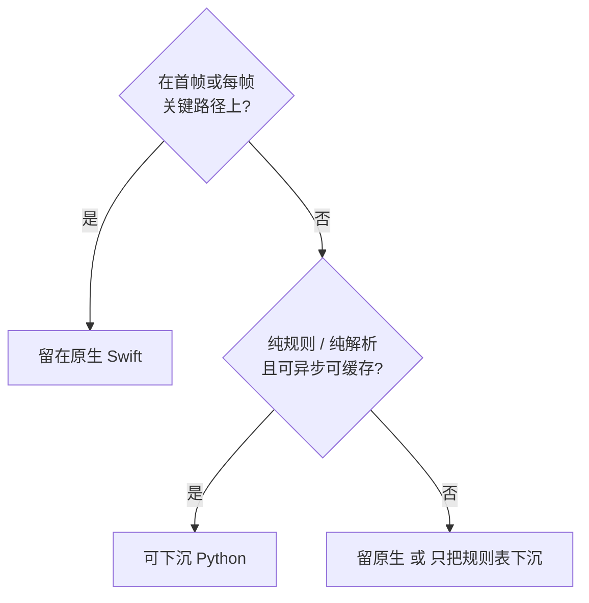
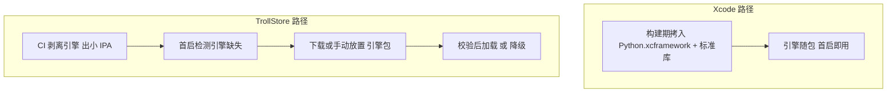

# 假定捆绑 Python3 引擎：功能下沉可行性与选型分析

> 本文档为分析交付物。分析对象为 Kline 项目当前代码；本文档不含任何代码改动。

## Why

当前 Kline 项目约 **5.4 万行 Swift（154 个文件，不含空行）** 承担了从图表渲染、指标计算、公式解析到数据摄取与同步的全部职责；同时仓库已有约 **4400 行 Python**（`src/` 的 PC 侧数据管线 + `check_indicators.py` 编译期校验）在实现**同一批口径**——周期聚合规则、腾讯取数字段序号、`.tdx` 指标模板解析。

两套实现目前靠源码注释里的「改这里前先读那边」维持一致，已经出现明确的漂移风险点。本分析回答：假定必须在 App 内捆绑 Python3 引擎，**哪些功能下沉更合适**（可读性 / 可维护性 / 版本更新灵活性 / 避免造轮子四维，**外加一条「通用性」判据**，见 §2.1）、**哪些必须留原生**，以及「Xcode 内嵌 + CI 剥离 + 运行时获取」双路径方案**是否可行**。

除「下沉已有功能」外，本版还评估了**两个仓库里尚不存在的新能力**——通用数学栈（§3.6.2）与 K 线形态识别（§3.6.3），因为它们是「Swift 只是壳」这条架构意图下最典型的受益者。

---

## 一、现状基线

### 1.1 Swift 侧运行时承担的计算类职责

> **2026-10-16 阶段 3 更新（单源腾讯化）**：设备侧已删除**云端分片链路**与**东财取数**，
> 现行取数为**单源腾讯直连**（`GapBackfill` 补缺口 + `WatchlistSyncManager` 清单范围日更 +
> `TdxSyncManager` 四时刻调度）。下表带 `*` 的行已按此更新（`*` 为**非空行数**，含注释；
> 其余行仍为阶段 3 之前的 cloc 快照，口径不同），请以代码现状为准。

| 职责 | 文件 | 行数 | 算法一句话 |
| --- | --- | --- | --- |
| TDX 公式引擎 | [FormulaEngine.swift](file:///c:/Users/sunck/home/projects/ios/Kline/Kline/Formula/FormulaEngine.swift) | 1570 | 手写词法 → 递归下降语法 → 求值；**22 个具名内置函数**（另 3 个小写别名、11 个序列键）；支持**分块增量求值**（递归指标跨块续算） |
| 指标预计算与跳空缺口 | [IndicatorPipeline.swift](file:///c:/Users/sunck/home/projects/ios/Kline/Kline/Chart/IndicatorPipeline.swift) | 1013 | 前台近似（可见 100 + 预热 50 ≈ 150 根）+ 后台按 500 根/块向历史推进，覆盖到可见窗口末端后替换近似值；缺口用维护 pending 列表的线性扫描 |
| 回测引擎 | [StrategyBacktestEngine.swift](file:///c:/Users/sunck/home/projects/ios/Kline/Kline/Backtest/StrategyBacktestEngine.swift) | 854 | 逐 bar 推进，T+1 / 涨跌停 / 费率口径；网格与分批状态机；复用 `StrategyCondGenerator.drafts` 与 `SimCondRule` 口径 |
| 条件单结算（含预警） | [SimCondEngine.swift](file:///c:/Users/sunck/home/projects/ios/Kline/Kline/Trading/SimCondEngine.swift) + [SimCondRule.swift](file:///c:/Users/sunck/home/projects/ios/Kline/Kline/Trading/SimCondRule.swift) + [SimCondKit.swift](file:///c:/Users/sunck/home/projects/ios/Kline/Kline/Trading/SimCondKit.swift) | 308 + 424 + 124 | 行情刷新时结算全部 monitoring 条件单：重入保护 → 有效期 → 快照 → 纯函数判定 → 组装委托。**「仅提醒」（预警）是同一引擎的 `isAlertOnly` 形态，不是独立引擎** |
| 模拟交易规则 | [SimTradingRules.swift](file:///c:/Users/sunck/home/projects/ios/Kline/Kline/Trading/SimTradingRules.swift) | 158 | T+1 / 整手 / 佣金 / 印花税 / 涨跌停 / 交易时段的集中规则表与校验；注释明写「规则层是纯计算，校验失败不产生任何数据写入」 |
| ~~东财取数~~（**已删除 2026-10-16**） | ~~`EastmoneyQuoteFetcher.swift`~~ | ~~432~~ | 东财批量快照取数；「单源腾讯化」后整体下线（清单日更改走腾讯 `newfqkline`） |
| 取数（单源腾讯） | [GapBackfill.swift](file:///c:/Users/sunck/home/projects/ios/Kline/Kline/Infrastructure/GapBackfill.swift) | 1085* | 主库 `meta.last_date` 之后缺口 → 腾讯 `newfqkline`（4 条 h2 连接 × 24 路并发）；基准日自校准（价格逐字段相等、量比吸附 1/100/1e-4/1e-7、额比≈1），不合则整只丢弃；缺口行写增量库并重算锚桶及之后的周/月/季/年 |
| 到点调度（原「分片同步」已删除） | [TdxSyncManager.swift](file:///c:/Users/sunck/home/projects/ios/Kline/Kline/Infrastructure/TdxSyncManager.swift) | 202* | 仅保留四时刻（11:00 / 14:30 / 15:05 / 17:30）到点判定与触发：先补「清单并集」范围缺口再写当日 bar；17:30 档为全市场补缺口（含自动合并主库）。**无 manifest / 无分片 / 无补丁** |
| 增量库读写 | [LiveDataStore.swift](file:///c:/Users/sunck/home/projects/ios/Kline/Kline/Data/LiveDataStore.swift) | 1453* | 五表增量库；按 `file` 建键；当日K线 UPSERT / 当期与缺口周期聚合 / **周期感知裁剪**；指纹（size+mtime+sha256）轮询 |
| 主库合并 | [MainDBMerger.swift](file:///c:/Users/sunck/home/projects/ios/Kline/Kline/Data/MainDBMerger.swift) | 272 | 单事务 `BEGIN IMMEDIATE` + 预编译 `INSERT OR REPLACE`，按 `(meta_id,date)` UPSERT 并同步 `meta.last_date` |
| 清单自动更新编排 | [WatchlistSyncManager.swift](file:///c:/Users/sunck/home/projects/ios/Kline/Kline/Infrastructure/WatchlistSyncManager.swift) | 552* | 清单并集 → **腾讯**取当日 K 线 → 直写增量库；并用「主库当期 bar ⊕ 新日线」合并出当期季/年 bar |
| 本地 HTTP 服务 | [KlineHTTPServer.swift](file:///c:/Users/sunck/home/projects/ios/Kline/Kline/Infrastructure/KlineHTTPServer.swift) | 1281* | Network.framework 手写 HTTP，前台监听 5051；暴露 Downloads 目录 IPA 供 TrollStore 安装（**2026-10-16 已删云端分片/补丁路由**） |
| 指标模板解析 | [SystemIndicatorStore.swift](file:///c:/Users/sunck/home/projects/ios/Kline/Kline/Formula/SystemIndicatorStore.swift) | 251 | 解析 `Kline/Indicators/*.tdx` 的 NAME / SCOPE / GROUP / FORMULA |
| 策略 DSL | [StrategyFormula.swift](file:///c:/Users/sunck/home/projects/ios/Kline/Kline/Formula/StrategyFormula.swift) + [FormulaKind.swift](file:///c:/Users/sunck/home/projects/ios/Kline/Kline/Formula/FormulaKind.swift) | 617 + 348 | 策略文档 TRADE / RULES 段的解析与展开 |
| 图表渲染与交互 | `Kline/Chart/*`（18 文件） | 8515 | 主副图绘制、十字光标、手势识别、惯性动画、图例与数据栏 |
| SQLite 查询层 | [DatabaseManager.swift](file:///c:/Users/sunck/home/projects/ios/Kline/Kline/Data/DatabaseManager.swift) | 348 | `dbQueue` 串行访问；meta 加载；五周期查询；`dataVersion` 驱动热刷新 |
| 布局 schema | [PageLayoutSchema.swift](file:///c:/Users/sunck/home/projects/ios/Kline/Kline/App/PageLayout/PageLayoutSchema.swift) + [PageLayoutCodec.swift](file:///c:/Users/sunck/home/projects/ios/Kline/Kline/App/PageLayout/PageLayoutCodec.swift) | 474 + 46 | 页面/组件布局的声明式模型与 JSON 编解码 |

### 1.2 PC 侧 Python 模块

| 文件 | 行数 | 用途 | 第三方依赖 |
| --- | --- | --- | --- |
| `src/tdx_parser.py` | 754 | 通达信 txt → SQLite 全量导入；定义五表 + meta 表结构；`period_key` 周期键与周期聚合 | **无**（`sqlite3/os/re/sys/time/threading/platform/datetime`） |
| ~~`src/txt_patch_builder.py`~~ | ~~1080~~ | **已删除 2026-10-16**（随云端分片链路删除）；原为：新 txt 目录 + 基线库 → `patch_<seq>.db`，区分 append / rewrite / new 三类差分 | — |
| ~~`src/live_db_builder.py`~~ | ~~1131~~ | **已删除 2026-10-16**（随云端分片链路删除）；原为：日分片增量库生成 + 东财批量快照取数 + secid 映射 + manifest/bucket | — |
| `src/txt_changes.py` | 282 | 新旧 txt 目录变更判定（stat / content / bc 三种 mode），全项目唯一一份实现 | **无**（含 `hashlib/subprocess/xml.etree`） |
| `src/tdx_gui.py` | 1071 | PC 侧 GUI 操作入口 | **PySide2**（Qt 绑定，全项目唯一第三方依赖） |
| `check_indicators.py` | 103 | **编译期**校验 `.tdx` 模板；复刻 `SystemIndicatorStore.parse()` 的解析规则 | **无** |

> 关键事实：**承载口径逻辑的数据模块全部为标准库实现，没有 pandas / numpy / requests**（阶段 3 删除
> `txt_patch_builder.py` / `live_db_builder.py` 后余 `tdx_parser.py` / `txt_changes.py` / `check_indicators.py`）；
> 全项目唯一的第三方依赖是 GUI 壳 `src/tdx_gui.py`（PySide2），它不承载任何口径规则。这直接影响「避免造轮子」这一维度的兑现方式——见 §3.5。

### 1.3 构建 / 签名 / 打包现状

- **编译期已在使用 Python**：`project.pbxproj` 存在 `Check Indicators` Run Script 阶段，脚本为 `python3 "$SRCROOT/check_indicators.py" "$SRCROOT/Kline/Indicators"`。这条跑在**构建机的 macOS 上**，与「App 内捆绑引擎」是两回事。
- **工程结构**：`Kline` 是 `PBXFileSystemSynchronizedRootGroup`（文件自动同步，无需手工加 pbxproj 条目）；`Indicators/*.tdx` 通过 `membershipExceptions` 排除出编译、作为资源。
- **CI（`.github/workflows/build.yml`）**：unsigned `xcodebuild`（`CODE_SIGNING_ALLOWED=NO`）→ 交叉编译并嵌入 `rootprobe` / `opener` 两个 root helper → `codesign -f -s - --entitlements Kline.entitlements` 对主二进制与 helper 做 ad-hoc 签名 → 打包 `.ipa` → 发布到 `latest` Release 作为 App 内远程更新的下载源。
- **`Kline.entitlements` 实际键值**：`com.apple.private.security.no-sandbox`、`platform-application`、`com.apple.private.security.storage.AppDataContainers`、`com.apple.private.persona-mgmt`。
- **关键否定事实**：**CI 当前不存在任何 `TROLLSTORE` 之类的条件打包分支**，也没有剥离/条件拷贝任何资源的逻辑；工程内无 embedded framework、无 SPM / CocoaPods 依赖（`Frameworks` build phase 为空）。仓库内 `tdx.db` 仅 0.9MB（种子库），设备上的主库是 1.4GB 量级。

### 1.4 `src/` 的定位（澄清一处前提，本版新增）

`src/` 下的 Python 模块（2026-10-16 阶段 3 删除两个分片生成端后，余 `tdx_parser.py` / `txt_changes.py` / `tdx_gui.py` / `check_indicators.py` 等）**目前不打算放进 Kline App 内运行**；它们与 App 放在同一仓库，目的是**统一版本管理，避免两份版本管理各自漂移**。

这个前提对结论有实质影响，而且是**有利**的：

- 它意味着「同仓」目前只达成了**源码级统一**——两份实现仍在，靠人读注释对齐（原 `EastmoneyQuoteFetcher.swift` 头部那句「改这里前先读那边」正是这种对齐方式的写照；该文件已于 2026-10-16 随单源腾讯化删除）。
- 而**引擎下沉能达成运行时级统一**：App 侧的 Python 可以直接 `import` `src/tdx_parser.py` 里那份 `period_key` / 周期聚合，**同一份 `.py` 文件在两端执行**。这是「统一版本管理」的最终形态，也是本分析里**最强的下沉理由**——比「消除双实现」这个说法更准确：**它不是把 PC 代码搬进 App，而是让两端共用同一份源码。**
- 代价要说清：一旦 App 侧 import 了 `src/` 的模块，`src/` 就**不再是纯 PC 工具**，而是「两端共享库」，随之带来约束——GUI 壳（`PySide2`）必须与共享模块**物理隔离**、不能假设 PC 的文件系统布局、标准库版本要兼容 iOS 侧的 Python 版本。
- **好消息**：`tdx_parser.py` / `txt_changes.py` / `check_indicators.py` 本来就无第三方依赖（已核实），天然满足共享前提；唯一带第三方依赖的 `tdx_gui.py` 恰好是纯 GUI 壳，隔离成本很低。（原表内的 `live_db_builder.py` 已于 2026-10-16 删除。）

---

## 二、筛选判据

从 `[q1]` 起读：先问「是否在首帧或每帧关键路径」，再问「是否纯规则或纯解析」。



**图里没画出来的部分**：

1. 这只是第一道筛。命中「可下沉」后还要再过 §4 的「FFI 数据搬运量」与「引擎缺失时的降级能力」两道闸，三关都过才算推荐项。
2. 命中「可下沉」**不等于**本轮就该做——§6 结论区分「架构上更合适」与「现在值得做」。
3. 判据只作用于**运行时**职责；`check_indicators.py` 这类编译期脚本不在范围内（它已在构建机执行）。
4. **这张图不包含 §2.1 新增的「通用性」判据**——它是另一条独立的筛法，用文字给出更清楚，所以没有画进图里。

### 2.1 补一道判据：通用性（本版新增）

上面那张图筛的是「**能不能**下沉」，缺一道筛「**该不该**下沉」。这道判据来自一条明确的架构意图：

> Swift 只是壳。未来要支持更丰富的数学引擎，不想在 Swift 里重学一遍数学那一套；不要求一份代码编译出多平台产物，但**通用功能希望通用**。

按这条判据，职责先分成两层：

| 层 | 判据 | 归属 |
| --- | --- | --- |
| **通用计算层** | 换一个宿主（PC 脚本 / 服务端 / 另一个 App）后**原样还有用**：数学与统计、时序指标、公式求值、形态模式匹配 | 应下沉，且应做成可移植模块 |
| **平台外壳层** | 离开 iOS 就失去意义：渲染、手势、窗口、沙盒路径、后台调度、系统集成 | 留原生 |

这条判据与前一道**不冲突，但会重排候选**：它把候选 2（公式引擎）往上推，把候选 4（取数口径）往下推——后者版本灵活性最高，却**本质不通用**（绑死各源字段序号与量纲折算规则）。两个维度在候选 4 上方向相反，逐项重排见 §3.6.1。

---

## 三、候选功能评估（四维 + 通用性）

### 3.1 四维汇总表（「通用性」单列在 §3.6.1）

| # | 候选 | 可读性 | 可维护性 | 版本更新灵活性 | 避免造轮子 | 分级 |
| --- | --- | --- | --- | --- | --- | --- |
| 1 | 指标模板解析与校验 | 持平 | **强正** | 中 | 弱 | **推荐下沉** |
| 2 | TDX 公式引擎 | 略正 | 中 | 中 | **强正** | **推荐下沉（解析层 + 函数库）；首帧调度留原生**（§3.6.1 上调） |
| 3 | 周期聚合 | **强正** | **强正** | 中 | 中 | **推荐下沉** |
| 4 | 取数口径（**单源腾讯 `newfqkline`**；原「东财快照 + 多源历史 K 线」已于 2026-10-16 收窄） | **强正** | **强正** | **强正** | 中 | **推荐下沉** |
| 5 | 策略 / 公式 DSL 解析 | 中 | 中 | 中 | 弱 | 中性 |
| 6 | 回测引擎 | 略正 | **强负** | 中 | 弱 | **不建议下沉** |
| 7a | 条件单 / 预警**判定层**（`SimCondRule` + `SimTradingRules` + `SimCondKit`） | 持平 | 中 | 中 | **零** | **中性偏不建议** |
| 7b | 条件单**副作用层**（`submit` / 委托 / 成交 / 资金流水 / 落盘） | 负 | 负 | 负 | 弱 | **不建议下沉** |
| 7c | 预警记录（`SimAlertRecord` 追加 / 保序裁剪 / 展示） | 持平 | 弱 | 弱 | 弱 | **不建议下沉** |
| 8 | SQLite 查询层 | 持平 | 弱 | 弱 | 弱 | **不建议下沉** |
| 9 | 本地 HTTP 自更新服务 | **强正** | **强负** | 负 | 中 | **不建议下沉** |
| 10 | 图表渲染与手势 | 负 | 负 | 负 | 负 | **不建议下沉** |
| 11 | 布局 schema 与编解码 | 持平 | 持平 | 弱 | 负 | **不建议下沉** |
| 12 | K 线形态识别（**新能力，仓库内暂无**） | **强正** | **强正** | 中 | **强正** | **推荐下沉**（§3.6.3） |
| 13 | 通用数学 / 统计函数库（**新能力，仓库内暂无**） | **强正** | **强正** | 中 | **强正** | **推荐下沉**（§3.6.2） |

「强正 / 略正 / 持平 / 弱 / 强负 / 负」= 该维度上下沉相对留原生的净收益方向与强度。

> 候选 12 / 13 与前面 11 项**性质不同**：前 11 项是「要不要把已有实现搬走」，12 / 13 是「这个新能力该建在哪一侧」。它们放在同一张表里是为了四维可比，但结论读法不同。

### 3.2 专项论证：公式引擎与回测引擎为什么分级不同

这两个候选最容易被质疑，单独说清。

**TDX 公式引擎（候选 2）——从「不建议」连升两级到「推荐下沉（解析层 + 函数库）」**

*支持下沉的理由：*
- **避免造轮子收益真实且最大**：`FormulaEngine.swift` 手写了 22 个具名内置函数（`MA/EMA/SMA/DMA/MEMA/REF/HHV/LLV/ABS/MAX/MIN/SUM/AVEDEV/SAR/STD/COUNT/IF/CROSS/BARSLAST/AND/OR/NOT`）及其增量版本。Python 侧 `MyTT`（单文件、按通达信口径实现）、`pandas-ta`、`TA-Lib` 已覆盖其中大部分，这是本项目中唯一能**实质减少自研代码量**的候选。
- **解析规则已存在双实现**：`check_indicators.py` 明确写着「校验逻辑与 App 内 `SystemIndicatorStore.parse(content:id:)` 保持一致」——单一事实源收益。
- 公式本身是数据（`.tdx` 文件），解析器天然适合脚本语言。
- **它有不止一个消费者（本版补充）**：公式引擎目前被**三处**调用，所以下沉的收益面比上一版描述的大：
  1. 图表指标：[IndicatorPipeline.swift](file:///c:/Users/sunck/home/projects/ios/Kline/Kline/Chart/IndicatorPipeline.swift) → `TDXFormulaEngine.evaluate`；
  2. **表头筛选公式列**：[MarketRowCache.swift L292](file:///c:/Users/sunck/home/projects/ios/Kline/Kline/Market/MarketRowCache.swift#L292) 的 `matchFormula` → `TDXFormulaEngine.evaluate`（用于选股 / 筛选命中判定）；
  3. 策略 DSL：`StrategyFormula` → 回测。
- **通用性判据（§2.1）把它往上推**：一个 DSL 求值器 + 内置函数库**与平台无关**，换到 PC 脚本、服务端都原样可用，正是「Swift 只是壳」想要的那类资产。这条判据是本次分级上调的直接原因。

*不支持整体下沉的理由（都不是「能力问题」，而是两个具体工程约束）：*
- **首帧路径**：`IndicatorPipeline` 的设计是「前台先算可见 100 + 预热 50 ≈ 150 根立即显示，后台按 500 根/块用正确覆盖替换近似值」。这 150 根落在用户打开标的的那一帧上。引入解释器后，这一段要额外付解释器调用开销，甚至 numpy import 开销。
- **跨语言状态机**：后台分块之所以便宜，靠的是 `TDXIncrementalState` 把 EMA/SMA/DMA/MEMA 等递归指标的块末值跨块续算（`resumingMain` / `resumingSubs`），并且 `TDXSharedSeries` 让各块**共享引用**避免重复 map。跨 FFI 时这个状态要序列化、共享数组要变拷贝，是实打实的复杂度。

*因此建议的切法*：**下沉「解析 + 内置函数库」，留原生「首帧近似 + 分块增量调度」**。或者更彻底：Python 只做**整序列批量计算**（后台、vectorized、可缓存），原生仅保留首帧近似这一小段标量代码——注意这段近似**今天就已经与「正确值」不一致**（这是既有设计，不是 Python 引入的漂移）。

*阈值化条件*：若 Phase-0 实测「Python 计算 150 根 + 桥接往返」耗时落在可接受阈值内，则首帧调度也可一并下沉，**全引擎可整体搬走**。这是个可被实测推翻的判断，不是定论——但请注意：即使实测不达标，**解析层与函数库仍然应该下沉**，因为那部分本来就不在首帧路径上。这是本版把它从「中性」上调为「推荐下沉」的关键：**上调不依赖任何未验证的假设**。

**回测引擎（候选 6）——维持「不建议下沉」，但理由要换成语义一致性**

先纠正一个不准确的理由：**不是性能问题**。回测不是逐 bar 跨 FFI，标准做法是整段 bar 数组一次传入、净值曲线一次返回，这个形状很干净；而且它本身就是 `nonisolated`、不碰 `DatabaseManager` / `MarketRowCache` / `SimStore`、文档明写「纯函数，同参数重复调用结果一致」——**这恰恰是最适合下沉的形状**。

真正的阻断点是**语义一致性**，证据在代码里：

- [StrategyBacktestEngine.swift](file:///c:/Users/sunck/home/projects/ios/Kline/Kline/Backtest/StrategyBacktestEngine.swift#L36-L43) 的规则映射「沿用同一张映射表，不重复实现」，直接调用 `StrategyCondGenerator.drafts`；
- [同文件 L736-L755](file:///c:/Users/sunck/home/projects/ios/Kline/Kline/Backtest/StrategyBacktestEngine.swift#L736-L755) 复用 `SimCondRule.gridLevelCount`（注释「不重复实现」），`batchQty` 则是**同口径重写**（注释「与 `SimCondRule.batchQty` 同口径」）——两者都是「必须与实时结算一致」的显式声明；
- [同文件 L339](file:///c:/Users/sunck/home/projects/ios/Kline/Kline/Backtest/StrategyBacktestEngine.swift#L339) 注释「止损腿优先（与 `SimCondRule.evaluate` 同序）」。

也就是说，回测引擎与实时条件单引擎（候选 7）是**刻意做成的「一套语义、两个执行器」**：回测 = 历史回放，`SimCondEngine` = 实时结算。若只把回测搬到 Python，就会得到「实时在 Swift、回放在 Python」的**两套交易语义**——这正是仓库目前在数据口径上极力避免的漂移，但落在**交易语义**上，分歧的代价是错的委托，而不是偏旧的数据。

结论：候选 6 与候选 7 是**成对**的——要下沉就成对下沉。而这一对能否成立，取决于候选 7 判定层的信任代价是否可接受，见下一节。

### 3.3 专项论证：条件单与预警（为什么不能按「预警 / 条件单」切）

**先纠正一个前提：预警不是独立引擎。** 预警是条件单的一个**形态**——`SimCondDirective.isAlertOnly`（[SimConditionModels.swift L151](file:///c:/Users/sunck/home/projects/ios/Kline/Kline/Trading/SimConditionModels.swift#L151)，`alertOnly` 字段本身定义在 L131）。它走**同一条** `SimCondEngine.sweepConditions` 结算路径、**同一个** `SimCondRule.evaluate` 判定、同一批触发源（行情刷新 / 手动检查 / 数据重载）。差别只在触发后的分支：`isAlertOnly` 跳过数量与持仓校验（[SimCondRule.swift L164/L192/L245](file:///c:/Users/sunck/home/projects/ios/Kline/Kline/Trading/SimCondRule.swift#L164-L192)），不下单，改追加一条 `SimAlertRecord`（[SimCondEngine.swift L144](file:///c:/Users/sunck/home/projects/ios/Kline/Kline/Trading/SimCondEngine.swift#L144)）。

因此「把预警和条件单分别下沉」这个切法**在代码里不存在对应的边界**。真正存在的边界是四层（本轮修正：上一版把 `SimCondKit` 错列进判定层，实际它是**纯展示原子件**——见 [SimCondKit.swift L5](file:///c:/Users/sunck/home/projects/ios/Kline/Kline/Trading/SimCondKit.swift#L5) 自述「条件单纯展示原子件……不持有业务状态」）：

| 层 | 内容 | 纯度 | 能否下沉 |
| --- | --- | --- | --- |
| **判定层** | `SimCondRule`（`evaluate` / `gridLevelCount` / `batchQty`）+ `SimTradingRules`（T+1 / 整手 / 佣金 / 印花税 / 涨跌停 / 交易时段） | **纯函数**，`nonisolated` | 见本节末「修订后的分级」 |
| 取数层 | `SimCondSnapshotCenter`（`@MainActor`，读行情快照、`maValue`） | 有副作用（**读**） | 留原生 |
| 副作用层 | `SimStore.submit` / 委托 / 成交 / 资金流水 / 落盘 | 有副作用（**写**） | 留原生 |
| 展示层 | `SimCondKit`（类型 chip / 提醒标记 / 状态标签 / 进度条 / 概览条）+ 条件单页面记录与配置 + **B/S/T 主图标记（未实现，设计待定）** | 无业务状态 | 与候选 10（图表渲染）同命运，留原生 |

#### 本轮重要修正：「8 条 kind 的 `switch`」是实现现状，不是架构必然

你的反驳成立。上一版我把「8 条固定规则的标量比较」当成判定层的**本质形状**，据此断言没有现成库可用、轮子收益为零。这是**把当前实现当成了问题本质**。逐条交代它会改变什么。

**① 「避免造轮子 = 0」在公式化前提下不成立。** 规则可以改写成公式，改写后立刻复用公式引擎的函数库。8 种 kind 的改写潜力：

| kind | 能否写成公式 | 表达式 / 原因 |
| --- | --- | --- |
| `price` | 能 | `C >= trig` |
| `stopLoss`（双边 OCO） | 能 | `C <= stop OR C >= take` |
| `changePct` | 能 | `(C - REF(C,1)) / REF(C,1) * 100 >= thr` |
| `maCross` | 能 | `CROSS(C, MA(C,N))` |
| `trailing` | 能（需区间极值） | 突破后用 `HHV` 取区间最高价，再比回落幅度 |
| `time` | **不能** | 它是**时钟事件**，不是价格序列上的表达式 |
| `grid` | **不能** | 跨次评估的**有状态推进**（`gridLevel` / `gridLastPrice`），每次评估改写自身状态 |
| `batch` | **不能** | 同上（`batchDone`） |

即：**5 种可干净公式化、1 种是时钟事件、2 种是有状态推进。** 判定词汇是**异质的**——这条比「能不能下沉」更有价值，因为它直接划出了「统一化」的边界。

**② 它同时暴露了真正该统一的对象。** `grid` / `batch` 要的不是表达式求值器，而是一个**有状态规则运行时**——而那正是 [StrategyBacktestEngine](file:///c:/Users/sunck/home/projects/ios/Kline/Kline/Backtest/StrategyBacktestEngine.swift) 已经具备的东西（逐 bar 推进、维护网格档位与分批计数）。所以真正的统一不是「条件单 → 公式」，而是：

> **条件单判定（实时）+ 回测执行（历史）= 一个「策略运行时」**，内部以表达式求值器作为信号计算子层。

在该框架下，候选 2（表达式求值）、候选 6（有状态执行）、候选 7a（实时判定）**合并为一个候选**。合并后：
- 轮子收益不再为 0（表达式层复用公式函数库；执行层可对齐 `backtrader` / `vectorbt` 的语义）；
- §3.2 的「两套语义」阻断点**自动消失**（本来就只有一套）；
- 需要维护的实现从三份变一份。

**③ 信任代价的重新评估（本轮诚实下调）。** 上一版把它当**阻断项**并定级「中性偏不建议」——我认为**偏重了**。精确的残留风险只有一条：**「是否触发」这个判决由一份可远程替换的脚本产生。** 而它**可缓解**，上一版没给缓解手段：

| 缓解手段 | 作用 |
| --- | --- |
| 引擎包**签名 + 版本锁定 + 哈希校验** | 让「设备上跑的是哪一版判决逻辑」重新可回答（对应上一版第 ①④ 条） |
| **native 硬约束复核闸门**：T+1 / 涨跌停 / 整手 / 可卖数量**仍留在 Swift** | 把风险**压缩到「错但合法」**——脚本判错最多产生一笔不该下的合法委托，无法产生非法委托。这与「原生 `switch` 里有 bug」是**同一风险类**。⚠️ **本行已被 §9.7 D2 推翻（2026-10-17）**：硬约束复核亦下沉，Swift 不再保留；红线 4 缓解只剩签名 + 版本锁 + 脚本哈希（验证见 §10.9） |
| 引擎缺失 / 校验不过 → **禁用条件单**，而非静默降级 | 避免「判决逻辑悄悄变成另一个东西」 |

缓解之后**唯一不缩小的部分**：判决逻辑的更新权限从「必须发新 IPA」变成「推引擎包」。若引擎包与 IPA 走**同一 CI、同一发布通道**（本仓库现在就是 `latest` Release），增量风险很小——你本来就在信任这条通道；若引擎包走独立通道，则必须配签名与版本锁定。

**④ 「两个副作用」指的是两层，性质不同**：

| 层 | 副作用类型 | 具体表现 | 为什么不能当纯函数搬 |
| --- | --- | --- | --- |
| 取数层 `SimCondSnapshotCenter` | **读副作用** | `@MainActor`；从 `SimQuoteCenter` 读最新价 / 昨收，从 `MarketRowCache` 读最高 / 最低 / 涨跌幅 / 均线值，并**触发预取** | 它不只是「读」：读会改变缓存状态、拉起 prefetch，且必须回主线程。跨 FFI 时无法简单地「传参调用」，必须先把快照取好再传进去 |
| 副作用层 `SimStore.submit` / 委托 / 成交 / 资金流水 / 落盘 | **写副作用** | 真正改变账户状态：生成委托、撮合成交、扣减资金、追加流水、写盘 | 这是全 App 唯一允许改账户状态的地方；下沉等于把「改账本」的权限交给脚本 |

**只有判定层**（`SimCondRule` + `SimTradingRules`，注意**不含** `SimCondKit`——它是展示层）是**真纯函数**——既无读副作用也无写副作用。这正是「四层边界」这个切法能成立的原因：**能搬的只有判定那一层，而它恰好就是判决本身。**

#### 核实：「条件单 / 预警」与「指标引擎」到底是不是同源

你的判断**在产品语义上成立，在代码依赖上不成立**。逐条核对（本版新做）：

- `SimCondRule.evaluate(order:snapshot:)`（[SimCondRule.swift L91](file:///c:/Users/sunck/home/projects/ios/Kline/Kline/Trading/SimCondRule.swift#L91)）是纯函数，入参 `SimCondSnapshot` 只有**六个标量**：`last` / `prevClose` / `high` / `low` / `changePct` / `ma`（[L19-L26](file:///c:/Users/sunck/home/projects/ios/Kline/Kline/Trading/SimCondRule.swift#L19-L26)）。它**不 import、不调用** `TDXFormulaEngine` 或 `IndicatorPipeline`。
- 8 种 `kind`（`price` / `stopLoss` / `trailing` / `time` / `changePct` / `maCross` / `grid` / `batch`）**全部是标量比较**（价格 ≥ 阈值、涨跌幅 ≥ 阈值、昨收与最新价分列均线两侧……），**没有一种是「求值一段公式」**。
- 唯一带「指标味」的输入是 `snapshot.ma`，来源是 `SimCondSnapshotCenter.maValue()` → `MarketRowCache.numberFor(metaID, .ma5/.ma10/.ma20/.ma60)` → [MarketRow.swift L129](file:///c:/Users/sunck/home/projects/ios/Kline/Kline/Market/MarketRow.swift#L129) 的 `ma(bars:n:)`——一个**独立的、几行的滑动平均辅助函数**，**不是 TDX 公式引擎算出来的**。

所以两者的关系是**同构，不是同源**：

| | 条件单 / 预警判定层 | TDX 公式引擎 |
| --- | --- | --- |
| 形状 | 8 条**固定规则**的标量比较（`switch`） | **表达式求值器**（词法 → 语法 → 求值） |
| 输入 | 六个标量 | 整段 OHLC 序列 + 公式文本 |
| 扩展方式 | 加一种条件 = 加一个 `case` + 一套编辑器 UI | 加一个函数 = 改求值器 |
| 依赖 | 无（纯标量运算） | 无（纯数组运算） |
| 动作 | **下单**（资金授权） | **画线**（展示） |

「同构」正好解释了为什么它们看起来像一家：都是「条件成立 → 动作」。但**动作的性质不同**——一个是授权，一个是展示，这正是 §3.2 与本节结论不同的根本原因。

**顺带纠正一处上一版没写准的地方**：真正与「指标引擎」耦合的不是条件单，而是**公式引擎有三个消费者**（已在 §3.2 列出：图表指标 / 表头筛选公式列 / 策略 DSL）。而 B/S/T 标记与「条件单页面记录」属于**结果可视化**——它们消费判定结果，与判定层解耦，**下沉判定层不会动到它们**。

> 说明：我在仓库里**没有找到**主图 B/S/T 成交标记的绘制实现（`grep` 只命中指标线的 `markerDirections` 逐点取色，与成交标记无关）。如果它已存在，请指出位置，我会补进 §1.1 基线表；如果它是待做功能，那它属于「消费判定结果」的展示层，不影响本节结论。

**支持下沉判定层的证据（比回测那条更硬）**：

- `SimCondRule` 的声明注释就是「**nonisolated：纯计算层，历史回测引擎在后台线程直接复用**」（[SimCondRule.swift L84-L85](file:///c:/Users/sunck/home/projects/ios/Kline/Kline/Trading/SimCondRule.swift#L84-L85)）——判定层已经是三处消费者（实时结算 / 预警 / 回测）共享的**单一实现**，形状上完全适合脚本化。
- **一个意外的重要推论**：如果判定层下沉，那么 §3.2 里给回测引擎提的「语义一致性」阻断点**自动消失**——因为回测、实时、预警本来就共用这一层，一起搬走就不会产生两套语义。也就是说，提出「把条件单、预警也下沉」这个方向，恰好是解开回测那个死结的唯一钥匙。

**但收益侧几乎为零，代价侧独有一项**：

- **避免造轮子 = 0**。A 股的 T+1、涨跌停、整手、佣金/印花税、网格与分批状态机、追踪止损，**没有任何现成 Python 库**。这与公式引擎形成鲜明对比（那边有 MyTT / pandas-ta / TA-Lib 可直接用）。全项目里，判定层是**最不可能靠「不造轮子」获益**的一块。
- **独有代价：判定层是资金动作的授权闸门**。`evaluate` 本身不写数据，但它产出的 `SimCondDecision` 就是「是否下单 / 是否触发预警」的判决。把判决逻辑放进一个**可远程替换的脚本**，等于让一个可被替换的组件掌握授权。副作用层留在原生只能保证「写」这一侧安全，保证不了「判决」正确——原生会忠实地执行错误的判决。
- 触发时机在**行情刷新路径**上（另有 11:00 / 14:30 / 15:05 / 17:30 四次定时更新），延迟敏感度中等；按「整轮结算一次 FFI 调用」的形状批量传递订单与快照，单次开销可控。这一点不是阻断项。

**结论**：判定层**只能整层搬，不能按「预警 / 条件单」拆**——拆开就是两套交易语义。而整层搬的净收益为负（轮子收益为 0，多付授权闸门的信任代价），故定级 **中性偏不建议**。若未来确有「让用户写自定义预警脚本」的产品需求，那才是重新评估的时机，且届时必须配签名与版本锁定。

### 3.4 三个「已有功能」推荐候选，逐个说清

> 本轮共 6 个推荐下沉项。另外三个不在这里：候选 2（公式引擎）见 §3.2，候选 12（形态识别）与候选 13（数学栈）见 §3.6。本节只讲「已有实现里最该搬走」的三个。

**候选 1：指标模板解析与校验（推荐）**
- 可读性：持平（Swift 版已清晰）。
- 可维护性：**强正**。今天有两份解析规则（`check_indicators.py` 与 `SystemIndicatorStore.parse`），靠注释约束同步；合一后彻底消除。
- 版本更新灵活性：中。模板本身已是数据，但**解析规则**的变化今天需要重新构建。
- 避免造轮子：弱（无现成库，规则是项目私有的）。
- 反向约束：调用频率极低（启动/切指标），可缓存，不在首帧路径。**三关全过。**

**候选 3：周期聚合（推荐）**
- 可读性：**强正**。季 `YYYYQ` / 年 `YYYY`、`date` = 该周期首个交易日、周线用哪个交易日——这类纯规则用 pandas `resample`/`groupby` 表达只需十几行。
- 可维护性：**强正**。当前聚合逻辑同时存在于 `tdx_parser.py`（PC 全量）与 `WatchlistSyncManager` / `LiveDataStore`（设备当期季/年 bar 合并）两侧，且 `LiveDataStore` 里专门为「季/年线 date 远早于最近 N 个交易日、按 `date <= beforeDate` 会误删当期 bar」写了周期感知裁剪——两侧口径必须同步，是明确的漂移面。
- 版本更新灵活性：中（交易日历、周期约定偶有变化）。
- 避免造轮子：中（pandas 能显著简化，但要付体积代价）。
- 反向约束：批量、低频、可缓存。**三关全过。**

**候选 4：取数口径（推荐；2026-10-16 收窄为单源腾讯）**
- **范围已收窄**：2026-10-16「单源腾讯化」删除了 `EastmoneyQuoteFetcher.swift`（东财批量快照）与东财 `push2his`
  兜底，设备侧取数**只剩腾讯 `newfqkline` 一处**（`GapBackfill.swift` 的历史 K 线 + 量纲自校准，
  `WatchlistSyncManager` 复用同一取数写当日 bar）。原候选名「多源取数口径」不再适用。
- 可读性：**强正**。`requests`/`urllib` + `json` 比 1085 行 Swift 简洁得多。
- 可维护性：**强正**。设备侧 `GapBackfill` 的**量纲自校准**（吸附窗口 1x/100x/1e-4/1e-7、额折算）
  与 PC 端曾是又一处双实现漂移面；PC 端 `live_db_builder.py` 已于 2026-10-16 删除 → 漂移面**收敛为单侧 Swift**，
  但也意味着设备侧口径**再无 PC 参照**，下沉后反而更需要契约测试锁死。
- 版本更新灵活性：**强正，且是本项目收益最高的一项——证据比上一版更硬**。腾讯接口的隐蔽陷阱很凶——`param` 必须 6 段（缺第 6 段复权类型 → 全市场 3312 只全灭）、历史 K 线价格顺序是**开-收-高-低**、起始日会被接口**向前扩**（须用根数控制）；此外清单范围日更还叠加了「同日覆盖当日 bar / 主库已含当日 bar 时锚点回退」等语义。这些在 GapBackfill 头注释里有整段实测记录，任何一条写错都是静默错值。今天变了要改 Swift → 重新构建 → 重新签名 → 重装 IPA；下沉后可推脚本。
- 避免造轮子：中。
- 反向约束：后台串行/并发队列、非首帧、可重试。但**新增一道闸**——吞吐能力，见 §4 第 3 条。
- **顺带收编一份口径知识**：新浪快照字段语义（`[1]`开 `[3]`收 `[4]`高 `[5]`低 `[8]`量(股)→÷100 四舍五入 `[9]`额(元)，≤300/批、GBK、需 Referer）原本记录在已下线的 `DirectQuoteProbe.swift`（对拍 PoC，2026-10-02 实测腾讯 3312/3312 逐只全等、新浪 ÷100 后 3307 只全等）头注释里。若未来接入新浪作第三源，这段口径就是起点；届时候选 4 的下沉范围应写成「**每个源一个模块**」的插件式结构。**三关全过（吞吐闸待 Phase-0 实测）。**

### 3.5 「避免造轮子」维度的诚实结论

这是最容易被高估的维度。事实是：**承载口径的五个 Python 数据模块全部为标准库实现**（唯一的第三方依赖是 PC 端 GUI 壳的 PySide2，与口径无关）。要让「避免造轮子」真正兑现，下沉后**必须为 iOS 侧引入第三方库**（MyTT / pandas-ta / TA-Lib / numpy / requests），并同时承担：

- **体积**：numpy 单轮就数十 MB，与「TrollStore 剥离引擎以缩小 IPA」的初衷直接冲突；
- **iOS 可用性**：TA-Lib 是 C 扩展，需要交叉编译为 iOS framework；纯 Python 的 MyTT 无此问题但覆盖面较窄；
- **纯 Python 优先**：若要在体积与收益间取平衡，应优先选纯 Python、单文件、无 C 扩展的库（如 MyTT），而不是 pandas 系。

> 这条结论在候选 12 / 13（§3.6）上会与「通用性」诉求**正面冲突**：想要 numpy 级的数学栈，就必然要接受这几十 MB。这是全文唯一一处无法用工程手段化解的取舍。

### 3.6 通用性维度重排 + 两个全新候选（本版新增）

#### 3.6.1 「通用性」如何重排候选

只列**有区分度**的候选（其余候选在两个维度上同向，不重排）：

| 候选 | 版本更新灵活性 | 通用性 | 重排结果 |
| --- | --- | --- | --- |
| 2 TDX 公式引擎 | 中 | **强正**（DSL 求值器与函数库与平台无关） | 由「中性 / 可部分下沉」**上调**为「**推荐下沉（解析层 + 函数库），首帧调度留原生**」 |
| 4 取数口径（单源腾讯） | **强正** | **负**（绑死腾讯字段序号、市场码规则与量纲折算，换宿主即失效） | 维持**推荐下沉**，理由收窄为「版本灵活性」+「量纲自校准漂移面」两条，**不再宣称它通用** |
| 12 K 线形态识别（新） | 中 | **强正** | **推荐下沉**（见 §3.6.3） |
| 13 通用数学 / 统计函数库（新） | 中 | **强正** | **推荐下沉**（见 §3.6.2） |

**候选 4 上两个维度方向相反**，这是全文唯一需要权衡的地方：它版本灵活性最高（字段是外部供应商可变的，今天改要重新构建 + 重新签名 + 重装 IPA；腾讯接口的隐蔽陷阱见 §3.4），但通用性最差（离开取数语境就无用）。**结论不变**——因为「设备侧直连行情源（单源腾讯 `newfqkline`，东财已于 2026-10-16 下线）」是项目既定事实（见项目约束），灵活性收益是实打实的；而通用性损失**本来就已经存在**，不是下沉带来的新增损失。

#### 3.6.2 候选 13：通用数学 / 统计函数库（新能力）

这是**唯一一条「只有在 Python 侧才能获得」的价值**，必须单独点出：Swift 生态**没有**与 `numpy` / `scipy` / `pandas` 对等的通用数学栈。要在 Swift 里做回归、矩阵运算、分布函数、时序统计，只有两条路——**手写**，或找零散的第三方包。而「未来支持更丰富的数学引擎」这个诉求，**在原生路线上几乎无法兑现**。

- 四维：可读性 **强正** / 可维护性 **强正** / 版本更新灵活性 中 / 避免造轮子 **强正**。
- 反向约束：纯计算、批量、可缓存，**天然满足**「非首帧、可异步」。**三关全过。**
- **但代价必须一起说**：`numpy` 单轮数十 MB，与 §5.1「剥离引擎以缩小 IPA」的初衷**直接冲突**。要在「数学引擎丰富度」与「IPA 体积」之间二选一——**二者不可兼得**，这是本分析里唯一一处无法用工程手段化解的取舍。若体积优先，可行折中是只带**纯 Python 的轻量统计实现**（放弃 numpy 生态，能力上限随之下降）。

#### 3.6.3 候选 12：K 线形态识别（新能力，含实现与验证方案）

**先说清一件事：仓库里目前零形态识别代码。** 全文 `grep` 无 `CDL` / 锤子 / 吞没 / 启明星等任何形态相关实现。所以这不是「把已有功能下沉」，而是**全新能力**——本节的结论是「这个能力该建在哪一侧」，不是「搬不搬」。

**它为什么天然适合 Python**：

| 判据 | 结论 |
| --- | --- |
| 避免造轮子 | **强正，且是全文最高**。TA-Lib 提供 **61 个 `CDL*` 形态函数**（锤子 / 吞没 / 启明星 / 三只乌鸦……），是该领域的**事实标准参考实现**；`pandas-ta` 亦有 pattern 模块 |
| 是否首帧关键路径 | 否。形态只依赖**已收盘 bar**，新 bar 只影响最后几根 |
| 可否异步 / 缓存 | 可以。与 `IndicatorPipeline` 的后台 500 根/块预取**同构**，甚至可并入增量库作为派生数据 |
| 输入输出形状 | 整段 OHLC 数组进 → 每 bar 形态命中集合出。**批量、无回调**，是 §4 里最干净的那种形状 |

**但有一个必须先做的二选一判断（否则方案会走错）**：

> TA-Lib 的 `CDL*` 是 **C 实现**。如果目标就是它，**最短路径是把 TA-Lib 交叉编译成 iOS framework 直接给 Swift 调**——而不是通过 Python 引擎。因为「Python 里的 C 扩展」在 iOS 上要**同时**解决「Python 引擎」和「C 扩展交叉编译」两件事，比单独一个 iOS framework 更难。
> 反过来，若要用**纯 Python** 的形态实现（纯 Python 形态库 / 按 TA-Lib 语义自己重写），才**必须**走 Python 引擎。

| 路线 | 需要 Python 引擎？ | 说明 |
| --- | --- | --- |
| **A.** TA-Lib（C）交叉编译为 iOS framework，Swift 直调 | **不需要** | 「不造轮子」最短路径；代价是引入 C 依赖，且形态逻辑留在原生侧 |
| **B.** 纯 Python 形态实现，走 Python 引擎 | 需要 | 与「Swift 只是壳」的意图一致；代价是性能与体积 |

**实现形状**（两条路线一致）：

- 输入：OHLC(V) 整段数组；输出：每个 bar 的 `{形态 id, 方向, 强度}` 集合。
- 落点：后台预取（与 `IndicatorPipeline` 同构），或增量库派生表；**不进首帧**。
- 形态只依赖已收盘 bar → **增量友好**：新 bar 到达只需重算末尾若干根，不必全序列重算。

**验证方案**（这正是「没搞明白怎么验证」那一问，分三层，从便宜到贵）：

1. **合成序列单元测试**（最便宜，先做）。手工构造**能唯一确定某形态**的 OHLC 序列（如一根标准锤子线：长下影 + 小实体 + 短上影），断言「第 N 根必须命中 `hammer`，第 N±1 根必须不命中」。这是回归网，防止后续调参把已通过的形态改坏。
2. **参考实现差分测试**（关键，必须做）。**锁定一个参考实现**（如 TA-Lib），在 PC 侧对**全量标的 × 全历史**跑一遍，把每个 bar 的形态输出导出为 golden 数据集（或按标的存哈希）；设备侧实现与之**逐 bar 比对**。这与项目既有的「基线库比对」哲学完全一致（`tdx_baseline.db` 那一套）。
3. **可视化抽查**（最终产品级验收）。在图表上叠加形态标记，人工核对。这是**唯一**能发现「参考实现本身不合直觉」的手段——形态识别没有绝对标准，只有「与参考实现一致」。

**动手前必须先定死的三件事**（否则第 2 层验证无从谈起）：

| # | 要定的事 | 为什么必须先定 |
| --- | --- | --- |
| 1 | **参考实现选谁**（TA-Lib？某个纯 Python 库？） | 没有参考实现就没有 golden 值，第 2 层验证无法执行 |
| 2 | **参数阈值锁哪一套** | TA-Lib 的 `CDL*` 带一堆参数（`penetration`、影线 / 实体比例等），**不同库默认值不同**，不锁定就必然两端不一致 |
| 3 | **先做哪几个形态** | 61 个全做没有意义；先做 5~10 个常用形态（锤子 / 吞没 / 启明星 / 十字星 / 三只乌鸦）打通链路，再扩 |

> **三件事已定死（2026-10-12 落地回填）**：
> 1. **参考实现 = TA-Lib C 0.6.4 源码**（`src/ta_func/*.c` 逐函数提取判定条件与 lookback；PC 侧参考环境 talib 0.8.1 + numpy 2.5.4 出 golden）。
> 2. **阈值 = TA-Lib 默认参数表**（`ta_common/ta_global.c`：BodyShort/BodyLong=实体 10/1.0、BodyDoji=高低幅 10/0.1、ShadowLong=实体 0/1.0、ShadowVeryShort=高低幅 10/0.1、Near=高低幅 5/0.2、Far=高低幅 5/0.6；morningstar/eveningstar penetration=0.3）。
> 3. **首批 = 10 个形态**：hammer / invertedhammer / engulfing / doji / shootingstar / harami / morningstar / eveningstar / 3blackcrows / 3whitesoldiers。
>
> **路线选择：路线 B 的实现变体**——不做 TA-Lib C 交叉编译（路线 A 引入 C 依赖且 iOS 交叉编译无官方支持），也不引入 Python C 扩展，而是**按 TA-Lib C 源码语义做 numpy 向量化移植**（`Kline/PyScripts/candle_patterns.py`，BSD 许可声明保留；numpy 已随引擎包就绪）。零新增原生依赖。
>
> **验证结果（第 2 层已执行）**：PC 全量差分 62,373 bar × 10 形态**零差异**（语料：随机游走/独立 OHLC/跳空游走/乌鸦易发/退化序列 + 手工样例，含 ±100 双向分支）；golden fixture（409 命中）→ 模拟器（iPad mini 5）契约测试双轮：引擎轮 2/2 PASS、降级构建轮（`KLINE_SKIP_ENGINE_EMBED=1`）2 skipped 语义正确；全量 KlineTests 39/39 绿。
>
> **性能实测**：62k bar 全量 10 形态，C 0.088s vs numpy 移植 0.144s（**1.6x**，远优于「纯 Python 慢 10~20x」的悲观预估——向量化把逐 bar 循环消灭后差距只剩 numpy 调用开销）。
>
> **关键经验：浮点平局必须逐位镜像 C 累加器**。2 位小数行情下「实体 == 实体均值」的**语义平局**高频出现（如 0.71 == 0.71），C 版结果是 `>` 还是 `==` 由滚动求和的最后一位 ulp 决定；`TA_CANDLEAVERAGE` 的滚动和若**对每个窗口独立求和**（即使同样左到右），舍入序列也与 C 的「init 一次左到右求和 + 每步 `+= fl(新 - 旧)`」不同，会导致平局在两实现间随机翻转。解法：**镜像 C 的差分累加**——`S = np.cumsum(concat([init], r[j0:]-r[a:]))`（`np.cumsum` 严格左到右、首根 = init、差分项 d[k] 属于 j0+k→j0+k+1 转移，去尾不去头），与 C 逐位一致后差分清零。提取 C 判定条件时**绝不能按关键词过滤**（曾因漏读含 `PeriodTotal` 的条件行引入 153 处假差异）。

- 四维：可读性 **强正** / 可维护性 **强正**（自研代码量为零，全部来自参考实现）/ 版本更新灵活性 中 / 避免造轮子 **强正**。
- 分级：**推荐下沉**（若走路线 B）；若走路线 A 则**不需要引擎**，分级变为「引入 C 依赖，与 Python 引擎无关」。

---

## 四、反向约束（下沉前必须过的另外三道闸）

1. **FFI 数据搬运量**：单次调用搬运的数据量决定成败。整序列批量（一次传几千根 bar 的数组）可接受；逐 bar / 逐帧回调不可接受。候选 2 的「分块增量状态」正是踩在这条线上。
2. **引擎缺失时的降级能力**：任何功能都必须在「引擎未安装 / 下载失败 / 校验不过」时仍有可用路径。**首帧关键路径上的功能不得被门禁**——否则「刚装完 App」会直接变成「图表画不出指标」，这是不可接受的体验回归。
3. **并发吞吐**（本版新增，仅约束带网络 I/O 的下沉项——目前只有候选 4）：设备侧直连的吞吐依赖原生网络栈。以 GapBackfill 为例：4 条 HTTP/2 连接分摊 24 路并发（URLSession 对同一 host 复用单条 h2 连接，单连接 24 流会被服务端掐断 `PROTOCOL_ERROR`），全市场补缺口跑在可接受时间内。Python 引擎内（GIL + 标准库 `urllib`，无 aiohttp/httpx 这类第三方库时）**能否复现该吞吐是未知数**，必须 Phase-0 实测。若不达标，候选 4 的切法退为「**网络层留 Swift（连接管理与并发调度），口径解析层下沉 Python（字段序号 / 量纲折算 / 自校准）**」——这仍然能兑现版本灵活性收益，只是下沉范围收窄。

---

## 五、双路径打包方案评估

从 `[xc]` 与 `[ts]` 两个 subgraph 分别起读：上面是开发/调试路径，下面是发布路径。



**图里没画出来的部分**：

1. 两条路径共享同一套 Swift 代码，差异只在「资源是否存在」的运行时判断，不画在图上。
2. 图里省略了 `b3` 与现有自更新链路（`GitHubRemoteUpdate` + `KlineHTTPServer`）的关系——那正是 §5.4 的循环依赖问题。
3. `b4` 的「降级」不是一种行为，而是一整套按功能分级的降级矩阵，需要按 §4 逐项定义。

### 5.1 体积量级（**基于仓库事实的估算**）

- 当前 IPA 内无任何 embedded framework，`Frameworks` build phase 为空，种子 `tdx.db` 仅 0.9MB——**引入引擎是全新量级的体积冲击**。
- `Python.xcframework` + 标准库的量级是**数十 MB**；裁到最小集（去掉 `test`、`idlelib`、`tkinter`、`lib2to3`、大量 `.pyc` 与 C 扩展）后仍会显著改变分发与安装体验。
- 这直接削弱了「TrollStore 路径剥离引擎以缩小 IPA」的收益：剥离省下的体积，与「运行时再下载回来」是同一笔账，只是把成本从安装时挪到首次启动。

### 5.2 运行时加载的可行性边界（**必须区分结论与假设**）

*已能由仓库事实推出的部分*：`Kline.entitlements` 含 `no-sandbox` 与 `platform-application`，CI 已对主二进制与 helper 注入该 entitlements 并 ad-hoc 签名；TrollStore 安装绕过 CoreTrust。因此 App 具备读写系统路径、spawn root helper 的能力——「下载引擎包并落盘到可访问目录」这一步**没有问题**。

*必须设备实测才能确认的假设（不得当作结论）*：

- **`dlopen` 一个随包下载的 `libpython` 能否成功**。dylib 自身仍受代码签名校验；`no-sandbox` / `platform-application` 放宽到什么程度、是否需对该 dylib 单独 ad-hoc 签名、arm64e 指针认证是否介入、iOS 版本间是否有差异——**均未知**。
- 引擎冷启动（解压 + `Py_Initialize` + import）耗时是否可接受。
- 用户提出的「参考 XcodeAnyTroll 做 fakesign / 配置 `CODE_SIGNING_ALLOWED=NO`」——这两件事**本仓库 CI 已经在做**（见 §1.3），因此不是新增能力，而是已有流程上再加一步「条件剥离 + 对下载来的 dylib 签名」。

### 5.3 引擎未就绪时的门禁与降级

用户方案里「首次启动时检测并配置 `PYTHONHOME`，不存在则走下载/手动放置的备用路径」在流程上成立，但**漏了功能可用性这一层**：下载可能失败、可能被用户跳过、可能校验不过。

据此的硬结论：**Python 只能承载「非首帧、可异步、可缓存、缺了也不影响核心可用性」的功能**。这恰好把 §3 的三个推荐候选全部覆盖（模板解析、周期聚合、取数口径——都能缓存或延后），而把图表渲染、首帧指标近似、条件单结算全部排除在外。**推荐候选集合与这条约束是自洽的，这不是巧合。**

### 5.4 循环依赖风险

现有自更新链路是 `GitHubRemoteUpdate` + `KlineHTTPServer`（暴露 Downloads 目录 IPA，拉起 TrollStore 安装）。若**引擎获取也走这条链路**，就形成「更新器依赖被更新对象」：引擎包分发通道本身依赖 App 已能运行。

规避方式：
- 引擎包与 App 本体**各自独立的版本号与校验**（sha256），不共享 manifest；
- 引擎获取失败**绝不阻断** App 启动与自更新；
- 引擎包分发走独立于 IPA 的通道（独立 Release 资产 / 独立分支），避免与 `latest` Release 的 IPA 发布互相干扰；
- **下载顺序与原子替换保障**（用户决策，见 §5.6）——从流程顺序上消除循环依赖的实际影响面。

### 5.5 对用户方案原话的逐条回应

| 用户方案原话 | 评估 |
| --- | --- |
| 「CI 加 `TROLLSTORE=1` 环境变量判断，为真时跳过拷贝引擎」 | 方向成立。**但仓库当前 CI 没有任何条件分支**，需要新增；且 `PBXFileSystemSynchronizedRootGroup` 下资源是自动同步的，剥离必须在打包后对 `.app` 做，而不是靠 pbxproj 排除。 |
| 「参考 XcodeAnyTroll 的 workflow，用 `ldid` fakesign 并配置 `CODE_SIGNING_ALLOWED=NO`」 | **本仓库已具备等价能力**（unsigned `xcodebuild` + `codesign -f -s -` 注入 entitlements），不是新增工作。真正新增的是「对运行时下载来的 dylib 做签名」这一步，且其必要性待实测。 |
| 「引擎放 iCloud/本地文件系统，用户手动放置，App 检测并配置 `PYTHONHOME`」 | 可行，但应作为**兜底**而非主路径——手动放置的可用性很差，且 `PYTHONHOME` 指向的目录需与 dylib 的签名/加载方式匹配。 |
| 「App 自己下载引擎包，解压到 Documents/Library，再 `dlopen` 动态加载」 | 流程可行，**但 `dlopen` 成功与否是未经证实的假设**（见 §5.2），必须 Phase-0 实测。 |
| 「同一份源码，两种安装方式都能跑，首次启动体验略有差异」 | **表述过于乐观**。「略有差异」实际是「核心功能可能不可用」，必须按 §5.3 定义分级降级矩阵。（后续决策：下载顺序保障可把「引擎未就绪」从常态压缩为异常兜底，见 §5.6。） |

### 5.6 引擎获取顺序与原子替换（用户决策，2026-10-04）

TrollStore 场景下引擎包有两条获取通道，二者都能通过**调整下载顺序 + 原子替换**从根源上消除两类坏状态：

- 坏状态 A：App 已更新到新版，而 Python 引擎还没下载好（增强功能集体不可用）；
- 坏状态 B：引擎下载过程中失败/中断，**在用的旧引擎被半成品覆盖**（比 A 更糟，原本能用的也没了）。

| 通道 | 流程顺序 | 关键保证 |
| --- | --- | --- |
| **PC 部署助手（USB 推送）** | 推送顺序固定「**引擎包 → IPA**」；引擎包推送完成后先本地校验 sha256，通过才继续推 IPA | 不依赖 App 自身网络能力，天然无 §5.4 循环依赖 |
| **App 内个人中心（GitHub 拉取）** | 检测到新版本 → **先**下载引擎包到**临时目录** → sha256 校验 → 再提示/执行 IPA 更新（TrollStore 安装重启）→ 新 App 首启发现已暂存的引擎 → 兼容性校验通过后**原子切换激活** | 引擎「先暂存、后激活」；引擎包永远不在在用引擎上就地覆盖 |

配套两条硬规则：

1. **原子切换，禁止覆盖写**。引擎更新永远是「临时目录下载 → 完整性校验 → rename/目录交换激活」，任何一步失败即丢弃临时目录、**在用旧引擎原样保留**。失败的最大代价是「这次更新没成」，绝不会是「原本能用的引擎坏了」。
2. **版本配对校验**。引擎包携带 API 版本号，App 端 manifest 声明兼容区间；加载引擎前先校验配对，不匹配则**不激活**新引擎（保持旧引擎继续服务，或按 §5.3 降级矩阵处理）。这条防的是顺序调整带来的新问题——「新引擎 + 旧 App」的口径错位。

有了这两条，§5.3 的降级矩阵从「常态兜底」退为「**异常兜底**」：正常流程下「引擎未就绪」状态被下载顺序消灭，降级路径只在用户主动跳过、磁盘不足、校验被篡改等异常场景才会走到。

#### 5.6.1 更新矩阵（用户决策，2026-10-04）：引擎与 IPA 是两个独立的版本轴

引擎包**不随 IPA 打包**、独立分发、独立版本号。更新检查时按两个轴分别判断，动了哪个下哪个：

| IPA | 引擎 | 动作 | 生效时机 |
| --- | --- | --- | --- |
| 无变更 | 无变更 | 什么都不做 | — |
| 无变更 | **有变更** | 只下引擎 → staging 校验 → 原子切 `active/` | **下次启动**生效（当前进程里已 `dlopen` 的旧 libpython 不可安全卸载，`dlclose` 不可靠；改名切换不影响已映射的旧镜像） |
| **有变更** | 无变更 | 只更 IPA，`active/` 原样保留；**加载前做版本配对校验**——新 IPA 兼容区间覆盖旧引擎则直接用，不兼容则引擎置为待更新、按 §5.3 降级并提示拉引擎 | IPA 重启后 |
| **有变更** | **有变更** | §5.6 顺序保障：先下引擎到 staging → 校验 → 再更 IPA → 首启原子激活 | IPA 重启后 |

配对规则落在两份 manifest 里：引擎包 manifest 声明 `apiVersion`（引擎 API 版本），IPA 内置常量声明可接受的 `minEngineAPI/maxEngineAPI` 区间。**任何一方的变更都不要求另一方跟着变**——这正是把「引擎包版本号」从 IPA 版本号里拆出来的意义。

---

## 六、总评与结论

### 6.1 可行性判断

**有条件可行。** 条件不是技术流程（流程成立），而是**功能边界**：Python 引擎只能承载非首帧、可异步、可缓存的功能；且其运行时加载能力必须先被实测证实。

补上「通用性」判据（§2.1）后，可行性还多一个注脚：**如果目标包含「通用数学栈」（候选 13）与「形态识别」（候选 12），那么 Python 引擎从「可选增强」变成「几乎唯一可行路径」**——Swift 生态没有与 numpy / scipy 对等的数学栈。此时唯一必须接受的代价是 IPA 体积（§3.6.2），而这是**无法用工程手段化解**的取舍。

### 6.2 推荐形态（一句话）

> **规则、数学与口径下沉 Python，渲染与热路径留在原生；引擎只做增强，永不进入首帧，也永不成为核心可用性的前置条件。**

即：Python 承载「模板解析 / 周期聚合 / 取数口径 / 通用数学 / 形态识别 / 批量质检」这类**纯规则、可缓存、可延后**的工作；Swift 承载渲染、交互、指标首帧近似、条件单结算与回测。**交易判定层尤其不进脚本**——它是资金动作的授权闸门（见 §3.3）。

### 6.3 分阶段建议（每阶段写清进入条件）

| 阶段 | 内容 | 进入条件 |
| --- | --- | --- |
| **阶段 0** | 不引入引擎。`src/` 同仓统一管理**已在做**（§1.4），本阶段补的是把「靠注释对齐」升级为「**靠测试锁死**」：为周期聚合、腾讯取数口径（行解析 + 量纲校准）、模板解析各写一份契约测试（PC 侧 Python 产出 golden 值，Swift 侧断言同值） | 无前置条件，**现在就可做，收益立刻兑现**；且**不需要引擎**，与「是否引入引擎」完全解耦 |
| **阶段 1** | 引入引擎（Xcode 内嵌路径），承载候选 1 / 3 / 4 + **候选 2 的解析层与函数库** + **候选 13（数学栈）**，并定义分级降级矩阵 | 阶段 0 完成；Phase-0 实验全部通过；**已接受 §3.6.2 的体积代价**（或已决定放弃 numpy 生态） |
| **阶段 2** | 候选 12（形态识别）落地。先做 §3.6.3 的「三件事定死」，再选路线 A（iOS framework，**不需引擎**）或路线 B（走引擎） | 阶段 1 稳定运行；参考实现与参数阈值已锁定；合成序列单测通过 |
| **阶段 3** | 评估「CI 剥离 + 运行时获取」 | 阶段 1 / 2 稳定运行；引擎包独立分发通道就绪；剥离带来的体积收益经实测确认值得 |

**明确不做（在可预见阶段内）**：候选 6（回测）、7a/7b/7c（条件单判定层 / 副作用层 / 预警记录）、8（SQLite 查询层）、9（本地 HTTP 自更新服务）、10（图表渲染与手势）、11（布局 schema 与编解码）。其中 7a 的重新评估时机是「出现让用户写自定义预警脚本的产品需求」，且届时必须配签名与版本锁定。

候选 2 只有「解析层 + 内置函数库」下沉，**「首帧近似 + 分块增量调度」明确留原生**（§3.2）。

**阶段 1 试点批完成记录（2026-10-06，iPad mini 5th gen 模拟器 / iOS 26.5）**：经用户决策，阶段 1 首批收窄为**试点批**——候选 3（周期聚合）+ 候选 1（指标模板解析）先下沉，打通「生产桥接层 + 业务脚本随 bundle 分发 + 契约测试复用 golden + §5.3 降级矩阵」全链路；**numpy（候选 13）拆为第二批**，进入条件 = 试点批验收通过。实现与验证：

- **生产桥接层** `Kline/Python/KlinePythonBridge.swift`：`ensureReady()`（后台串行队列一次初始化，状态非 `.installed` 不尝试，绝不同步触发）/ `call(script:input:timeout:)`（Bundle.main/PyScripts 定位脚本、UUID 临时文件 JSON in/out、base64 输入防注入包装、超时看门狗）/ `blockingCall`（禁主线程）。失败路径三类（引擎未就绪 / 超时 / 脚本报错）均 DebugLogger 可检索，调用方 Swift 降级。
- **业务脚本** `Kline/PyScripts/`：`period_aggregate.py`（aggregate/merge 双操作，桶键=周期日历起始日，镜像 `src/tdx_parser.py` 口径）、`quote_parse.py`（`tencent_kline` 行解析 + `calibrate` 量纲校准，镜像 `GapBackfill`）、`template_parse.py`（逐条镜像 `SystemIndicatorStore.parse`，KIND≠TECH 拒载语义）。
- **调用点切换**：`WatchlistSyncManager.currentPeriodBars` Python 优先 + Swift 原路径降级；`SystemIndicatorStore` 加载完成后台 Python 重解析对拍校准（同步路径零改动，差异以 Python 为准并记录明细）。**激活时机 = 惰性激活（ensureOnce）**：调用点发现引擎未就绪时会话内一次性后台触发加载（模拟器实测 43ms），首启早期先走 Swift 降级，就绪后自动切 Python——既满足「绝不同步阻塞首帧」，又保证试点候选在真实启动路径上实际生效（沙盒日志实证：`跳过 → 后台触发加载 → 加载成功（43ms）`三段记录）。
- **验证结果**：有引擎构建 KlineTests **36/36 全绿**（PyBridge 契约 ×2 套件 vs golden + 引擎冒烟，xcresult 实证）；降级构建（`KLINE_SKIP_ENGINE_EMBED=1`）**36 tests / 4 skipped / 0 failures**（桥接契约 3 用例 + 冒烟 1 用例 XCTSkip，其余 32 个纯 Swift 路径全绿 = 聚合/模板行为与现状一致）。
- **打包修正**：同步组把 `.py` 平铺进 bundle 根 → 新增 Copy PyScripts 构建阶段保住 `PyScripts/` 目录；Embed Python Engine 阶段跳过分支补 `rm -rf`（修复增量构建引擎残留）。
- **待办**：真机（TrollStore 路径）端到端验证待用户执行；UI 测试 3 个既有失败与本批无关（相关提交 71dbe89 / 855aa6a / 7db0d7f 远早于本批，已取证）。

### 6.4 收益不对称的提醒

- 「避免造轮子」是本项目**最被高估**的收益：承载口径的 Python 全为标准库，兑现它要付 numpy/pandas 的体积与交叉编译代价，且与「剥离以缩小 IPA」互相冲突。**唯一的例外是候选 12 形态识别**——TA-Lib 的 61 个形态函数是真正意义上的「不造轮子」。
- 「可维护性」是**最被低估**、也是**最确定**的收益：三处双实现（模板解析、周期聚合、取数口径）都是已存在的、有书面证据的漂移面。
- 「版本更新灵活性」收益高度集中在**候选 4**（外部供应商字段可变），其余候选的收益有限。
- 「通用性」是**本版新增、且唯一会改变分级**的维度：它把候选 2 从「中性」推上「推荐下沉」，并且是候选 12 / 13 的**唯一成立理由**。它同时也是全文唯一一个**与体积诉求正面冲突**的维度（§3.6.2）。
- 「可读性」在交易相关候选（6 / 7a）上是**伪收益**：这类逻辑的复杂度来自 A 股规则本身，不是语言造成的，换语言不会让它变简单。
- 唯一一个**收益为负**的候选是 7a 条件单 / 预警判定层：轮子收益为零，却要额外承担「可远程替换的组件掌握下单授权」这一风险（四件事见 §3.3）。它是全表中**唯一「形状很合适、但结论是别做」**的候选。

---

## 七、Phase-0 验证实验（不超过 3 条，各带通过判据）

> 候选 12（形态识别）的验证不走本节——它不是「引擎可行性」实验，而是一套独立的三层验证方案，见 §3.6.3。

| # | 实验 | 通过判据 |
| --- | --- | --- |
| 1 | 在目标设备（TrollStore 安装、已注入 `Kline.entitlements`）上，把 `libpython` 放到可写目录后 `dlopen` 并 `Py_Initialize`，跑通一次最小脚本 | `dlopen` 返回非空且 `Py_Initialize` 成功执行最小脚本；**若失败，阶段 3 的运行时获取路径直接作废**（阶段 1 的内嵌路径不受影响） |
| 2 | 测量引擎冷启动耗时（解压 + `Py_Initialize` + import 目标模块），以及「计算 150 根 K 线指标 + 桥接往返」的单次耗时；**并测 `import numpy` 的额外耗时与体积增量**；**再加测 Python 侧多连接并发取数吞吐**（尽量对齐 GapBackfill 的「4 连接 × 24 路并发」形状，对照原生实测值） | 冷启动与单次调用均落在可接受阈值内；**这是候选 2 首帧调度能否一并下沉的判据**；numpy 的体积增量是 §3.6.2 取舍的实测依据；**吞吐对比是候选 4 整体下沉还是「网络留 Swift / 口径下沉」切分的判据**（§4 第 3 条） |
| 3 | 模拟引擎缺失/损坏，验证 App 全功能可用（仅增强项降级） | 图表、指标、条件单、自更新全部正常；降级矩阵与 §5.3 定义一致 |

### 7.1 Phase-0 实验记录（2026-10-04，iPad mini 4 / iOS 15.5.x / TrollStore）

| 实验 | 结果 | 证据与结论 |
| --- | --- | --- |
| 实验 1（运行时下载 dylib + dlopen） | **失败，且为结构性失败** | 引擎包（beeware 3.14.7，真机 slice）下载 → sha256 → 自研 gunzip（一次性解码 + ISIZE 校验）→ tar 解包 → 逐文件 sha256 全过 → 原子激活，链路全通；`dlopen` 对 **macOS codesign** 与 **ldid -S** 两种 ad-hoc 签名均报 `code signature invalid (errno=1)`（blob 自洽、内容逐字节一致——排除损坏）。结论：**iOS AMFI 对运行时下载的可执行代码一律拒绝，信任只在 TrollStore 安装时授予**。按本表判据：**「运行时获取引擎」路径作废** |
| 实验 1′（分发架构改判） | **路径 B 成立，dlopen/init 全通** | 引擎改为**迷你 `Engine.app` .tipa**（内含 Python.xcframework + manifest），经 TrollStore 安装授信后，主 App 从其安装路径 dlopen：**dlopen 8.5~39ms、Py_Initialize 76~116ms**，Python 3.14.7 在 iPadOS 15.8.8 完整可用。**关键架构实证：Engine.app 内 dylib 可 dlopen，但其可执行文件 exec 被 AMFI SIGKILL**（dlopen 与 exec 是两条信任路径）——Python 执行隔离改走 **opener `--py` 子进程**（Kline.app 内受信 root 助手） |
| 实验 2（150 根指标计算） | **通过** | 进程内 PyRun（GIL 修正后）：**150 根 MA5/MA10/EMA12 各一遍，纯计算 0.34ms**——Python 计算性能完全不是瓶颈；首帧红线维持（Py_Initialize 76~116ms 不可进首帧）。**本次踩坑：Py_Initialize 在 GCD 线程 A 执行后，PyRun 在线程 B 直接调 C API 会在 _PyObject_Malloc 段错误（.ips 崩溃报告实证）——每次调用必须 PyGILState_Ensure/Release** |
| 实验 3（Python 并发吞吐） | **通过（带网络环境前提）** | 8 线程 urllib × 20 次腾讯快照：**20/20 成功，总 1174ms，吞吐 17.0 req/s**（HTTP 明文、直连、禁系统代理）。两个环境结论：①https 的 TLS 握手在用户网络被掐（TimeoutError: handshake operation timed out，关代理无效→明文 HTTP 即通）②urllib 默认读系统代理，必须 ProxyHandler({}) 显式禁用。**吞吐判据结论：Python/GIL/urllib 基线 17 req/s，与原生（4×24 路 h2 并发）差一个量级 → 候选 4 按 §4 第 3 道闸预判切分：网络层留 Swift（URLSession h2），口径解析层下沉 Python** |
| 引擎包境内分发（新增议题） | 待定 | GitHub Release 直连在国内设备不可用（下载引擎包需开代理，与实验 3 网络环境问题同源）——候选：**gitee / cnb 镜像通道**（用户已提出，下一轮决策） |

工程侧沉淀（本次踩坑，供后续复用）：Release 资产 `--clobber` 同名更新后，GitHub CDN/代理可能发旧文件（设备 sha256 不匹配）→ 下载 URL 必须带时间戳穿透参数；iOS 上无 tar/zip 公共 API，解包用「gzip 尾部 ISIZE 预分配 + `compression_decode_buffer` 一次性解码」防静默截断；`shasum` 输出双空格分隔，解析路径侧必须 trim。

---

## 八、本版修订记录与待确认事项（2026-10-04）

### 8.1 修订摘要

1. **代码量基线更新**：4.9 万行 / 149 文件 → **5.4 万行 / 154 文件**（期间新增补缺口等功能；已删除废弃的 `DirectQuoteProbe.swift` 对拍探针，其 `userAgent` 常量收编进 `GapBackfill`）。
2. **§1.1 基线表新增「补缺口（多源直连）」一行**（`GapBackfill.swift`，766 行）。
3. **候选 4 扩围改名**：「东财取数口径」→「多源取数口径（东财快照 + 腾讯/东财历史 K 线）」，理由与证据更新见 §3.4 / §3.6.1；腾讯接口隐蔽陷阱纳入版本灵活性论据；量纲自校准列为新增双实现漂移面；新浪快照字段语义从已删除的探针头注释收编进 §3.4。
4. **§4 新增第三道反向闸「并发吞吐」**，Phase-0 实验 2 同步加测（§7）。
5. **§5.6 新增「引擎获取顺序与原子替换」（用户决策）**：PC 部署助手与 App 内个人中心两条通道均采用「先下引擎（临时区 + sha256 校验）→ 后更 App → 首启原子激活」顺序，从根源消除「App 新/引擎缺」与「半成品覆盖在用引擎」两类坏状态；降级矩阵从常态兜底退为异常兜底（§5.3）。
6. **首帧红线确认（用户决策）**：「引擎不进首帧」按默认红线执行；仅当 Phase-0 实验 2 实测「150 根 + 桥接往返」落在阈值内（引擎常驻预热、近似计算不依赖 numpy）方可重估，将候选 2 的首帧调度一并下沉（§3.2 阈值化条件）。
7. **阶段 1 试点批落地（2026-10-06）**：候选 3（周期聚合）+ 候选 1（模板解析）下沉完成——桥接层 / 业务脚本 / 调用点切换 / 契约测试 ×2 全链路打通，模拟器双轮验证（有引擎 36/36 全绿；无引擎 4 skip 0 fail，纯 Swift 降级路径与现状一致）。实现与验证明细见 §6.3 试点批完成记录。
8. **numpy 拆为第二批（用户决策，2026-10-06）**：接受 §3.6.2 数十 MB 体积代价，进入条件 = 试点批验收通过；届时启动 mobile-forge wheel 链路评估。
   **第二批基建落地（2026-10-07）**：进入条件满足后启动，范围钉死「只做 numpy 基建」（spec: `.trae/specs/add-numpy-engine-batch2/`）。
   - **来源评估证伪与定案**：mobile-forge（beeware mobile wheels）已半退役、不支持 Python 3.14+（引擎为 CPython 3.14.7）；PyPI 从未发布 numpy iOS wheel（iOS 为 Tier 3，仅构建支持不承诺发布）。唯一路径 = **cibuildwheel 4.3.0 自建**：PyPI `numpy-2.5.3.tar.gz`（sdist sha256 `df2d5874…`）+ PR#28759 iOS 补丁移植（`scripts/patch_numpy_ios.py`：long double cross 探测绕过 / darwin→ios 平台分支 / ILP64 SDK 检查 / `[tool.cibuildwheel.ios]` 配置）。
   - **本机 12 轮构建实证**（CI 三轮网络修复）：`allow-noblas=true` 纯 C 回退（兼容 iOS 13+，不链 Accelerate）；ninja 须在 host PATH（xbuild-tools）；跨 arch 复用 build-dir 会污染；CI runner 需 venv 装 cibuildwheel 且 ninja 独立目录（venv bin 含 python 干扰其检测）。
   - **产物**：`numpy-wheel-2.5.3` prerelease（iphoneos 5.4MB / iphonesimulator 5.5MB 双 wheel + sidecar）；engine.yml 装 wheel 到 site-packages（19 个 .so）→ vtool 平台冒烟 → ldid 全签一次覆盖；manifest build 标记 `beeware-3.14-b11+numpy-2.5.3`（`scripts/install_numpy_into_engine.sh` CI/本地单一来源）。
   - **体积实测**：KlineEngine .tipa 22.0MB → **28.4MB**（+6.4MB，压缩态；远小于 §3.6.2 预估的数十 MB——wheel 内纯 C 回退无 OpenBLAS 二进制）。模拟器 KlineTests 37/37 全绿（含 numpy import + mean/dot/max 冒烟）。
   - **App 内引擎更新通道**：本地更新面板新增「更新引擎」行（构建号：远程取 Release 说明 run #N，当前取 Engine.app CFBundleVersion；下载走 sidecar + Release digest 双 sha256 校验 → TrollStore 安装）。真机实证：`发现新引擎 #9（当前 #7）` → 下载 24s → 双校验通过 → TrollStore 拉起。
9. **候选 14（补缺口 GapBackfill）暂不立项**（用户决策，2026-10-06）：继续走既有 Swift 实现与测试闭环，不进 §3.1 表。
10. **单源腾讯化（2026-10-16，阶段 3）**：设备侧删除**云端分片链路**（`live_db_builder.py` / `txt_patch_builder.py` /
    `sync-live-db.yml` / manifest 分片 / 差分补丁 / 设备侧 `/sync/{merge-bucket,apply-patch,patch-session,probe}` 路由）
    与**东财取数**（`EastmoneyQuoteFetcher.swift`、`quote_parse.py` 的 `em_snapshot`·`secid`、`universe_secids.txt`），
    取数收敛为**单源腾讯 `newfqkline`**；候选 4 随之收窄为「腾讯取数口径」，§1.1 / §1.2 / §3.1 / §3.4 已同步修订。
11. **目标态评估新增 §9（2026-10-17，用户提出）**：把目标从「挑能搬的搬」上调为 **「Swift 只做 GUI + 调用引擎，前后端分离」**，
    明确**条件单与预警也应进引擎**。§9 给出：量化基线（渲染层 39.8k / 宿主平台层 ≈5.2k 不可搬 / 领域逻辑 ≈12k 可进引擎）、
    四条红线（引擎硬依赖 / 每帧路径 / 网络吞吐 / 下单授权）、逐子系统可行性矩阵、桥接「无 push」这一结构性缺口，
    以及 A（判定成对下沉）→B（状态所有权反转，引擎持有 `sim.json`）→C（拆 `MarketRowCache`/`SimQuoteCenter` 共享枢纽）→D（永不动）的分阶段建议与四个决策点（§9.7）。
    **结论：领域逻辑层可行且方向正确；平台/宿主层与高频投影结构上搬不走。**
    **2026-10-17 追加（用户拍板 + 两个技术追问）**：D1 **接受引擎硬依赖**（缺失时按 §9.10 降级矩阵显式空态，阶段 B 不保留 Swift 影子实现）；
    D2 **硬约束复核一并下沉**（`SimTradingRules` 整体进引擎，Swift 不留交易规则实现 → 红线 4 缓解降为「签名+版本锁+脚本哈希」）；D3 **保持 L0 解释器常驻（= 现状，零改动），L1 为可选增强，不做 L2/L3**；D4 **凡支持 Python 引擎的平台均为潜在目标**（跨平台靠「一套 GUI 文档 + 每平台复刻 GUI」）。
    追问「桥接能否推」→ 新增 **§9.8**：可以，生产为进程内，推荐 **pipe 变体（零新 libpython 符号）**，但建议只作可选增强、主模型仍「Swift 驱动 / 引擎响应」；
    追问「共享枢纽怎么拆」→ 新增 **§9.9**：按「计算下沉 / 数据留投影」的 S1–S5 步骤拆 `MarketRowCache`/`SimQuoteCenter`/`DatabaseManager`，判据 = **Swift 侧不再 `import SQLite3`**；
    决策 D1 配套新增 **§9.10 降级矩阵**（哪些功能缺引擎可用 / 不可用）；
    D3 认识澄清 → 新增 **§9.11**：解释器**本来已常驻**（L0，零代价）；「引擎主动推送」分 L0–L3，L2（进程内常驻线程）有 GIL / 崩溃 / 耗电 / 后台挂起代价，且**本项目「最新价」= 本地日线收盘、无盘中 tick → 条件单本来只能在数据更新 / App 激活时结算，后台常驻几无收益** → **定 L0 常驻（现状），L1 可选、不做 L2 / L3**；追问「L1 有什么好处」→ 新增 **§9.11.1**（回测进度 / 扫描增量 / 可取消 / 诊断流式四个实例 + 只对长调用有意义的边界）；
    阶段 A 落地设计 → 新增 **§11 `sim_rules.py` op 契约**（19 个 op + 字段映射 + `SimFormat` 复刻的 half-even 陷阱 + 时区注入 + 返回模型 + `SimRulesBridge` 双跑 + A0–A6 顺序）；
    fixture 导出 → 新增 **§12**（三 fixture 结构、dump 模式 env 门与生成命令、沙盒兜底、差分评审流程、CI 漂移检测）；
    新增 **§10 阶段 A 契约测试用例清单**（8 套件：条件单判定 / 建单校验 / 交易规则 / 结算状态机 / 策略→条件单映射 / 回测 / 策略 DSL / 信任链与降级，含 fixture 生产流程与「允许删 Swift」的 6 条闸门）。
12. **阶段 A 开工，A0 完成（2026-10-17）**：产出 `Kline/PyScripts/sim_rules.py`（骨架 + op 分发 + `_sim_format` + A 组条件单判定/建单校验/文案 + B 组结算纯推进 + C 组交易规则校验/计算；D/E/F 组挂**显式未实现**占位）与 `scripts/verify_sim_rules.py`（内置 172 条用例，`python3 scripts/verify_sim_rules.py` → **172/172 全绿**；A1 后走 `--fixture` 逐位差分）。
    过程用 **macOS Foundation 原样探针**（25,242 项语料）实证出两处高风险口径并落定，均记入 **§11.9**：
    ① **`NumberFormatter` 的 half-even 是对「最短往返十进制表示」生效**（`amount(2.675)="2.68"`，而 `Decimal(float(2.675))` 给 `"2.67"`）→ 必须 `Decimal(repr(v))`；
    ② **`amount`/`price` 保留负零负号**（`amount(-0.0)="-0.00"`），A0 初版的「负零归一」被探针直接证伪；
    ③ 网格倍数取整须自备「远离零」`_swift_round`（Python 内建 `round` 是 half-even，会静默错一位）；
    ④ **契约发现**：`SimCondRule.evaluate` 顶部 `guard last > 0` 先于 `switch`，故 `time` 分支的「昨收回退」**实际不可达**，契约按「`last` 缺失 → hold」**锁现状**、不顺手修正。

### 8.2 待确认事项（下一轮讨论输入）

| # | 事项 | 影响 |
| --- | --- | --- |
| 1 | **补缺口（GapBackfill）是否立为候选 14 单独评估？** 它是后台、批量、可缓存、非首帧，按 §2 判据可过三关；字段解析 / 量纲自校准现已收敛为**设备侧单实现**（PC 端 `live_db_builder.py` 已于 2026-10-16 删除，不再有 PC 参照） | 若立项，§3.1 表加一行，阶段 1 内容相应扩 |
| 2 | **新浪是否接入为第三源？** 前置：先实测新浪是否提供成交额（口径见 §3.4 收编的字段语义） | 影响候选 4 下沉范围是否写成「每源一个模块」的插件式结构 |
| 3 | **WatchlistSyncManager（552 行，现腾讯单源）是否进一步与 GapBackfill 合并取数层？** | 若合并，§1.1 行数与候选 4 收益面需再更新 |
| 4 | **主图 B/S/T 成交标记是否仍不存在？**（§3.3 的遗留待确认项） | 若已实现需补进 §1.1 基线表 |

---

## 九、目标态评估：Swift 只做 GUI + 调用引擎（前后端分离）

> 本节回应一条**比 §6 结论更激进的目标**：不是「挑能搬的搬」，而是 **Swift 只保留 GUI 与引擎桥接，其余（含条件单、预警）全部进引擎**，以便跨平台时只重写 GUI。
> 本节为评估，不含代码改动。结论见 §9.8。

### 9.1 先把目标拆成可判定的形态

「Swift 只做 GUI」在**单进程、离线、嵌入式**的 App 里，不等于 Web 的前后端分离。三处关键差异：

| 维度 | Web 前后端 | 本项目 |
| --- | --- | --- |
| 通信 | HTTP / 连接常驻，后端可**主动推送** | 桥接是**文件型 request/response**（input JSON → PyRun → output JSON），**无 push 通道**（§9.5） |
| 前端状态 | 前端基本无状态，按需拉取 | SwiftUI **每帧同步渲染**，必须有本地数据（K 线数组 / 行情表行 / 指标线） |
| 部署 | 后端可独立升级 | 引擎与 GUI 同机同进程，取数/状态迁移后**引擎缺失 = 前端无数据** |

因此精确的目标应表述为：

> **Swift = 渲染 + 平台适配 + 引擎宿主；领域逻辑与状态归引擎。UI 通过「投影（projection）」读取，而不是每帧 FFI。**

「投影」= GUI 渲染所需的、常驻在 Swift 内存里的数据副本；它由引擎产出，但**渲染本身不触发引擎调用**。

### 9.2 量化基线：要搬的到底是哪一块

按「是否含 `View`/`body`」切分（2026-10-17 实测，启发式口径，仅用于量级判断）：

| 分层 | 行数 | 目标态归属 |
| --- | --- | --- |
| 含 `View` / `body`（渲染层） | 39,837 | **留 Swift**（跨平台时按平台重写的就是这一层） |
| 非 View 总量 | 23,050 | 再切三份 ↓ |

对 23,050 行「非 View」再分三类：

| 类别 | 代表文件（行数） | 量级 | 目标态 |
| --- | --- | --- | --- |
| **引擎宿主 / 平台适配** | `PythonEngineHost`936 · `KlinePythonBridge`452 · `PyTDXFormulaBridge`382 · `KlineHTTPServer`1369 · `LANSync*`~1731 · `GitHubRemoteUpdate`231 · `DebugLogger`88 | **≈5.2k** | **永远留 Swift**（dlopen / GIL / Network.framework / 沙盒 / TrollStore 更新） |
| **纯领域逻辑** | `LiveDataStore`1562 · `SimStore`1300 · `GapBackfill`1153 · `StrategyBacktestEngine`946 · `StrategyFormula`687 · `WatchlistSyncManager`596 · `DatabaseManager`591 · `SimCondRule`482 · `StrategyCondGenerator`429 · `SystemIndicatorStore`422 · `FormulaKind`396 · `SimCondEngine`357 · `SimConditionModels`356 · `MainDBMerger`312 · `StrategyTrade`268 · `TencentQuoteFetcher`239 · `TdxSyncManager`234 · `SimModels`223 · `SimTradingRules`186 … | **≈12k** | **引擎候选**（含条件单 / 预警 / 回测 / 策略 DSL） |
| **GUI 状态与投影模型** | `FavoritesStore`794 · `PageLayoutEditorModel`747 · `TrainingStore`534 · `PageLayoutSchema`533 · `MarketConfigStore`297 · `HomePageModel`289 · `MarketRowCache`314 … | **≈5.8k** | 拆成「引擎产出 + Swift 投影缓存」；布局 schema（候选 11）可下沉但收益弱 |

**结论**：「Swift 只做 GUI」在本仓的现实上限，是把第三类（**≈12k 行领域逻辑**）的绝大部分搬进引擎；宿主/平台层 ≈5.2k 行**结构上不可能**搬走。即 Swift 从 62.9k 降到约 **50k 量级**，但边界从「按目录」变成「按职责」。

### 9.3 四条不可回避的红线（目标态与它们正面冲突）

| # | 红线 | 出处 | 与「Swift 只留 GUI」的冲突 | 处理方式 |
| --- | --- | --- | --- | --- |
| 1 | **引擎不得成为核心可用性前置** | §4 第 2 闸 / §6.2 | 全搬后引擎缺失 = App 空壳 | **须拍板**（决策点 D1，§9.7） |
| 2 | **引擎不进每帧路径** | §6.2 | 行情表滚动 / K 线首帧若每次问引擎，固定开销 bin 2.9ms / JSON 13.8ms 直接爆预算 | 只下沉**非帧**逻辑；帧内数据靠**投影** |
| 3 | **网络吞吐** | §4 第 3 闸 | 取数网络层搬到 Python：17 req/s vs 原生 h2 差一个量级 | **网络层永远留 Swift**；引擎只做口径解析（已落地） |
| 4 | **下单授权闸门** | §3.3 | 判决逻辑变成**可远程替换的脚本** | 签名 + 版本锁定 + 哈希（**D2 已定「硬约束复核也下沉」，故不再有 native 复核兜底**；残余风险与验证见 §10.9） |

红线 1、4 是**本目标独有的新增决策**；红线 2、3 已有结论，不因目标变更而松动。注意红线 1「引擎不得进首帧」其实已被阶段 B 部分松动（图表指标前台求值已归 Python，靠 R1 预热兜底）——本次是把同一条红线从「图表」扩到「行情表 / 交易」。

### 9.4 逐子系统：能不能进引擎

| 子系统 | 行数 | 形状 | 能否进引擎 | 阻塞点 / 前提 |
| --- | --- | --- | --- | --- |
| 指标 / 公式 / 形态 / 缠论 / 周期聚合 | — | 纯计算 | **已进** | — |
| 回测引擎 `StrategyBacktestEngine` | 946 | 纯函数、批量、`nonisolated` | **能** | 必须与候选 7a **成对**下沉（共用 `StrategyCondGenerator.drafts` + `SimCondRule`，否则两套交易语义） |
| 条件单判定 `SimCondRule` + `SimTradingRules` | 482 + 186 | 纯函数 | **能** | 同上；配红线 4 的三重缓解 |
| 条件单副作用 `SimStore` + `SimCondEngine` + `SimConditionModels` + 预警记录 | 1300 + 357 + 356 | JSON 落盘 + 纯算术 | **能，且是最大的一块** | 需「状态所有权反转」：引擎持有 `sim.json`，Swift 退化为投影（§9.6 阶段 B） |
| 策略 DSL（解析 / 校验 / 预览）+ 生成器 | 687 + 268 + 396 + 429 | 纯文本 + 映射 | **部分能** | 编辑器**每帧同步校验**；生成器与交易语义绑定，随候选 7 走 |
| 取数 / 补缺口 `GapBackfill` / `WatchlistSyncManager` / `TencentQuoteFetcher` | 1153 + 596 + 239 | 网络 + 编排 + 口径 | **口径已进；网络 / 编排不能** | 红线 3 |
| SQLite 查询 / 写 `DatabaseManager` / `LiveDataStore` / `MainDBMerger` | 591 + 1562 + 312 | SQLite3 | **写路径能；读路径不能** | 读路径是图表 / 行情表**每帧数据源**（红线 2）；写路径是 batch 后台，可下沉但需事务与落盘一致性 |
| `MarketRowCache` / `SimQuoteCenter` | 314 + ~30 | 行情行缓存 | **不能整搬** | **同时**是行情表 UI 数据源 **和** 条件单快照源；必须拆为「引擎快照 API」+「Swift 投影」 |
| `TdxSyncManager` 四时刻调度 | 234 | 定时 | **触发留 Swift** | 用 `UIApplication.didBecomeActiveNotification`（平台 API）；动作已进引擎 |
| 图表 / 手势 / 布局渲染 | ~20k | 渲染 | **不能** | 平台外壳层 |

> **关于预警的澄清**：预警不是独立引擎，是条件单 `isAlertOnly` 形态（§3.3）。当前**全仓无 `UNUserNotificationCenter` 使用**——预警产出只是 `sim.json` 里的一条 `SimAlertRecord`（纯状态），因此**随副作用层一起下沉，无平台残留**。仅当未来要在 App 未运行时弹系统通知，才涉及平台侧（决策点 D3）。

### 9.5 关键工程缺口：桥接是「拉」不是「推」

`KlinePythonBridge` 的现行契约（代码事实）：

- Swift 写 `input.json` → `PyRun_SimpleString` → Python 在 `__main__` 里 `exec` 业务脚本 → 写 `output.json` → Swift 读回；
- **没有 Python→Swift 回调，也没有常驻服务对象 / 推送**；
- 固定开销 bin **2.9ms** / JSON **13.8ms**；宿主 workQueue **串行**；`blockingCall` 禁主线程。

对目标态的两个直接后果：

1. **引擎不可能「主动触发」条件单结算**——仍必须由 Swift 侧（行情刷新 / 定时 / 手动）驱动调用，引擎只是**被调用方**。若要让引擎真正常驻 + 主动推送，需**新增 push 通道**（当前架构不具备，属额外工程）。
2. **状态要么每次全量进出，要么落在双方都认的磁盘文件上**。**好消息**：交易状态本就是 `Documents/Simulation/sim.json`（纯 JSON，schema 3），引擎可直接读写 → 「状态所有权反转」的**物理载体已经存在**，这是本项目做这件事的天然优势。

### 9.6 分阶段落地建议（含进入条件与验证）

| 阶段 | 内容 | 进入条件 | 验证 |
| --- | --- | --- | --- |
| **A. 交易判定成对下沉** | 回测 + 条件单判定 + 策略 DSL 纯解析一起进引擎（`sim_rules.py`）；Swift 保留 `SimCondRule` 兜底或删除 | 红线 4 的三重缓解就位（签名 / 版本锁 / 硬约束复核） | golden 差分（复用 `StrategyBacktestModels` 既有口径）；`SimCondRule` 逐 kind 对拍 |
| **B. 状态所有权反转**（本目标的实质） | 引擎持有 `sim.json`：`SimStore` 退化为「投影缓存 + 桥接客户端」；新增 `sim_state.py`（提交 / 成交 / 流水 / 预警记录 / 条件单管理） | 阶段 A 稳定；定义状态同步协议（revision + 全量快照，diff 留作优化） | `sim.json` schema 兼容测试；每类写操作前后状态对拍；UI 投影刷新时延实测 —— **✅ 已落地（2026-10-18，过渡期双写）**：`sim_state_*` 新增五 op（共 8）+ `SimStore` 走引擎，见 §11.29 |
| **C. 拆共享枢纽** | `MarketRowCache` / `SimQuoteCenter` 拆为「引擎快照 API」+「Swift 投影」；只把**非帧**的快照路径下沉 | 阶段 B 稳定；实测确认拆后行情表仍 60fps | 行情表滚动帧率；条件单快照与主库逐字段对拍 —— **✅ 首批已落地（2026-10-18）**：`quote_snapshot_batch` + `MarketRowCache` 0.2s 防抖批量，见 §11.29；`DatabaseManager` 拆分未动 |
| **D. 永不动** | 网络栈、图表 / 手势 / 布局、HTTP / LAN / 更新、引擎宿主、SQLite 每帧查询、定时触发源 | — | — |

### 9.7 决策点（2026-10-17 用户拍板）

| # | 决策 | 用户结论 | 影响 |
| --- | --- | --- | --- |
| **D1** | 引擎是否允许成为**硬依赖**（缺失 = 交易 / 回测不可用）？ | ✅ **接受硬依赖**；缺失时按「允许的功能与操作」清单降级（§9.10），不做静默兜底 | 红线 1 松动；阶段 B **不保留** Swift 影子实现 → 无双实现漂移面 |
| **D2** | 交易判定下沉后，**硬约束复核**放哪？ | ✅ **一并下沉**（2026-10-17 二次拍板）：下单授权与 `T+1 / 涨跌停 / 整手` 硬约束复核**都进引擎**，Swift 侧**不留**交易规则实现 → 红线 4 的缓解只剩**签名 + 版本锁 + 脚本哈希**（残余风险与验证见 §10.9） | `SimTradingRules` 整体进 `sim_rules.py`；红线 4 缓解强度下降，须由套件 8（信任链）兜住 |
| **D3** | 是否需要**引擎主动推送**？ | 🔄 **认识已澄清（见 §9.11）**：解释器**本来就已经常驻**（进程内，L0，零代价）；缺的是「引擎自己醒来干活 / 主动推送」（L2/L3）。但**本项目「最新价」= 本地日线库最后一根 close（无盘中 tick）→ 条件单本来就只能在「数据更新 / App 激活」时结算**，后台常驻几乎无收益；且 iOS 退后台会挂起常驻线程。结论：**保持 L0 常驻（= 现状，零改动）；L1 为可选增强；不做 L2/L3** | 不建常驻 Python 线程 → 不做 push 通道的强制依赖（§9.8 的 pipe 变体降为可选增强，L1 收益与边界见 §9.11.1） |
| **D4** | 跨平台目标是哪些平台？ | ✅ **凡支持 Python 引擎的平台均为潜在目标**；届时维护一套**完善的 GUI 文档**，实现某平台时按文档快速复刻 GUI | 明确「共享引擎 + 每平台复刻 GUI」的战略；Swift 只是 iOS 那份 GUI |
| **D5** | `SimFormat`（数值 / 日期**文案格式化**，生产 **219** 处调用点，全在 SwiftUI 渲染路径）是否下沉进引擎？ | ✅ **格式化归 GUI**（2026-10-17 拍板）：**生产不调 `sim_format`**，`SimFormat.swift` 明确归入「GUI 层」；`sim_format` op **保留**（`_sim_format` 回归网 / 引擎内部 / fixture 用） | 修订 §11.3 的 op 适用面：`sim_format` 不再是生产契约面；「舍入口径单一来源」不再由引擎担任 → 靠 §11.9 的 macOS Foundation 探针 + `simFormat` fixture（23 条）保证两边同步（残余风险见 §11.18.4） |

> D5 的由来：§11.18.4 盘点发现 `SimFormat.` 生产调用点 **219** 处（文档原估「约 90 处」严重偏低），且**每帧求值**。「每帧文案逐个走异步投影」不可行（缓存命中率≈0、需改 219 处签名），故按 D1「Swift 只保留 GUI + 平台适配 + 引擎宿主」的战略，把「展示文案格式化」显式划归 GUI 层——它本就是**呈现**而非**领域状态/判定**。

> D4 修订了 §9.2 的口径：GUI 文档（而非 GUI 代码）才是跨平台的复用载体。因此「Swift 只做 GUI」的价值 = **让 GUI 成为唯一与平台相关的部分**，从而跨平台成本 ≈ 按文档复刻一套 GUI。

### 9.8 桥接 push 通道可行性（回应「桥接可以支持推吗」）

**结论：可以。且生产链路是进程内的，push 成本不高——但「push」≠「引擎后台常驻」。**

现有形态（代码事实）：

- **生产 = 进程内**：`dlopen` libpython + `PyRun_SimpleString` + `PyGILState_Ensure/Release`（`PythonEngineHost.runPyBridge`，workQueue 串行）；
- **实验 = 子进程**：`opener --py` 拉起 pyrunner（仅 Debug 实验室用，进程隔离）。

四种实现（按代价升序）：

| 变体 | 机制 | 需新增 | 适用 |
| --- | --- | --- | --- |
| **A′ 进程内管道（推荐最小实现）** | Swift `pipe()` 建管道，写端 fd 交 Python bootstrap；Python `os.write` 写 NDJSON；Swift `DispatchSourceRead` 收 | **零 libpython 新符号**（只用 `os.write`） | 生产首选 |
| A 进程内 C 回调 | `PyImport_AddModule` + `PyCFunction_NewEx` + `PyUnicode_AsUTF8` 注册 `kline_host.emit()` | 3~4 个**简单** dlsym（不碰 `PyConfig`，符合宿主既有约定） | 想要结构化 API 时 |
| B 子进程管道 | IPC（pipe / socket） | 隔离执行链路 + framing | 仅当生产切子进程隔离 |
| C outbox 轮询 | Python 追加文件，Swift 定时轮询 | 无 | 降级兜底（弱） |

三条硬约束（无论哪个变体）：

1. **回调线程 = Python worker 线程**（非主线程）：必须 `DispatchQueue.main.async` 落 UI；**回调内禁止同步调回 Python**（重入 + GIL 死锁，宿主已在 `runPyBridge` 踩过 GIL 线程坑）。
2. **push 只做通知、不做真相**：Swift 收到 `{topic, revision}` 后仍以「拉一次全量状态」为准；引擎崩溃 / 热重载丢事件不致命（对应阶段 B 的 revision 协议）。
3. **「主动」需常驻线程**：当前 Python 只在 `PyRun_SimpleString` 被调用时执行；要让引擎**自己**触发，须一个专用 Python 线程 / 任务队列（替换 `runPyBridge` 模型）。但**在 iOS 上价值有限**——App 退后台会被挂起，`beginBackgroundTask` 仅有限时窗，且当前无 `BGTaskScheduler`。

> **建议**：只加 **A′** 作为「调用期事件流 + 变更通知」原语，主模型保持「**Swift 驱动、引擎响应**」；不建常驻 daemon，除非 D3 明确要「UI 关闭也触发预警」并能接受 iOS 生命周期限制。
>
> 说明：**即使不 push，也能满足本目标**——条件单结算是被行情刷新驱动的，Swift 侧（`MarketRowCache.$rows`）已能检测刷新并调用引擎、引擎返回「触发 + 新状态」。push 是**可选增强**，不是前置。

### 9.9 共享枢纽拆分方案（回应「共享枢纽怎么拆」）

问题：`MarketRowCache`（314 行）**同时**服务高频 GUI（行情表 / 快捷面板）**与**领域（条件单快照）；`SimQuoteCenter` 同样是快捷面板（GUI）与交易引擎共用。按文件切无法解耦，必须按**「计算 vs 渲染数据」**切。

**三条拆分原则**：

1. **计算下沉、数据留投影**：字段公式 / 均线 / 快照组装 → 引擎；Swift 只存 plain DTO（无计算、无 DB 访问）。
2. **交易快照与 GUI 缓存解绑**：条件单快照不再读 `MarketRowCache`，改由引擎直接算（引擎已能 sqlite3 直读库，模块 14 已证）。
3. **渲染零 FFI**：`View`/`body` 求值期内**禁止任何 bridge 调用**；数据一律在事件（导航 / 刷新 / 生命周期）时批量备好。

**落地步骤（风险递增）**：

| 步 | 动作 | 解除的耦合 |
| --- | --- | --- |
| S1 | `MarketRow` 去计算 → 纯 DTO；新增引擎 `market_fields`（批量字段窗口 → 字段集，bin 通道） | 字段公式从 GUI 侧移走 |
| S2 | `MarketRowCache` → `MarketRowProjection`：预取改为「批量请引擎算」；排序 / 筛选留 Swift（对投影做，零 FFI） | GUI 只读投影 |
| S3 | 删 `SimCondSnapshotCenter` 对 `MarketRowCache` 的读；快照由引擎 `sim_snapshot` 直读库算 | **交易彻底不依赖 GUI 缓存** |
| S4 | `DatabaseManager` 读路径下沉为 `db_query` op；Swift 侧退化为薄 facade（DTO 转换 + `dataVersion` 触发重取） | 读路径统一到引擎 |
| S5 | 写路径（`LiveDataStore` / `MainDBMerger`）下沉为 `db_write`，**单一写者**（引擎或 Swift 二选一，禁止双写） | 写路径统一 |

**可分界指标**：一旦引擎持有 DB 读写，**Swift 侧不再出现 `import SQLite3`**——这是「前后端分离」是否真落地的硬判据。

### 9.10 引擎缺失时的降级矩阵（决策 D1 配套）

用户已定：**引擎为硬依赖**；缺失时按「允许的功能与操作」清单显式降级（非静默）。

| 分类 | 功能 | 缺引擎时 |
| --- | --- | --- |
| **引导（必须可用）** | 「更新引擎」通道（`LocalUpdateView` + `KlineHTTPServer` + `GitHubRemoteUpdate`）、TrollStore 安装 | ✅ 可用（否则无法自愈） |
| **平台** | 导航 / 空态渲染、设置 / 关于、LAN 传输、诊断日志 | ✅ 可用 |
| **数据入口** | 取数（网络留 Swift，但口径 / 写库在引擎） | ⚠️ 二选一：禁用取数，或保留 Swift 冷路径写库（引入双写风险，待细化） |
| **计算类** | 图表指标 / 公式 / 选股 / 形态 / 缠论 | ❌ 禁用（空图 + 明确提示） |
| **行情** | 行情表字段 / 快捷面板数值 | ❌ 空态 |
| **交易** | 条件单 / 预警 / 下单 / 回测 | ❌ **整体禁用**（授权闸门无实现 = 落在安全侧） |

要点：**降级 = 显式空态 + 引擎修复入口**，不是「悄悄没数据」；且**交易必须整体禁用**，不允许「GUI 还能点但引擎不下单」的半可用态。

### 9.11 D3 追问：「引擎常驻」分四层，代价各异（回应「引擎本来就要常驻」）

**先纠正一个前提**：当前架构里**解释器已经常驻**——进程内 `dlopen` libpython + `Py_Initialize` 一次，进程存活期一直留在内存（`isLoaded=true`）。这部分**零代价，也不需要改**。
但 **Python 只在 `PyRun_SimpleString` 被调用时才执行**：没有 Python 侧的循环或线程。所以「常驻」要分清是「解释器在内存」还是「引擎自己会醒来干活 / 主动推送」——**只有后者需要新东西**。

| 层 | 含义 | 现状 | 代价 |
| --- | --- | --- | --- |
| **L0 解释器常驻** | 解释器在内存、随时可调 | ✅ 已成立 | **0** |
| **L1 调用期事件流** | 一次 call 内 Python 经管道向 Swift 发进度 / 事件 | ❌ 需加 pipe | **小**（pipe + `DispatchSourceRead`；无新 libpython 符号、无新线程模型） |
| **L2 专用 Python 线程**（进程内常驻工作者） | Python 侧一个循环线程，自己排队 / 推进 / 推送 | ❌ | **中-高**（见下） |
| **L3 独立常驻引擎进程** | 引擎是独立进程长期存活，Socket / 管道双向 | 实验室仅「一次一个 pyrunner 子进程」 | **高**（IPC / 签名 / 脆弱性 / 生命周期） |

**L2 的坏处（你问的「有什么不好的」）**：

1. **GIL / 线程模型复杂化**：现在 `runPyBridge` = workQueue 串行 + `PyGILState_Ensure/Release`；宿主已因「`Py_Initialize` 在线程 A、PyRun 在线程 B」踩过**原生段错误**。再引入一个长期持解释器的线程，两条路径抢 GIL，必须把所有调用**收敛到那一个线程的队列**（等于重写 `runPyBridge`）。风险实打实。
2. **崩溃暴露面变大**：进程内 Python 跑得越久，原生崩溃杀掉整个 App 的概率越高。当前「短调用、串行、可预测」是它的保护壳，常驻循环会削弱它。
3. **换引擎 / 热更新变难**：现在解释器进程内只 init 一次；要换版本得停线程 → finalize → 重启。
4. **UI 更新变异步推送**：需引入 revision / 顺序 / 去重纪律，契约测试的「确定请求-响应」假设被打破，测试与排障难度上升。
5. **耗电**：轮询式循环会持续唤醒 CPU（条件变量等待会好些，但仍是常驻唤醒源）。

**最关键的一条（不是实现难点，而是天花板）**：

6. **本项目对「后台常驻」几乎没有需求**：`SimCondRule` 头注释明确——**「最新价」是本地日线库最后一根 K 线的 `close`，没有盘中 tick 推送**。也就是说条件单**本来就只能在「数据更新 / App 激活」时结算**，后台空转不会有新价格可判。**后台常驻对条件单几乎零收益**。
7. 而且 **iOS 后台挂起是硬约束**：App 退后台，进程被挂起，**你的常驻 Python 线程也一起冻结**——L2 **拿不到**「UI 关闭也能触发预警」。要「无 UI 也跑」只有 **L3**（TrollStore root-spawn 独立进程），代价是 IPC 协议 + 签名/沙盒 + 进程生命周期 + 孤儿进程管理，且**与「跨平台」冲突**（Android/Windows 等价物要另做）。

**结论（2026-10-17 用户拍板）**：**只保持 L0（解释器常驻，= 现状，零改动）**；**L1 为可选增强，按需再补**（好在哪、实例与边界见 §9.11.1）；L2 除非有明确刚需（长任务要边算边刷 UI），不划算；L3 是唯一能「后台常驻」的路，但代价陡增且不可跨平台移植，**不建议为预警去走 L3**。

**预警「无 UI 也触发」的替代方案**：结算在 **App 下次激活时补跑**（Swift 驱动，本来就是这个时机），若要提醒，用 `UNUserNotificationCenter` 本地通知把「错过的触发」补发（可标注为历史记录）。用户感知近似真后台，成本只是「激活时补跑 + 补发通知」，无需 L2/L3。

#### 9.11.1 L1 到底买到什么（举实例）

你问「L1 有什么好处」——**一句话：让「一次长调用」从黑箱变成可观察、可中断的流**。它不改变主模型（仍是 Swift 驱动、引擎响应），只是在**单次 `call` 期间**多一条 Swift 可读的事件旁路（pipe + `DispatchSourceRead`），Python 在跑的过程中往管道里写 NDJSON 事件。

**具体例子（都由本次「成对下沉」直接产生需求）：**

1. **回测进度条**。`backtest_run` 一次要吃 3000+ 标的的日线并逐标的推进净值。下沉后这段在 `PyRun` 里跑，Swift 在调用结束前**拿不到任何中间量**——UI 只能转圈。有 L1 后 Python 每处理完 N 个标的写一条：

   ```json
   {"topic":"backtest.progress","done":1234,"total":3312,"equity":1028446.5}
   ```

   Swift 收到就更新进度条，并可用 `equity` **边算边画**净值曲线（渐进结果，用户不用等全程）。

2. **全市场扫描 / 选股**。扫到命中项立即推一条 `{"topic":"scan.hit","code":"600519.SH","score":0.82}`，列表**边扫边长**，用户可以先点开第一个命中的标的——不必等 3312 个扫完。

3. **可取消（这条最实际）**。现在 `blockingCall` 的 timeout 只是**放弃等待**，底层 Python 仍会把整轮回测跑完（§9.5 已记录）。L1 给了反向通道：Swift 往管道写一个 cancel 信号，Python 在**检查点（chunk 边界）**检测到就提前中止。没有 L1，长任务是「不可中断」的。

4. **诊断流式回传**。Python 的耗时分解、缓存命中率、`traceback` 可直接回到 Swift 日志，不必靠 stderr 文件或等最终错误对象。

**诚实的边界（避免过度设计）：**

- **只对长调用（≳200ms）有意义**。bin 通道固定开销 2.9ms、JSON 13.8ms——短调用上 L1 是纯开销。
- **它不带来「后台常驻」能力**。事件只在「一次 call 进行中」存在；App 退后台被挂起时，pipe 也冻结。要「无 UI 也跑」仍需 L3（§9.11 结论不变）。
- **它不破坏「确定请求-响应」契约主体**：事件是**旁路**，最终仍返回那一份 `kline_result`；事件通道**可开关**（关掉即退回今状），契约测试仍按「一请求一响应」写。

**结论**：L1 是**可选增强**，收益集中在「长任务的可观察性 + 可取消」，与「常驻」无关；先按 L0 落地，待阶段 A/B 出现真实的长调用 UI 需求（回测进度、扫描增量）再补 L1，**不提前建**。

### 9.12 一句话结论

> **目标在「领域逻辑」这一层可行且方向正确**（≈12k 行可进引擎，含交易——判定与副作用都能进，且 `sim.json` 已是现成的状态载体）；**但「Swift 只留 GUI」有约 5.2k 行平台 / 宿主层结构上搬不走**。
> 两个被追问的技术点均已论证可行：**桥接 push 可行**（进程内，推荐 pipe 变体，零新 libpython 符号；但建议只作可选增强，主模型仍「Swift 驱动、引擎响应」，§9.8）；**共享枢纽可按「计算下沉 / 数据留投影」三步拆开**（§9.9）。真正的工程重心不是「能不能用 Python 写」，而是：① 阶段 B 的**状态所有权反转**（引擎持有 `sim.json` + revision 协议）；② **共享枢纽拆分**（`MarketRowCache`/`SimQuoteCenter`）；③ **降级矩阵**（引擎硬依赖下的显式空态，§9.10）。建议按 A→B→C 推进，D 永不进引擎。

---

## 十、阶段 A 契约测试用例清单（2026-10-17）

> 阶段 A = **交易判定成对下沉**：把 `SimCondRule`（482）· `SimTradingRules`（186，D2 后含硬约束）· `StrategyCondGenerator`（429）· `StrategyBacktestEngine`（946）· 策略 DSL 纯解析（`StrategyRuleParser` / `StrategyTradeParser` / `StrategyRuleCatalog` / `StrategyValidator` / `StrategyPreview`）一次性搬进 `Kline/PyScripts/sim_rules.py`。
> 本清单是**「删 Swift 实现」的前置闸门**：清单全绿才允许删。全部为**离线**用例（不发网络、不打库）。

### 10.1 测试形态与 fixture 生产

沿用既有契约测试范式（对齐 `QuoteParsingContractTests` / `PyBridgeQuoteParsingTests`）：

| 项 | 约定 |
| --- | --- |
| 测试文件 | 过渡期 `KlineTests/SimRulesContractTests.swift`（Swift 现状 ↔ fixture，A1 已落地）；长期 `KlineTests/PyBridgeSimRulesTests.swift`（Python ↔ fixture，**A3 已落地**，见 §11.13）。二者同 golden、同比较口径（共用 `KlineTests/SimRulesJSONCompare.swift`）；删 Swift 实现后过渡期文件随实现一并移除。另有 **A4** `KlineTests/SimRulesDiffTests.swift`（Swift ↔ 引擎**同用例双跑**，不读 expected，见 §11.14） |
| fixture | `KlineTests/Fixtures/sim_rules.json`（计算类：evaluate / validateCreate / tradingRules / sweep / mapping）· `strategy_dsl.json`（解析类）· `backtest_golden.json`（回测净值） |
| 生产流程（两阶段） | **A1** 由 Swift 现状**导出** golden（`sim_rules.json` 由一次「dump 模式」测试产出）→ **A2** 删 Swift 后 fixture 冻结为唯一 golden，`PyBridgeSimRulesTests` 继续对拍 |
| 解析类 golden | `strategy_dsl.json` **手写为规格**（文本口径稳定），Swift 与 Python **同时**对其断言 |
| 数值容差 | 价格/金额 `1e-6`；比例（pct / 费率 / 均线）`1e-12`；`date` 整形精确；**文案精确相等**（含标点与空格） |
| 枚举断言 | 用 `rawValue` 字符串（`"fire"` / `"hold"` / `"abort"` / `"complete"`；`"invalidQty"` / `"noPosition"` …） |
| 时间注入 | **必须注入** `now` / `today` / `TimeZone`（`SimTradingRules.isTradingSession`、`validateCreate`、`expiredReason` 都依赖系统时区与当前时间）→ fixture 记固定 `now` 与 `tz` |

### 10.2 套件 1：条件单判定 `SimCondRule.evaluate`（8 kind × 四态）

golden: `sim_rules.json → evaluate[]`，每条 `{caseName, kind, params, directive, runtime, snapshot, expected{decision, qty, at, runtime?}}`。

**总闸**（先于一切）：`snapshot.last` 为 nil 或 ≤0 → 一律 `hold`（不误触发）。

| kind | 用例 | 关注点 |
| --- | --- | --- |
| price | 上破命中 / 下破命中 / 未达 / `compareUp` 缺省(=true) / `triggerPrice` 缺失或 ≤0→abort / last=nil→hold / last=0→hold | 成交价 = 触发价（at=trigger） |
| stopLoss | 单止盈命中 / 单止损命中 / **双边同时满足→取止损腿** / 两腿全缺→abort / 都不满足→hold | 风控优先优先级 |
| trailing | 首次未突破→hold(runtime 不变) / 已突破推进 extreme 但未够回落→hold+extreme 更新 / 回落够→fire(at=price) / **保底价触发先于突破判定** / breakout 缺→abort / trailPct 缺或 0→hold / 连续两次评估 extreme 单调 | 极值只在评估点采样 |
| time | now<fireDate→hold / now≥fireDate 且有 last→fire(at=last) / last 缺但 prevClose 有→fire(at=prevClose) / 两者都无→hold / fireDate 缺→abort | 成交价退化链 |
| changePct | 正阈值 pct≥thr→fire / 负阈值 pct≤thr→fire / 未达→hold / thr 缺或 0→abort / changePct 缺→hold | 符号语义 |
| maCross | 上穿(prev<ma && price≥ma)→fire / 下破(prev>ma && price≤ma)→fire / 同侧→hold / ma 或 prevClose 缺→hold / period 或 maAbove 缺→abort | **bar 对 bar**（避免持续满足反复触发） |
| grid | 首触发(drop 或 rise≥step)→fire / **倍数因子 level∈{0,1,4,5} × multiplier∈{1,2,3,5}**（cap4 / cap5 / 下限 1）/ 越出区间→complete / 未达 step→hold 且初始化 gridLevel、gridLastPrice / 仅提醒下 perLevel 缺或 0→放行 / 普通单 perLevel 缺或 0→abort / lower/upper/step 缺→abort | `factor=mult^min(level,4)`，`qty=perLevel×round(factor)` |
| batch | 买入越跌越买(target 递减) / 卖出越涨越卖(target 递增) / 未达→hold / index>count→complete / 仅提醒下 total 缺或 0→放行 / 普通单 total 缺或 0→abort / count<2 或 first≤0 或 step≤0→abort | **batchQty 均分向下取整到手 + 末批吃余数**，覆盖 `total=250,count=3,lot=100` 类边界 |

### 10.3 套件 2：建单校验 `SimCondRule.validateCreate`

golden: `sim_rules.json → validateCreate[]`，`{caseName, order, account, position, snapshot, now, expectedRejection | nil}`。

**判序敏感** → 必须含「前因遮蔽后因」的用例（如「数量非法 + 无行情」应报数量）。

| 序 | 用例 |
| --- | --- |
| 1 账户 | `isArchived`→accountUnavailable；`id` 不匹配→accountUnavailable |
| 2 数量（非仅提醒） | grid perLevel≤0 或非整手→invalidQty(lot)；batch total≤0 或非整手→invalidQty(lot)；其余 qty≤0 或非整手→invalidQty(lot)；**仅提醒整段放行**（数量可为 0） |
| 3 行情 | last nil 或 ≤0→noQuote |
| 4 持仓 | 非仅提醒 + 卖出 + sellableQty≤0→noPosition；仅提醒卖出无持仓→放行 |
| 5 类型参数 | price 缺 trigger→missingParam("触发价")；stopLoss 两腿全缺→missingParam / `baseMode=.price` 且 take≤base→invalidOCORange / stop≥base→invalidOCORange；trailing 缺 breakout→missingParam / 缺 trailPct→missingParam / floorEnabled 缺 floor→missingParam("保底价")；time 缺 fireDate→missingParam / fireDate≤now→invalidFireDate；changePct 缺或 0→missingParam；maCross period∉{5,10,20,60}→missingParam / maAbove nil→missingParam；grid 缺 base→missingParam("基准价") / 缺 lower/upper→missingParam / upper≤lower→invalidGridRange / step≤0→invalidGridStep；batch count<2 或 >5→invalidBatchCount / 缺 first→missingParam / 缺 step→missingParam / total<count×lot→batchTooSmall |
| 6 有效期 | `untilDate` 且 `expiresAt=nil`→missingParam("有效期到期日") |
| 7 通过 | → nil |

### 10.4 套件 3：交易规则 `SimTradingRules`（D2 后整体下沉）

golden: `sim_rules.json → tradingRules[]`。

| 函数 | 用例 |
| --- | --- |
| commission | 费率分支（大额）/ 最低佣金分支（小额）/ **两者相等边界** |
| stampTax | 卖出=额×千一；买入=0 |
| fee | 买 = 佣金；卖 = 佣金 + 印花税 |
| isTradingSession | 09:29 / 09:30 / 11:30 / 11:31 / 12:59 / 13:00 / 15:00 / 15:01 八个边界；周六、周日；**注入固定时区** |
| limitRange | prevClose nil / 0 / 负→nil；正常→±10% |
| affordableQty | 费率上界 vs 最低佣金上界取小；**现金不足最低佣金→0**；price≤0 或 cash≤0→0；向下取整到手 |
| sellableQty | T+1 开→availableQty；关→qty；无持仓→0；向下取整到手 |
| validate | 判序 账户→整手→行情/报价→涨跌停→资金/股数；emptyAccount / notLotMultiple / noQuote（市价无 last；限价无或 ≤0）/ **priceOutOfLimit 仅限价单且 prevClose 缺失时跳过** / 买入 insufficientCash（回报 affordableQty）/ 卖出 insufficientShares（回报 sellable）/ 通过 nil |

### 10.5 套件 4：结算状态机（纯部分）

golden: `sim_rules.json → sweep[]`。`sweepConditions` 本身依赖 `submit`（Stage B），故本套件只锁**纯推进函数**；「触发→下单」整链在 Stage B 的 `sim_state` 对拍里覆盖。

| 函数 | 用例 |
| --- | --- |
| expiredReason | `day` 跨日失效（createdAt 前一天）/ 同日不失效；`untilDate` 过期/未过期；`longTerm` 永不失效；`untilDate` 但 expiresAt=nil→不失效 |
| fireDirection | grid：price<base→buy；≥base→sell；非 grid→directive.direction |
| executionPrice | market→nil；limit→trigger+offset×tick，**下限 0.01** |
| advanceRepeatable | grid→gridLevel+1 且 gridLastPrice=trigger；batch→batchDone+1；其他不变 |
| repeatableFinished | grid level≥gridLevelCount / batch done≥count / 其他 false |
| gridLevelCount | base/upper/lower/step 组合（对数档位）+ 缺参退 1 |
| alertMessage | 8 kind 文案（含 trailing 保底/回落两分支、changePct 正负、grid、batch 批次号） |
| 状态迁移（mock submit） | 单次成功→triggered / 单次失败→rejected（不重试）/ 多触发成功→monitoring+推进 / 多触发走完→completed / **仅提醒→不产生委托 + 每触发都 appendAlertRecord** / 重入保护（inFlight）/ 整轮只落盘一次（dirty=false 不写） |

### 10.6 套件 5：策略 → 条件单映射 `StrategyCondGenerator`

golden: `sim_rules.json → mapping[]`（`drafts()` / `entryDraft()`）。

| 用例组 | 关注点 |
| --- | --- |
| 8 kind × (TRADE 全配 / 缺省) | → `SimCondParams` **逐字段**对拍 |
| stopLoss | MODE 缺省=PCT / MODE=PRICE / BASE 缺省=COST / BASE=LAST / 百分数→价格 `base×(1±p/100)` / **未持仓 costPrice=nil → 价格腿为 nil** |
| trailing | breakout=lastPrice；FLOOR 有/无 → floorPrice + floorEnabled |
| changePct | `OP='<='`→负阈值；OP 缺省→正 |
| maCross | DIR=UP→true / DOWN→false / 缺省或非法→nil（交 validateCreate 报「穿越方向」） |
| grid | BASE/LOW/HIGH/STEP/QTY/MULT → params；STEP 直传；MULT 缺省=1 |
| batch | **`GAP`（元）→ `batchStepPct`（%）换算 = GAP/FIRST×100**（关键单位换算） |
| 指令优先级 | ORD* 覆盖 > TRADE > 内置默认；`resolvedDirection`（batch 缺省 buy、其余缺省 sell）；`resolvedQty`（grid→perLevel / batch→total / 其他 ORDQTY→ORDAMT→lotQty→TRADE.qty→TRADE.amount→lotQty→0）；`lotQty`（amount/last/100 向下取整，≥1 手；不可折算→0） |
| entryDraft | 无 direction→nil；lastPrice≤0→nil；compareUp=true + triggerPrice=lastPrice；validity 缺省 longTerm；expiresAt 仅 untilDate |
| 映射失败原因 | 8 kind 各一条中文原因（与 `skips[].reason` 精确对拍） |
| （Stage B 前置） | `generate()` 的三维展开 / 去重键 / 双重限额截断 —— 依赖 `SimStore`，归 Stage B 对拍 |

### 10.7 套件 6：回测引擎 `StrategyBacktestEngine.run`

golden: `backtest_golden.json`（现状 Swift 导出的净值曲线 + 明细）。

| 用例组 | 关注点 |
| --- | --- |
| 净值守恒 | 「净值 = 初始 + 已实现盈亏 + 期末浮动盈亏」精确成立（成本价含买入费用口径） |
| 成交口径 | 信号次日开盘成交；涨跌停无法成交（一字板）；费率 / T+1 / 涨跌停复用 `SimTradingRules` |
| 规则映射 | `planRules` 复用 `StrategyCondGenerator.drafts`（**两处必须同源**） |
| 分支 | evaluateFullExit / evaluateGrid / evaluateBatch / evaluatePriceBuy 各给正反例 |
| 档位/批次 | `gridQty` / `batchQty` / `gridLevelCount` 与 `SimCondRule` 同口径（**跨模块一致性**） |
| 确定性 | 同参数重复调用结果逐字节一致（排序显式、无字典序依赖） |
| 未来函数 | `futureFunctionWarnings` / `containsNegativeRef`（含负引用文本） |
| 边界 | 空数据 / 单 bar / 数据不足 MA 周期 / 全部标的一字板 |
| 取消 | `BacktestCancelBox` 中途取消 → 半途结果不落 |

### 10.8 套件 7：策略 DSL 解析 / 序列化

golden: `strategy_dsl.json`（**手写规格**）。

| 被测 | 用例 |
| --- | --- |
| `StrategyRuleParser.parse` | 正常行 / 多规则 / `{...}` 注释 / 空行 / **全角符号归一化** / 缺键 / 未知键 / 类型转换（number/percent/integer/text/option）/ option 非法取值 |
| `StrategyRuleParser.line` | **往返一致** `parse(line(call)) == call` |
| `StrategyRuleCatalog.specs` / `knownKeys` | 8 kind 的键集与类型（快照） |
| `StrategyTradeParser.parse` | 8 键各一 / 未知键报错 / 全角归一化 / 大小写容忍（buy/BUY、limit/LIMIT）/ `ACCOUNTS` 多值与非法 UUID / `EXPIRES` 非法格式 |
| `StrategyTradeParser.serialize` | 只输出非 nil、**顺序固定** DIRECTION→QTY→AMOUNT→PRICETYPE→OFFSETTICKS→VALIDITY→EXPIRES→ACCOUNTS / 往返一致 |
| `StrategyTradeParser.override` | ORD* 5 键（含 `isReservedKey` 大小写不敏感） |
| `StrategyValidator.validate` | 各 kind 参数校验文案 + early-return 顺序 |
| `StrategyPreview` | summary / pickSummary / tradeSummary / triggerText 文案 |

### 10.9 套件 8：信任链与降级（D2 配套 · 红线 4 缓解）

> D2 已定「硬约束复核也下沉」→ **Swift 侧不再有交易规则实现**，红线 4 缓解只剩「签名 + 版本锁 + 脚本哈希」。本套件即该缓解的验证，**是 D2 的下沉代价必须付的账**。

| 用例 | 期望 |
| --- | --- |
| 脚本哈希 | `sim_rules.py` 的 sha256 纳入引擎/脚本版本校验；fixture 记固定哈希 |
| 篡改检测 | 脚本被替换 → 哈希不匹配 → **拒绝加载 + 交易整体禁用**（不静默降级） |
| 版本锁定 | `apiVersion` 与脚本版本配对；不匹配 → 交易禁用 |
| 降级矩阵 | 引擎缺失/不可用 → 按 §9.10：交易 / 回测 / 条件单 / 预警**整体不可用**，引导与设置可用 |
| 输入只读 | 引擎只接受 `sim.json` + 快照入参，**不接受任何「直接下委托」指令**（下委托仍须走完整校验链） |
| 配置常量镜像 | `sim_rules.py` 的**交易规则常量**（整手 / 最小报价档位 / 费率 / 涨跌停幅）镜像到自动生成的 `Kline/Python/SimTradeRuleConstants.swift`；脚本 ↔ fixture ↔ 两个 Swift 文件**逐值**核对（§11.22） |

> **落地进度**：本套件已实现，见 §11.15（2026-10-17）。三处真源一致性（脚本 sha256 / 版本声明 / 规则常量）由 `scripts/gen_sim_rules_trust.py` 维护，`KlineTests/SimRulesTrustTests` + `verify_sim_rules.py --trust` 把关。规则常量镜像的由来见 §11.22（2026-10-17）。

### 10.10 通过判据（删 Swift 的闸门）

阶段 A **允许删 Swift 实现**的条件（全部满足）：

1. `SimRulesContractTests`（Swift 现状 ↔ fixture）与 `PyBridgeSimRulesTests`（Python ↔ fixture）**同 golden 零差异**；
2. 套件 8（信任链）全绿；
3. 文案类断言**精确相等**（含标点），不接受「语义等价」；
4. 回测净值曲线**逐点相等**（容差 `1e-6`）；
5. 跨模块一致性用例（`gridLevelCount` / `batchQty` 在 `SimCondRule` 与 `StrategyBacktestEngine` 两处同值）通过；
6. 不回归：`SimCondEditorView` 的**每帧同步校验**改走「防抖 + 投影」后，编辑体验不劣化（§前一轮分析：这是策略 DSL 下沉的唯一 UI 阻碍）。

---

## 十一、阶段 A 落地设计：`sim_rules.py` op 契约（2026-10-17）

### 11.1 脚本形态与调用通道

- **单文件** `Kline/PyScripts/sim_rules.py`，**仅标准库**（`json` / `math` / `datetime` / `decimal`）；
- **op 分发**对齐 `quote_parse.py`：模块末 `kline_result = _main()`，`_OPS = {...}` 按 `kline_input["op"]` 分发，异常由包装层统一捕获；
- **通道**：绝大多数 op 走 `KlinePythonBridge.call`（JSON，小对象）；`backtest_run` 走 `callBin`（净值曲线 / 明细大数组零拷贝回传）；
- **入参由 Swift 侧 `JSONEncoder` 生成**（不手拼字典）：统一用 `.iso8601` 日期策略 + `nonConformingFloatEncodingStrategy = .throw`（出现 NaN/Inf 即缺陷，不静默）；编好后 `JSONSerialization` 转 `[String: Any]` 交给桥接 → **键名与 Swift 属性名一致**（见 11.2），避免两套命名漂移；
- ⚠️ **时区不用 IANA 名**：`zoneinfo` 依赖系统 `tzdata`，iOS 沙盒不保证存在。统一传 **`tzOffsetSeconds`（整数偏移）**——A 股只用 Asia/Shanghai 且无夏令时，足够且零依赖。

### 11.2 数据契约：类型 ↔ JSON 映射（只列有坑的）

| Swift | JSON | 说明 |
| --- | --- | --- |
| `Date` | **ISO8601 字符串** | 与 `SimStore` 落盘同口径（`.iso8601`，UTC 带 `Z`） |
| `UUID` | 大写字符串 | Swift 默认编码，Python 原样透传 |
| `Double` | number | NaN/Inf 编码期即抛错 |
| `Int` / `Bool` | number / bool | 直传 |
| 枚举 | **`rawValue` 字符串** | `SimCondKind` = `"stopLoss"` / `"changePct"`（**驼峰**）；`direction` = `"buy"`/`"sell"`；`priceType` = `"limit"`/`"market"`；`status`/`validity`/`baseMode` = 小写 |
| `SimCondParams` | 扁平对象，**键 = 属性名**（`compareUp` / `triggerPrice` / `gridStepPct` …） | 与 `CodingKeys` 一致，无需映射表 |
| `SimCondDirective.alertOnly` | bool，**nil 时省略键** | 复刻旧档案兼容语义 |
| `SimCondDecision` | 见 11.6 | 四态判别用 `decision` 字段 |

### 11.3 op 清单

**A 组 · 条件单判定**

| op | 入参键 | 出参键 | 对应 Swift |
| --- | --- | --- | --- |
| `cond_evaluate` | `order` `snapshot` | `decision`（+`qty`/`at`/`runtime`/`reason`） | `SimCondRule.evaluate` |
| `cond_validate_create` | `order` `account` `position?` `snapshot` `now` | `rejection`（或 `null`） | `SimCondRule.validateCreate` |
| `cond_grid_level_count` | `order` | `count` | `SimCondRule.gridLevelCount` |
| `cond_text` | `order` `field` ∈ {`condition`/`directiveCore`/`directive`/`validity`/`preview`} | `text` | `conditionSummary` / `directiveCore` / `directiveSummary` / `validitySummary` / `previewSentence` |
| `cond_texts` | `order` `tzOffsetSeconds` | `text{condition,directiveCore,directive,validity,preview,gridLevelCount}` | **A5-3 批量**：一次取全上面 5 个文案字段 + `gridLevelCount`（等价逐字段调 `cond_text` + `cond_grid_level_count`，只一次往返；一致性由 `SimRulesDiffTests.testCondTextsBatchedConsistency` 把关） |

**B 组 · 结算纯推进（`sweepConditions` 的无副作用部分）**

| op | 入参键 | 出参键 | 对应 Swift |
| --- | --- | --- | --- |
| `cond_expired_reason` | `order` `now` `tzOffsetSeconds` | `reason`（或 `null`） | `expiredReason`（`day`/**`untilDate`**/`longTerm`） |
| `cond_fire_direction` | `order` `triggerPrice` | `direction` | `fireDirection` |
| `cond_execution_price` | `directive` `triggerPrice` | `price`（或 `null`） | `executionPrice` |
| `cond_advance` | `order` `triggerPrice` | `runtime` | `advanceRepeatable` |
| `cond_repeatable_finished` | `order` | `finished` | `repeatableFinished` |
| `cond_alert_message` | `order` `triggerPrice` | `message` | `alertMessage` |

**C 组 · 交易规则（D2 后整体下沉）**

| op | 入参键 | 出参键 | 对应 Swift |
| --- | --- | --- | --- |
| `trade_validate` | `draft` `account` `position?` `lastPrice?` `prevClose?` | `rejection`（或 `null`） | `SimTradingRules.validate` |
| `trade_calc` | `calc` ∈ {`commission`/`stampTax`/`fee`/`limitRange`/`affordableQty`/`sellableQty`/`isTradingSession`} + 各自参数 | 见下 | 同名方法 |
| ↳ `isTradingSession` | + `at` `tzOffsetSeconds` | `bool` | |
| ↳ `limitRange` | + `prevClose` | `{lower,upper}` 或 `null` | |
| ↳ `affordableQty` | + `cash` `price` | `qty` | |
| ↳ `sellableQty` | + `position` | `qty` | |

**D 组 · 策略 → 条件单映射**

| op | 入参键 | 出参键 | 对应 Swift |
| --- | --- | --- | --- |
| `strategy_drafts` | `rules` `trade` `meta` `accountID` `lastPrice` `costPrice?` `tzOffsetSeconds` | `drafts` `skips` | `StrategyCondGenerator.drafts`（纯映射部分） |
| `strategy_entry_draft` | `trade` `meta` `accountID` `lastPrice` | `draft`（或 `null`） | `StrategyCondGenerator.entryDraft` |

> `strategy_drafts` 需要 `tzOffsetSeconds` 仅因 `TIME` 规则的 `DATE`+`AT` 要按本地壁钟拼 `fireDate`（`Calendar.current.date(from:)`）；`strategy_entry_draft` 不落日期（`expiresAt` 由 `trade` 原样透传 ISO 串），故不需要。
> `drafts[]` 键：`accountID` `metaID` `code` `name` `kind` `params` `directive` `validity`（+ `expiresAt` 仅 `validity == untilDate`）；`skips[]` 键：`title` `reason`。**刻意省略 `StrategyCondDraft.id`**（Swift 侧是随机 UUID，回传会破坏确定性；由 Swift 装配时补）。
| （Stage B）`strategy_generate` | + `accounts` `monitoring` | `drafts` `skips` `truncated` | `StrategyCondGenerator.generate`（三维展开 / 去重 / 限额，依赖 `SimStore`） |

**E 组 · 策略 DSL**

| op | 入参键 | 出参键 | 对应 Swift |
| --- | --- | --- | --- |
| `strategy_parse` | `lines` | `rules` `errors` | `StrategyRuleParser.parse` |
| `strategy_rule_line` | `call` | `line` | `StrategyRuleParser.line` |
| `strategy_catalog` | `kind?` | `{kind: {specs, knownKeys}}` | `StrategyRuleCatalog` |
| `strategy_validate` | `doc` `pickerExists` `pickSyntaxError?` | `issues` | `StrategyValidator.validate` |
| `strategy_preview` | `doc` `pickerName?` `tzOffsetSeconds` | `{summary, pick, trade, executionNotice, triggers}` | `StrategyPreview` |
| `trade_parse` | `lines` `tzOffsetSeconds` | `spec` `errors` | `StrategyTradeParser.parse` |
| `trade_serialize` | `spec` `tzOffsetSeconds` | `text` | `StrategyTradeParser.serialize` |
| `trade_override` | `call` | `override` `isEmpty` `summary` | `StrategyTradeParser.override` |

> `tzOffsetSeconds` 出现在 `trade_parse`（`EXPIRES=YYYY-MM-DD` 要按本地日历拼日界）、`trade_serialize`（`EXPIRES` 回写本地日期串）、`strategy_preview`（`trade` 摘要里的「有效期至 MM-dd」）三处。
> `spec` 是**全键**对象（8 键恒在，nil 即 `null`）：`direction` `qty` `amount` `priceType` `offsetTicks` `validity` `expiresAt` `accountIDs`——不接受「nil 省略键」（与 `SimCondParams` 的省略规则相反，因为这里编的是入参而非实体）。

**F 组 · 回测**

| op | 入参键 | 出参键 | 对应 Swift |
| --- | --- | --- | --- |
| `backtest_run` | `doc` `params` `bars` `pickHits` `metas` `tzOffsetSeconds` `scannedCount?` | `params`（回显）`stats` `equity` `maxDrawdownRange` `trades` `scannedCount` `hitCount` `warnings` `skipped` | `StrategyBacktestEngine.run`（纯逻辑引擎） |
| `sim_format` | `fn` ∈ {`amount`/`amount0`/`signed`/`signed0`/`pct`/`shares`/`price`/`time`/`dateTime`/`shortDate`} + `value`/`date` + `tzOffsetSeconds` | `text` | `SimFormat.*`（⚠️ **生产不调用**，见 D5 / §11.18.4：格式化归 GUI；本 op 只作 `_sim_format` 回归网 / 引擎内部 / fixture） |

> `bars`：`{metaID: [{date,open,high,low,close}…]}`（**升序**，date 为 `YYYYMMDD` 整数）；`pickHits`：`{metaID: [YYYYMMDD…]}`；`metas`：`{metaID: {code,name}}`（缺省用「标 #id」占位）。
> `params` 缺省对齐 `BacktestParams`：`days=250` / `initialCapital=100000` / `executeNextOpen=true` / `includeEntry=true`（`pool` / `period` 是取数期参数，纯引擎不使用，传入即忽略）。
> ⚠️ **A0 期 `equity` 走普通 JSON 数组**（约 250 个点，体积可忽略）；§11.1 说的 `callBin` 零拷贝通道留到接入期（届时入参形状不变，只换运输方式）。
> `scannedCount` 引擎恒为 `len(bars)`；运行器会覆盖成「实际取数过的标的数」——**运行器侧的取数/as-of 命中不属于本 op**（那是 IO，见 §11.7），故提供可选 `scannedCount` 入参承接覆盖值。

**G 组 · 执行 / 结算主循环（2026-10-18，见 §11.29）**

| op | 入参键 | 出参键 | 对应 Swift |
| --- | --- | --- | --- |
| `submit_order` | `draft` `account` `position?` `lastPrice?` `prevClose?` `now` `tzOffsetSeconds` `fills` `orders` | `order` `fills` `positionChange` `cashChange` `ledgerEntry` `logEntry` `rejection` | `SimStore.submit`（校验 → 时段 → 建单 → 成交/持仓/资金/流水推进） |
| `training_sweep` | `orders` `snapshots` `now` `trainingDate` `tzOffsetSeconds` | `evaluated` `fired` `rejected` `expired` `completed` `orders` `tradeIntents` `alertRecords` | `TrainingSessionController.sweepConditions` |
| `training_execute_trade` | `sessionState` `trade` `accountType` | `trade`（成交 id/seq/费用/盈亏） | `TrainingSessionController.settleTrade` |
| `cond_sweep` | `orders` `snapshots` `now` `tzOffsetSeconds` `accounts` `positions` `lastPrices` `prevCloses` `existingFills` `existingOrders` | `evaluated` `fired` `rejected` `expired` `completed` `orders` `newOrders` `newFills` `cashChanges` | **预留（未接线）**：整环结算 op 已实现，`SimCondEngine` 现仍走既有细粒度门面（A/B 组逐 op），本 op 作为后续收尾的可选路径保留 |

> `submit_order` 是**唯一有副作用的 op**：内部复用 C 组 `trade_validate` + B 组判定，返回增量由 Swift 投影层（`applyPositionChangePython` / `appendLedgerFromDict` / `appendLogFromDict`）落到 `@Published`。
> 另有两支脚本的 op 属阶段 B/C，不在此表：`sim_state.py`（`get_revision`/`sync`/`deposit`/`withdraw`/`create_account`）与 `quote_snapshot.py`（`quote_snapshot`/`quote_snapshot_batch`）——详见 §11.29。

### 11.4 数值与文案口径（最易踩的一处）

`sim_rules.py` 必须内置一个 `_sim_format`，**逐条复刻 `SimFormat`**：

- 千分位 `","`、小数点 `"."`、固定小数位（金额/价格/百分比 2 位；`amount0`/`shares` 0 位）；**locale 固定 `en_US_POSIX`**；
- **舍入 = 银行家舍入（half-even），但对「最短往返十进制表示」生效，不是对二进制精确值**（⚠️ 2026-10-17 用 macOS Foundation 探针在 2.5 万个值上实证，见 §11.9 发现 2）：
  - `amount(2.675)` → `"2.68"`（最短表示 `"2.675"` → half-even）；而 Python `format(2.675,".2f")` → `"2.67"`（精确二进制 2.67499…）；
  - `amount(0.005)` → `"0.00"`、`amount(0.015)` → `"0.02"`、`amount(0.025)` → `"0.02"`（都是最短表示上的 half-even结果）；
  - **正确复刻** = `Decimal(repr(v)).quantize(..., ROUND_HALF_EVEN)`；**既不能用 `"%.2f"`，也不能用 `Decimal(float(v))`**；
- `signed` / `pct` 是「先 `abs` 再拼前缀」（负号由显式 `v < 0` 判定）；而 **`amount` / `price` 直接保留 Decimal 符号 → `amount(-0.0) == "-0.00"`、`amount(-0.004) == "-0.00"`**（不可做「负零归一」，见 §11.9 发现 3）；
- 日期文案 `HH:mm:ss` / `MM-dd HH:mm` / `MM-dd` 用**注入的 `tzOffsetSeconds`**。

> ⚠️ **必须专门加 `.5` 边界用例**：`0.005` / `0.015` / `0.025` / `1.005` / `2.675` / `0.125` / `-0.0` / `-0.004`（二进制不可精确表示，且 2.675 与 0.005 两类的偏差方向相反）。

### 11.5 时间与时区

- 所有时间相关 op 显式接收 **`now`**（ISO8601）与 **`tzOffsetSeconds`**；
- `Calendar.current.startOfDay(for:)` → 用 `tzOffsetSeconds` 求当日 00:00；
- ⚠️ 现有代码存在**「`sim.json` 以 UTC 存储 + `Calendar.current` 按本地日历比较」**的既有行为（`expiredReason`、`validateCreate` 的 `fireDate <= now`）。**契约测试必须锁现状，不允许「顺手修正」**——否则跨零点/跨时区行为会静默改变。

### 11.6 返回模型（枚举编码）

```
cond_evaluate → {"decision":"fire",     "qty":300, "at":1500.0}
              | {"decision":"hold",     "runtime":{...}}
              | {"decision":"abort",    "reason":"触发价缺失"}
              | {"decision":"complete", "reason":"价格已越出网格区间"}

rejection     → {"code":"invalidQty", "lot":100,
                 "message":"委托数量需为 100 股的整数倍且大于 0"}
              | null
```

- `code` = `SimCondRejection` / `SimOrderRejection` 的 case 名（**关联值展平成同级键**，如 `lot` / `lower` / `upper` / `available` / `affordableQty`）；
- **同时回传 `message`**：文案是 UI 可见面，属契约的一部分，必须逐字对拍（不接受「语义等价」）。

### 11.7 Swift 侧接入形态（过渡期双跑）——**A4 已按此落地，见 §11.14**

新增门面 `Kline/Python/SimRulesBridge.swift`：

- 提供 `evaluate(order:snapshot:completion:)` / `validateCreate(...)` / `tradeValidate(...)` / `drafts(...)` / `backtest(...)`，**语义与现有静态方法一一对应**；
- **运行开关** `SimRulesBridge.mode: .swift | .engine`（默认 `.swift`，可被单测与 Debug 页切换）；
- **降级**：引擎未就绪 → 返回 `nil`，调用方按 §9.10 走显式降级（不静默用 Swift 兜底，避免双语义）；
- 过渡期保留 `SimCondRule` / `SimTradingRules` / `StrategyCondGenerator` / `Backtest` 的 Swift 实现，仅用于**同进程差分测试**（`mode` 双跑 + 逐字段比较），阶段 A 闸门通过后整体删除。

### 11.8 落地顺序

| 步 | 内容 | 出口条件 |
| --- | --- | --- |
| **A0** | `sim_rules.py` 骨架 + op 分发 + `_sim_format` + PC 侧纯 Python 单测 | PC 侧跑通全部 fixture（不依赖引擎） |
| **A1** | Swift **dump 模式**导出 golden（§12） | fixture 生成并可评审 |
| **A2** | Python 对拍 golden **零差异** | PC 侧零差异 |
| **A3** | 引擎内跑通 `PyBridgeSimRulesTests` | 引擎对拍零差异 |
| **A4** | 加 `SimRulesBridge` + 差分双跑 | Swift 与引擎在同用例集上逐字段相等 |
| **A5** | 生产路径切到引擎 + 信任链（哈希 / 版本锁 / §9.10 降级） | 套件 8 全绿 |
| **A6** | 删 Swift 实现 + fixture 冻结 | §10.10 六条闸门全过 |

**A5 用户拍板（2026-10-17）= ③「一次性全切 + 信任链」**：条件单判定 / 交易规则 / 策略映射 / DSL 解析 / 回测**五个子系统一起切**，主线程同步调用点（`SimCondEngine` / SwiftUI 每帧取文案）改造为异步 + 投影（§10.10 闸门 6）。执行仍按「可交付检查点 = 一次 commit」切分：

| 子步 | 内容 | 状态 |
| --- | --- | --- |
| **A5-1** | **信任链（套件 8）**：脚本 sha256 + apiVersion 配对 + 篡改检测 + §9.10 降级闸门 | ✅ 见 §11.15 |
| **A5-2** | 生产编解码层：生产模型 → op 入参 JSON / 引擎出参 → 生产模型 | 🔶 回测子系统已落地，见 §11.16（其余随各子系统切换增量补齐） |
| **A5-3** | 引擎会话 + 投影层（异步 + 防抖 + 缓存，供 GUI 同步读；§10.10 闸门 6） | 🔶 条件单文案族已落地，见 §11.17（其余子系统随切换增量补齐） |
| **A5-4** | 逐子系统切 `.engine`：回测 → DSL/策略映射 → 交易规则 → 条件单判定/结算 | 🔶 回测已切（§11.16）；**交易规则（§11.20）+ 条件单判定·结算（§11.21）已切**；余 C 组展示面 / Training 路径 / D 组 / E 组 |
| **A5-5** | 默认 `SimRulesBridge.mode` 由 `.swift` 翻成 `.engine`（闸门生效） | 待做 |

### 11.9 A0 落地进度（2026-10-17）

**已产出（可跑，PC 侧不依赖引擎 / Swift）：**

| 产物 | 路径 | 说明 |
| --- | --- | --- |
| 引擎脚本 | `Kline/PyScripts/sim_rules.py` | 骨架 + op 分发 + `_sim_format` + A/B/C/D/E 组 op |
| PC 侧验证 | `scripts/verify_sim_rules.py` | 内置 245 条用例（期望值由 Swift 现状手工推得）+ `--fixture` 差分模式 |

```bash
python3 scripts/verify_sim_rules.py                                  # A0 内置用例（当前 245/245 全绿）
python3 scripts/verify_sim_rules.py --fixture KlineTests/Fixtures/sim_rules.json   # A1 后：逐位精确差分
```

**op 覆盖**：`sim_format`（9 数值 fn + 3 日期 fn）+ A 组（`cond_evaluate` / `cond_validate_create` / `cond_grid_level_count` / `cond_text`）+ B 组（`cond_expired_reason` / `cond_fire_direction` / `cond_execution_price` / `cond_advance` / `cond_repeatable_finished` / `cond_alert_message`）+ C 组（`trade_validate` / `trade_calc`）+ D 组（`strategy_drafts` / `strategy_entry_draft`）+ E 组（`strategy_parse` / `strategy_rule_line` / `strategy_catalog` / `strategy_validate` / `strategy_preview` / `trade_parse` / `trade_serialize` / `trade_override`）+ F 组（`backtest_run`）。
**§11.3 的全部 op 已无占位**：未知 op 与形状非法的入参一律返回 `{"ok": false, "error": …}`——**不是静默空结果**。
自检用例：**255 条，全绿**（含 D/E 组 60 余条、F 组 10 条）。

**A0 期落定的口径决策（后续所有 op 沿用）：**

1. **half-even 复刻（含「对什么舍入」这一层）**：`NumberFormatter` 默认 `.halfEven`，但**它舍入的对象是「最短往返十进制表示」，不是二进制精确值**。正确写法 = `Decimal(repr(v)).quantize(..., ROUND_HALF_EVEN)` + 手工千分位分组。**既不能用 `"%.2f"`，也不能用 `Decimal(float(v))`**（见发现 2）。
2. **`amount` / `price` 保留负号**：`amount(-0.0) == "-0.00"`、`amount(-0.004) == "-0.00"`（NumberFormatter 的行为）。**不可做「负零归一」**（见发现 3）。`signed*` / `pct` 的符号另由显式 `v < 0` 判定，故 `signed(-0.0) == "+0.00"`。
3. **网格倍数取整用「远离零」**：Swift `Int(round(factor))` 是 half away from zero，而 Python 内建 `round` 是 half-even → 脚本内自备 `_swift_round`。**这是静默错一位的经典坑。**
4. **周末判定**：`isoweekday() > 5`（等价 Swift `weekday` 2…6 = 周一至周五）。
5. **时区**：只用 `tzOffsetSeconds`（整型秒），本地日比较 = `dt.astimezone(tz).date()`（等价 `Calendar.current.startOfDay` 的比较语义，避开 IANA / tzdata 依赖）。

**A0 的两项实测发现（用 macOS Foundation 原样探针，而非猜测）：**

> 方法：把仓库里的 `SimFormat.swift` **原样**搬进一个 `swift` 脚本（数值 + 日期），对一个 25,242 项语料（`n/1000`、`n/100`、随机 4 位小数、大整数、显式 `.5` 边界）输出结果，再与 `sim_rules.py` 逐值对拍。**结论：0 不一致**（172 条 A0 用例中的 `format.amount_shortest_roundtrip_*` / `format.amount_neg_*` 即这次发现固化的回归点）。
>
> **可复现配方**（本机有 Xcode 时，约 5 分钟；不需要 iOS 工程）：
> ```swift
> // probe.swift：把 SimFormat 的 makeNumberFormatter / text 原样复制过来
> let f = makeNumberFormatter(minFraction: 2, maxFraction: 2)   // 与仓库逐字一致
> print(f.string(from: NSNumber(value: 2.675))!)                // 关键：看它给 "2.68" 还是 "2.67"
> // 日期同理：DateFormatter + timeZone = TimeZone(secondsFromGMT: tz)
> ```
> ```bash
> swift probe.swift   # 与 python3 -c 'from decimal import Decimal; ...' 逐值比对
> ```
> **要点：语料要成规模（≥1 万）**——`0.125`（碰巧一致）与 `2.675` / `0.005`（两个方向相反）会互相掩盖，小样本必然误判。
> 这套探针在阶段 B/C 继续移植任何 `NumberFormatter` / `DateFormatter` 依赖时可直接复用（`StrategyCondGenerator` 与回测引擎都经 `SimFormat` 出文案）。

- **发现 2：舍入基准是最短往返十进制，不是二进制精确值。** `amount(2.675)` → Swift `"2.68"`（最短表示 `"2.675"` 上的 half-even，7 为奇 → 进位），而 `Decimal(float(2.675))`（精确二进制 2.67499…）→ `"2.67"`；反向例子 `amount(0.005)` → Swift `"0.00"` 而精确二进制（0.005000…0104）→ `"0.01"`。**两个方向的偏差都存在，所以「碰巧一致」的少数用例会误导**——必须用大语料对拍。
- **发现 3：`amount` / `price` 保留负零与「舍入到零的负数」的负号。** `amount(-0.0)` → `"-0.00"`、`amount(-0.004)` → `"-0.00"`。A0 初版做了「负零归一」，**探针直接证伪**（修正前 162 项里 4 项不一致）。

**契约发现 1（锁现状，不得顺手修正）**：`SimCondRule.evaluate` 开头 `guard let price = snapshot.last, price > 0 else { return .hold(order.runtime) }` 先于 `switch`。因此 `case .time` 里 `snapshot.last ?? snapshot.prevClose` 的**「无最新价退化用昨收」分支实际不可达**（能让它走到 `at` 的前提是 `last > 0`，此时 `??` 必然取 `last`）。
→ 契约测试按「`last` 缺失 → `hold`」**锁死现状**，用例 `eval.time_no_quote_holds` 已标注原因。这是「契约锁现状」原则的实例：**旧的意图分支已死，但改动它会改变外部可观察行为，故冻结在 A 阶段不动**。

**下一步（A 阶段余量）**：F 组 `backtest_run` 已落地（见 §11.11）→ **A1 已落地**（Swift dump 导出三份 golden，见 §11.12 与 §12）→ **A2/A3 已落地**（PC 侧零差异 + 引擎内零差异，见 §11.13）→ **A4 已落地**（差分双跑，见 §11.14）；后续转入 **A5** 生产路径切引擎 + 信任链（见 §11.8）。

### 11.10 D/E 组落地进度与实测发现（2026-10-17）

**已完成**：D 组（`strategy_drafts` / `strategy_entry_draft`）+ E 组（`strategy_parse` / `strategy_rule_line` / `strategy_catalog` / `strategy_validate` / `strategy_preview` / `trade_parse` / `trade_serialize` / `trade_override`）。自检用例从 172 条扩到 **245 条，全绿**。D/E 组引入了一类前几组没有的依赖：**把 Swift 源码里到处出现的 `Double(s)` / `Int(s)` / `UUID(uuidString:)` / `DateFormatter` / `Calendar.date(from:)` 也当契约复刻**（策略 DSL 是用户手打文本，全是字符串入口）。这些 API 的宽松/严格边界与 Python 内建函数**系统性不同**，故逐项用 macOS Foundation 探针实测后落进 `sim_rules.py`（探针脚本可复现，配方见 §11.9 发现 2 上方注明的方法）。

| 被测 API | 实测行为（关键差异） | 复刻方式 |
| --- | --- | --- |
| `Double(s)` | **拒绝首尾空白**（含 `\t`/`\n`）与 `_`；**接受十六进制**（`"0x10"`→16.0、`"0x1p3"`→8.0）；接受 `.5` / `5.` / `+.5` / `1e3` / `1E+3`；接受 `nan`/`inf`/`infinity`（大小写不限）；**溢出 `1e400`→inf 而非 nil**；全角数字 `１０`、阿拉伯数字 `٣` 一律拒绝 | `_swift_double`：`strip()` 自检 + 两个正则（十进制 / 十六进制，字符类写 `[0-9]` 而非 `\d`——**Python 的 `\d` 会吃 Unicode 数字**） |
| `Int(s)` | 无空白 / 无 `_` / **无十六进制** / 无小数 / 无指数；容忍前导 0（`"007"`→7）；64 位溢出 → nil | `_swift_int`：`[+-]?[0-9]+\Z` + 2⁶³ 区间判定 |
| `UUID(uuidString:)` | 严格 8-4-4-4-12 十六进制；**不接受紧凑 32 位形式、不接受花括号、不接受首尾空白**；大小写均收 | `_uuid`：正则限定 + 输出统一大写（对齐 `uuidString`） |
| `DateFormatter("yyyy-MM-dd")`（`en_US_POSIX`，`isLenient=false`） | 接受首尾空白、月日不补零（`"2026-1-5"`）、**分隔符容忍 `-` / `/` / `.`**（`"2026/10/01"`、`"2026.10.01"`）、分隔符两侧可有空格（`"2026 - 10 - 01"`）、**日可 3 位**（`"2026-10-001"`）、**年按原样用**（`"26-10-01"`→年 26，不补世纪）；**拒绝**非法月/日（`2026-13-01` / `2026-02-30` / `2026-10-32` / 月 0 / 日 0）、拒绝 `"20261001"`、拒绝带时间的 `"2026-10-01T00:00"` | `_date_from_text`：`^\s*(年)\s*[-/.]\s*(月)\s*[-/.]\s*(日)\s*$` + `datetime.date` 严格校验 |
| `Calendar.date(from:)`（`.gregorian` + 本地时区） | **越界一律归一化、绝不返回 nil**：月 13→次年 1 月、月 0→上年 12 月、日 32→下月 1 日、日 0→上月最后一天、时 25→次日 01:00、分 75→+1h15m（年 2026/月 2/日 30 → `2026-03-02`） | `_fire_date`：先「年 + 总月数」求 `(year2, month2, 1)`，再把 `day-1` / 小时 / 分钟当 `timedelta` 相加 |

**D/E 组的口径决策（沿用 §11.9 的 5 条之外新增）：**

6. **`String(format:)` 的 nil locale ≡ POSIX ≡ Python `%`**：实测 `String(format:"%.2f", locale: Locale(identifier:"de_DE"), v)` 才出 `1.234,50`，而**不传 locale 的 `String(format:"%.2f", v)` 永远出 `1234.50`**（`Locale.current` 是 `zh_CN` 时也一样），且不做千分位分组。故 `StrategyPreview` 的 `"%.2f"` / `"%.0f"` / `"%g"` 可直接用 Python `%` 复刻——13,815 值语料 **0 不一致**。
7. **`String(Double)` ≡ Python `repr(float)`**：即 `Double.description` 的最短往返表示与 Python 的切换指数阈值（`>= 1e16` / `< 1e-4`）完全一致——13,815 值语料 **0 不一致**。故 `amountText` 的非整数分支直接写 `repr(v)`。
8. **`StrategyPreview` 的减号是 U+2212（`−`），不是 ASCII `-`**（Swift 源码字节 `e2 88 92`）。脚本里显式写 `_MINUS = "\u2212"`，避免「看起来一样」的静默错位。
9. **`Int()` 向零截断**用于 `lotQty = amount / lastPrice / 100`：正数即 `floor`；不足 1 手补足 1 手（`max(lots,1)*100`）；无法折算（缺价 / 非正数）→ 0。
10. **`ORD*` 覆盖 > `TRADE` 段**；`qty` 优先于 `amount`；`grid` / `batch` 的数量恒取规则自身参数（`gridQtyPerLevel` / `batchTotalQty`），**不受 `ORD*` 与 `TRADE` 影响**——这是 `StrategyCondGenerator` 的既有分支顺序，逐条对齐。

**已知不复刻项（登记在案，A1 dump 时若命中则以 dump 为准）：**

- `Calendar` 的年 < 1 分支（Swift 得到 era/LMT 混合怪值，如 `year=0` → `0001-01-01T01:24:17Z`）→ 脚本返回 `None`（该规则进 `skips`）；
- **1901 年以前** Asia/Shanghai 的历史 LMT 偏移（`+08:05:43`）：脚本只支持注入的固定偏移（A 股策略日期 ≥ 2000，不受影响）；
- `DateFormatter` 的完整 ICU 语法（只复刻上表已探针到的子集）；
- `String(oneLine.prefix(24))` 的 **grapheme cluster** 语义（Python 按码点计数）——仅影响含 emoji / 组合字符的选股条件摘要截断；
- 归一化后年 > 9999（Python `datetime` 上限）→ `None`。

**踩坑记录（值得复用）：** D/E 组首次跑自检 7 条失败，其中 **5 条是我的期望值写错、实现是对的**（`StrategyRuleParser` 遇单个坏参数只跳过该 token 但仍产出规则本体；`CHANGE_PCT` 预览用的是 `PCT` 原文而非 `drafts` 里的取负值；`String(prefix(24))` 的截断点），另 **1 条**是校验脚本 `_cmp` 不递归列表导致列表内浮点走了精确比对（已修为逐元素递归）。**这正是「期望值由 Swift 现状产生、不能手推」的证据**——§12 的 dump 模式因此不是可选项。

### 11.11 F 组落地进度（`backtest_run`，2026-10-17）

**已完成**：`backtest_run` 移植 `StrategyBacktestEngine.run`（946 行里的**纯逻辑部分**，即 `nonisolated enum StrategyBacktestEngine` 全体；`StrategyBacktestRunner` 属 IO/运行时，不下沉）。用例 245 → **255 条，全绿**。

**下沉范围的切分（照 §9.9「计算下沉、数据留投影」的判据）**：

| 部分 | 归属 | 理由 |
| --- | --- | --- |
| `run`（窗口/交易日历/账本/逐日推进/指标/回撤区间） | ✅ 引擎 | 纯函数，无 IO，无随机，遍历全排序 |
| `futureFunctionWarnings` / `containsNegativeRef` | ✅ 引擎 | 纯文本扫描 |
| `gridLevelCount` / `gridQty` / `batchQty` / `fillPrice` / `daysBetween` | ✅ 引擎 | 纯计算（`gridLevelCount` 与 A 组 op 同口径，脚本内单点实现） |
| `StrategyBacktestRunner.start`（取数 / as-of 命中 / 进度推送 / 取消 token） | ❌ Swift | 全是 `DatabaseManager` + `MarketRowCache` + 主线程 `@Published` IO |
| `preparedHits` 的生成（`PyTDXFormulaBridge.evaluateText` 一次全量求值取 as-of） | ❌ 保持现状 | 引擎侧已有公式求值链路（模块 13），不再搬一次 |

**F 组的口径决策（沿用 §11.9 的 5 条 + §11.10 的 6–10 条之外新增）：**

11. **规则 → 参数映射不重新实现**：回测里 `planRules` 每个 bar 现场重算，直接**复用 D 组的 `_build_draft`**（Swift 里同样是 `StrategyCondGenerator.drafts`）。这是「成对下沉」的收益：D 组一处改口径，F 组自动跟随。脚本内为此外层化了 `_build_draft` 的返回值（额外回传**内部参数 dict**，因为回测需要 `fireDate` 的原始 `datetime` 与 `gridMultiplier` 的数值，而不是 JSON 投影）。
12. **`executeNextOpen` 的两种成交路径都要有**：`true`（默认）→ 入 pending 队列，**信号日当日不成交**，顺延到该标的下一根 bar 的开盘（停牌自然跳过）；`false` → 信号当日按收盘价直接成交。**T+1 释放必须早于当日成交执行**（否则次日开盘的卖出单会因 `availableQty` 仍为 0 被误拒并永久丢弃）——这个次序是既有代码用注释标明的坑，照抄次序，不改。
13. **网格「先下后上」、分批「单批一步」**：网格同一 bar 内可走多档，但**先跑下移买入循环、再跑上移卖出循环**；分批每 bar 最多推进一批，且**只有成交才推进 `batchDone`**。
14. **`gridStopped` 是单向闩**：价格越出 `[gridLower, gridUpper]` 即永久停止该规则并记一条 warning（`%.2f` 文案），不重置。
15. **收尾不强制平仓**：未平仓按最后交易日收盘价计入净值，并追加「期末仍有 N 只标的未平仓…」；该 warning 的位置在**固定口径说明之前**（§11.9 的 warning 顺序也是契约的一部分）。
16. **指标口径**：`annualized = pow(1 + totalReturn, 252 / max(交易日数, 1)) - 1`（`base <= 0` 时为 `-1`）；`profitFactor = Σ盈利 / |Σ亏损|`（无亏损记 0）；`winRate = 盈利平仓笔数 / 平仓笔数`（无平仓记 0）；`maxDrawdown` 用「峰值逐步抬高」的单趟扫描，`maxDrawdownRange` 是**下标闭区间**（画图高亮用）。**净值里 `lastClose` 缺失时退化用成本价**（当日无 bar 的持仓）。

**F 组的一个真实缺陷（测试抓到的）**：跳空 warning 的文案里含**字面百分号**（`> 11%`），首次用 `"…11%，…" % count` 触发 Python 的格式化解析错误 → 报 `not enough arguments for format string`。改为 `%%` 后通过。**这类「文案里带 `%` 又要插值」的坑在中文文案较多的项目里会反复出现**，后续新增 warning/文案一律先过一遍 `%` 转义。

**F 组的测试口径**：A0 期为**手工推导**（入场 + 止盈止损成交明细 / 网格上下各一档 / 分批首批 / 空结果 / 不接入场 / 同 bar 成交 / 非法入参 9 条），其中公式型指标（`annualized` / `maxDrawdown`）在测试内**按源码写明的公式独立表达**而不是抄回输出。⚠️ **F 组的最终权威仍是 A1 的 Swift dump**（§12 的 `backtest_golden.json`）：回测是最容易「看着数值像对的就放过」的一环，净值曲线必须逐点对拍。

### 11.12 A1 落地进度与实测发现（Swift dump，2026-10-17）

**已完成**：A1 首次动 Swift —— 新增 `KlineTests/SimRulesContractTests.swift`（`@MainActor` dump/断言两用）、`scripts/gen_sim_rules_inputs.py`（输入骨架生成/保 golden）、`scripts/extract_sim_rules_golden.py`（stdout 哨兵抓 golden）；并给 `SimCondEngine.expiredReason` / `executionPrice` 去掉 `private`（**仅可见性、零行为变更**，沿用同文件 `alertMessage` 等「训练态复用：放宽为 internal」的既有注释体例）。

**产出三份 golden，Swift↔Python 全部零差异**：

| fixture | 段 | 用例数 | 差异 |
| --- | --- | --- | --- |
| `sim_rules.json` | `simFormat` / `evaluate` / `validateCreate` / `gridLevelCount` / `text` / `sweep` / `tradingRules` / `mapping`（**八段**，比 §12.1 初拟六段多出 `gridLevelCount` / `text`） | 191 | **0** |
| `strategy_dsl.json` | `strategyParse` / `strategyRuleLine` / `strategyCatalog` / `strategyValidate` / `strategyPreview` / `tradeParse` / `tradeSerialize` / `tradeOverride` | 54 | **0**（手写规格，2 处修正见下） |
| `backtest_golden.json` | `cases`（回测） | 7 | **0**（1 处口径修正见下） |

> 注：A0 内置 255 条中，形状非法的守卫用例（`srl.bad_kind` / `bt.bad_bars` / `bt.bad_bar_key`，期望 `ok:false`）Swift 侧**无法构造**，不进 fixture，仍留 A0 内置用例守。

**A1 抓到的两处真实差异（都证明「期望值不能手推」）**：

1. **CRLF 行号**：Swift `StrategyRuleParser.parse` 用 `lines.components(separatedBy: .newlines)`，把 `\r` 与 `\n` 当**两个**分隔符（`"a\r\nb"` → `["a","","b"]`，第二行行号是 3）；A0 手推按「CRLF 一个换行」写成 2。**修 Python**：`_NEWLINE_RE` 由 `\r\n|\r|\n|…` 改为字符类 `[\r\n\v\f\x85\u2028\u2029]`（逐字符切分，且不含 `str.splitlines()` 多出的 `\x1c-\x1e`），`verify_sim_rules.py` 的 `sp.crlf_lines` 期望同步改 3。
2. **回测成交 `ruleKind` 大小写**：Swift `BacktestTrade.ruleKind` 是 `StrategyRuleKind?`，编码为其 `rawValue`（`"STOP_LOSS"`/`"GRID"`/`"BATCH"`）；A0 手推误用 camelCase（`"stopLoss"`…）。**修 Python**：`_bt_trade` 输出经 `_KIND_RAW`（`SimCondKind.rawValue → StrategyRuleKind.rawValue`）反转，A0 的 F 组期望同步改大写。

**环境依赖（诚实登记）**：`KlineTests` 目标**不支持 macOS**（只有 iOS，`xcodebuild -showdestinations` 实测），故 §12.3 的「macOS 首选」作废，只能走 iOS 模拟器 + stdout 哨兵。且 `SimFormat` 日期文案 / `isTradingSession` / 策略 `fireDate` 都走**本机时区**，fixture 按 **+08:00** 生成，`SimRulesContractTests.testEnvironmentTimeZoneIsPlus8` 会显式校验（非 +8 直接失败并给出提示）。

**踩坑**：`[String: String]` 字面量里混 `NSNull()` 会编译期类型推断失败（回测/覆盖的 `null` 字段必须先声明 `[String: Any]`）；`xcodebuild test` 跑完偶发「收集诊断超时 600s」但 `TEST SUCCEEDED`（dump 的那次），后续以 stdout 为准。

### 11.13 A2/A3 落地进度与实测发现（2026-10-17）

**A2（PC 侧 Python↔golden 零差异）——已完成**：三份 fixture 全部逐位精确零差异（`--fixture` 为 tol=0 的严格比较）：

```bash
for f in sim_rules strategy_dsl backtest_golden; do
  python3 scripts/verify_sim_rules.py --fixture KlineTests/Fixtures/$f.json
done
# → 191 / 54 / 7，失败 0（PC CPython 3.13.1）
```

**A3（引擎内跑通 `PyBridgeSimRulesTests`）——已完成**：

| 产物 | 说明 |
| --- | --- |
| 新增 `KlineTests/PyBridgeSimRulesTests.swift` | 与 `SimRulesContractTests` **同 golden、同比较口径**（递归、对象键集必须完全一致、数值相对容差 `1e-9·max(1,|e|)`）；三个方法：`testPyBridgeSimRulesMatchesGolden`（八段）/ `testPyBridgeStrategyDSLMatchesGolden`（八段）/ `testPyBridgeBacktestMatchesGolden`（`cases`） |
| 调用通道 | `KlinePythonBridge.call(script: "sim_rules", input: input+["op": op])`。`kline_result = {"ok": true, …op 输出…}` 即 fixture 的 `expected`（桥接 `readResult` 校验 `ok==true` 后**原样**返回 `_kres`，不额外包 `result`——这点与 `quote_parse.py` 的 `{"result": …}` 自包一层不同，故本套件读顶层 dict 而非 `obj["result"]`） |
| skip 语义 | 引擎未就绪（无引擎构建 / `KLINE_SKIP_ENGINE_EMBED=1`）→ `ensureReady` 失败 → `XCTSkip`（降级路径非失败）；引擎就绪后 `call` 失败 = 真实缺陷 → 真 fail |
| 实测 | **252/252 全绿（0 skip）**；同批回归既有桥接套件（quote_parsing / period_aggregation / candle_pattern / chan / mytt / numpy_smoke / template_parse）**18 项全过 0 skip**，证明桥接层改动无副作用 |

**A3 抓手（真实差异，必须记档）——负零在传输层丢失**：

- **现象**：首次实跑仅 2 条失败，且都是负零——`format.amount_neg_zero`（期望 `-0.00` 实得 `0.00`）、`format.amount0_neg_zero`（期望 `-0` 实得 `0`）。
- **根因**（Foundation 探针实证）：`JSONSerialization.data(withJSONObject:)` 与 `JSONEncoder` **都把 `Double(-0.0)` 写成 `-0`**（不是 `-0.0`）；而 Python `json.load` 把 token `-0` 解析成 **int `0`**，负号在**入参传输层**就已丢失——脚本拿到的根本不是 `-0.0`，再怎么修 `sim_rules.py` 也无从恢复。PC 侧 `--fixture` 之所以绿，是因为 fixture 文件里的 `-0.0` 是 `gen_sim_rules_inputs.py`（Python `json.dumps`）写的，保住了 `.0`，从未过 Swift 的序列化器。
- **修复（改传输，不改逻辑、不改 fixture）**：`KlinePythonBridge.assemblePyRun` 的读入由 `_kjson.load(_f)` 改为
  ```python
  _kjson.load(_f, parse_int=lambda s: -0.0 if s == "-0" else int(s))
  ```
  **依据**：JSON 的 `-0` 只可能来自 `Double(-0.0)`（Swift 的 `Int 0` 恒序列化为 `0`，不存在「负零整数」），故把该 token 精确还原为 `-0.0` 是**无损且唯一**的解释；其余整数解析不变（`parse_int` 仅对整数字面量生效）。影响面：所有脚本的入参，但仅此一个 token。
- **旁证**：`signed_neg_zero`（期望 `+0.00`）与 `amount0_neg_zero` 在修复前**表现不一致**（前者恰因 `signed` 用显式 `v < 0` 判定、int `0` 不 `< 0` 而碰巧为 `+0.00`；后者同因丢失符号而错）——正是这条「一个大语料/一组边界才能同时暴露两个方向」的旧经验（§11.9 发现 3）在**传输层**的翻版。
- **未覆盖面的诚实登记**：A0 内置用例（`verify_sim_rules.py`，PC）只走 Python 内部数值，**永远覆盖不到传输层**；负零/整值 Double 的「Swift 序列化 → Python 解析」一致性**只能由 A3 的引擎内套件守**。这是 A3 存在的另一层价值（不只是「换个进程跑同一批用例」）。

**时区：A3 套件不依赖宿主时区（与 `SimRulesContractTests` 不同）**：`sim_rules.py` 的时间相关 op **一律吃入参 `tzOffsetSeconds`**（fixture 已逐条注入），不经本机时区；唯一取「真实 now」的是 `cond_evaluate` 的 `.time` 分支，用例用 2000/2099 远日期（对 now 不敏感）。故 `PyBridgeSimRulesTests` **不需要** `+08:00` 守卫——那条守卫是给「Swift 侧 dump」用的（`SimFormat.date*` 走 `DateFormatter` + 本机时区）。

**版本差异（诚实登记）**：内嵌引擎为 **CPython 3.14.7**（beeware 3.14-b11），PC 侧对拍用 **3.13.1**。本套件全部 op 仅标准库（`json`/`math`/`datetime`/`decimal`），252 例实测两版本行为一致；若未来出现版本敏感的 `decimal`/`datetime` 行为差异，**以引擎版本为准**（fixture 是引擎前面那堵墙，不是 PC 前面那堵）。

**下一步：A4 差分双跑**（已落地，见 §11.14）。

### 11.14 A4 落地进度与实测发现（差分双跑，2026-10-17）

**已完成**：按 §11.7 新增生产门面 **`Kline/Python/SimRulesBridge.swift`**：

- `Mode { .swift, .engine }` + `static var mode`（默认 `.swift`，单测 / Debug 页可切）；
- `payload(op:input:timeout:completion:)` 按 `mode` 分发；
- **`.swift`** → `swiftPayload(op:input:)`：把 Swift 现状投影成与 `sim_rules.py` **同形状 JSON**（含 `ok:true`）。⚠️ 该投影逻辑**原本在 `KlineTests/SimRulesContractTests.swift` 内，A4 迁到此处**——单一来源：dump 生产端与差分测试共用，避免两份漂移（A6 删 Swift 时随实现一并删）；
- **`.engine`** → `enginePayload(...)`：经 `KlinePythonBridge.call` 调 `sim_rules.py`，原样返回 `kline_result`；**引擎未就绪 → `.failure(.engineNotReady)`**（= §11.7 的「返回 nil」，调用方按 §9.10 显式降级，不静默用 Swift 兜底）。

**配套产物**：

| 产物 | 说明 |
| --- | --- |
| `KlineTests/SimRulesJSONCompare.swift`（新） | A1/A3/A4 **共用**的 JSON 逐字段比较器（递归 / 键集必须完全一致 / 数值相对容差 `1e-9·max(1,|e|)`）——消除原先三份拷贝 |
| `KlineTests/SimRulesDiffTests.swift`（新） | ① `testSwiftVsEngineSameCaseSet`：**不读 fixture 的 `expected`**，同用例集把 Swift 现状与引擎各自产出再逐字段对拍（拦「两边同源漂移」）；② `testModeDispatch`：`mode` 分发正确且两后端各自等价 |
| `KlineTests/SimRulesContractTests.swift`（改） | 投影迁出后只留 fixture 读写 + dump/断言 + 时区守卫（行为不变，dump 结果不变——见下「幂等往返」实证） |

**实测**：三套件同批 **9/9 全绿、0 skip**（`SimRulesContractTests` 4 + `SimRulesDiffTests` 2 + `PyBridgeSimRulesTests` 3）；252 用例双跑零差异。

**A4 抓手（golden 生成管线）——负零与幂等往返**：为验证「投影迁出未改 dump 结果」，用 dump 模式重跑并与提交态 fixture 比对，抓到两点（都已修）：

1. **extract 侧负零有损**（与 §11.13 桥接入参侧**同一坑**）：dump 产出是 Swift `.sortedKeys` JSON，`extract_sim_rules_golden.py` 的 `json.loads` 默认把 `-0` 解析成 int `0` → 3 条 `*_neg_zero` 的 **input** 被写成 `0`（`expected` 仍对，但下次 assert 必失败）。
   **修 Python**：`json.loads(..., parse_int=lambda s: -0.0 if s == "-0" else int(s))`（依据同 A3：`-0` 只可能来自 `Double(-0.0)`）。
2. **规范写盘者是 `gen_sim_rules_inputs.py`，extract 只是中转**：gen 拥有键序（`caseName/op/input/expected`）与最短往返表示；extract 写的是 Swift 顺序 + 17 位满表示（如 `2.675` 落成 `2.6749999999999998`），故两者**仅键序/表示不同、数值语义一致**。canonical 流程 = **dump → extract → gen**。
   **验证**：完整往返后 `git diff` **为空** → golden 重新生成**字节幂等**，`12.5` 的「CI 漂移检测（改 Swift 语义忘更新 fixture → dump 后 diff 非空）」由此可直接成立。

**下一步：A5**——生产路径切 `.engine` + 信任链（脚本哈希 / 版本锁 / §9.10 降级矩阵），套件 8 全绿；随后 A6 删 Swift 实现 + fixture 冻结。

---

### 11.15 A5-1 信任链落地进度（套件 8，2026-10-17）

**目标**：D2（硬约束复核一并下沉）把红线 4 的缓解压缩为「签名 + 版本锁 + 脚本哈希」→ 本子步即该缓解的 Swift 侧落点 + 验证（§10.9 套件 8）。

**真源与三方一致**：`sim_rules.py` 是**唯一真源**，其 sha256 与两处版本声明被抽到三个消费点，任一漂移即被拦下：

| 位置 | 角色 |
| --- | --- |
| `Kline/PyScripts/sim_rules.py` 顶部 `SIM_RULES_SCRIPT_VERSION` / `SIM_RULES_REQUIRED_API_VERSION` | 真源（脚本自我声明契约版本 + 要求配对的引擎 apiVersion） |
| `Kline/Python/SimRulesTrust.swift` 编译期常量（`expectedScriptSHA256` / `scriptVersion` / `requiredAPIVersion`） | 运行时信任链读它（**自动生成，勿手改**） |
| `KlineTests/Fixtures/sim_rules_trust.json` | 测试 / CI 读它（**自动生成**） |
| `scripts/gen_sim_rules_trust.py` | **唯一规范写盘者**：从脚本算哈希 + 解析版本 → 写 Swift 常量 + fixture；`--check` 只校验 |

**Swift 侧（新 `Kline/Python/SimRulesTrust.swift`，`@MainActor ObservableObject`）**：

- `State { unknown, trusted, untrusted(原因) }`；`refresh()` 重算（只读 Bundle 与 manifest，**绝不触发引擎初始化**）。
- 纯判定 `evaluate(scriptData:engineAPIVersion:)`（**判定顺序**：脚本缺失 → 哈希不匹配 → 版本声明缺失 → 契约版本不配对 → 要求 apiVersion 不配对 → **引擎 manifest 不可读** → **引擎 apiVersion 不配对** → `.trusted`）。哈希用 CryptoKit 流式 `SHA256`。
- **降级闸门** `isTradingAvailable`（§9.10）：过渡期 `mode == .swift` → 可用（Swift 后端仍在，A6 删实现后失效）；`mode == .engine` → **仅 `trusted` 且引擎就绪才可用，否则交易 / 回测 / 条件单 / 预警整体禁用**（不允许半可用态）。拆出纯函数 `isTradingAvailable(mode:state:engineReady:)` 供测试注入。
- 接线：`KlinePythonBridge.ensureReady` 两条成功路径（已加载 / 加载成功）→ 主线程 `refresh()`；`KlineApp.init` 启动即 `refresh()`（覆盖「未安装 → untrusted」）。

**验证**：

- `KlineTests/SimRulesTrustTests.swift`（新，10 用例）——①三方一致（fixture↔Swift 常量↔Bundle 脚本哈希↔脚本声明版本）；②真源判定（真脚本 + 真内嵌 manifest.apiVersion → `trusted`，无内嵌引擎则 skip）；③篡改检测（翻一位 → `untrusted`，含「哈希」）；④版本锁（apiVersion=999 / manifest 缺失 → `untrusted`）；⑤降级矩阵（五种 `(mode, state, ready)` 组合）；⑥声明解析（缺声明 → nil）。
- `python3 scripts/verify_sim_rules.py --trust`（PC 侧）：三方一致（脚本 / Swift 常量 / fixture）。
- **实测**：信任链 **10/10 全绿 0 skip**；同批较宽回归（`SimRulesContractTests` + `PyBridgeSimRulesTests` + `SimRulesDiffTests` + `SimRulesTrustTests`）**19/19 全绿 0 skip**；`--trust` OK；PC 侧内置 255 + 三份 golden 差分（191/54/7）仍全绿。
- 当前值：`sha256=3acb46a0…e55a`、`scriptVersion=1`、`requiredApiVersion=1`。

**抓手 / 已知取舍**：

- 脚本的**声明版本**两处守卫在「哈希守卫在前」时**逻辑上不可达**（哈希一致即意味着脚本未被改，声明必与生成时一致）；保留它们是防御性冗余——真正的版本锁在「引擎 manifest.apiVersion ↔ 脚本要求」这一对（跨版本轴，可独立漂移）。
- 每次改 `sim_rules.py`（**含仅注释**）都会改哈希 → **必须**重跑 `gen_sim_rules_trust.py`；否则 `SimRulesTrustTests` / `--trust` 会红。这是刻意的（哈希是信任链的锚）。

**下一步**：A5-2 生产编解码层（生产模型 ↔ op JSON）。

---

### 11.16 A5-2 / A5-4（回测子系统）落地进度（2026-10-17）

**A5-2 生产编解码层**——新 `Kline/Python/SimRulesCodec.swift`（`nonisolated enum`），与 `SimRulesBridge` 分工：

- `SimRulesBridge` = 过渡期**双跑门面**（JSON 入参 → JSON 出参；服务契约测试与 Swift dump）；
- `SimRulesCodec` = **生产**编解码（领域模型 ↔ op JSON），业务调用点只与本层打交道。

**单一来源**：JSON ↔ Swift 的**双向**转换只在本文件实现一次，`SimRulesBridge` 的 `specFromJSON` / `formulaDoc` / `metaItem` / `specToJSON` / `backtestJSON` 一律**委派**到本层（哪个方向漂了，A1/A3/A4 契约测试会红）。本步落地内容：

| 方向 | 内容 |
| --- | --- |
| 通用 | `int/num/bool/str/uuid/isoDate/isoString/dateList`；`CodecError.badShape` |
| JSON → Swift | `metaItemFromJSON` / `accountFromJSON` / `positionFromJSON` / `snapshotFromJSON` / `tradeSpecFromJSON` / `formulaDocFromJSON` / `backtestInputDecode` / `backtestResult(from:params:)` |
| Swift → JSON | `tradeSpecJSON` / `formulaDocJSON` / `backtestInput` / `backtestJSON` |

**A5-4（回测）**：`SimRulesBridge` 新增生产入口 `backtestRun(...)`（**后台线程**）：`.swift` → 现状 `StrategyBacktestEngine.run`；`.engine` → 编解码 + `blockingCall(sim_rules, "backtest_run")` + 反解，**引擎未就绪 → `.engineNotReady`**（不静默回退 Swift，避免双语义）。`StrategyBacktestRunner.start`（`MarketRowCache.computeQueue` 后台）改为经该入口分派；失败经 token/cancelBox 过滤后置 `.failed(原因)`。

**抓手 / 已知取舍**：

- **`blockingCall` 拒绝主线程**（有 assert）→ `backtestRun` 只能从后台调；回测本就在 `computeQueue` 上，天然满足。
- **`op` 必须由调用方写入入参**：`KlinePythonBridge.call/blockingCall` 只透传 `input`，不像 `SimRulesBridge.enginePayload` 会自动补 `op` → 首次实测报 `未知 op: None`，已在 `backtestRun` 内显式 `input["op"] = "backtest_run"`。
- **`tzOffsetSeconds`**：Swift 用 `Calendar.current`（含 DST），引擎用固定偏移；生产传 `TimeZone.current.secondsFromGMT()`（§11.5 已知限制，DST 时区可能差一小时；回测切日边界影响极小，暂不引入 IANA tzdata）。
- **取消语义**：`.swift` 逐日检查 `shouldCancel`；`.engine` 是一次性阻塞调用，取消只在返回后生效（与现状「取出结果前再查一次」一致）。
- **回测 `id`**：`BacktestTrade.id` 是本地 UUID，引擎 JSON 不含它 → 反解时重新生成；契约比较用 `backtestJSON`（不含 id），不受影响。

**验证**：`KlineTests/SimRulesCodecTests.swift`（新，4 用例）——① 入参编解码**不动点**（`encode(decode(x))` 幂等）；② 出参反解无损（`backtestJSON(backtestResult(fixture.expected))` == `expected`）；③ 生产编码喂引擎得 golden；④ 生产入口 `.engine` 结果 == `.swift` 结果。**实测**：本套件 4/4 全绿；同批五套件（A1/A3/A4 + 信任链 + 编解码）**23/23 全绿 0 skip**。

**注意**：`mode` 默认仍为 `.swift`（A5-5 才翻转）→ 上述回测切换目前**只被测试行使**，生产仍走 Swift，符合 §9.10「不允许半可用态」。

---

### 11.17 A5-3 引擎投影层落地进度（条件单文案族，2026-10-17）

**用户拍板（2026-10-17）**：A5-3 采用 **运行时投影缓存**（而非「物化到模型并落盘」）——不改 `sim.json` schema，符合 §10.10 闸门 6「防抖 + 投影」字面。

**新增 `Kline/Python/SimRulesProjection.swift`（`@MainActor ObservableObject` 单例）**：

- `request(_ orders:)`：收快照（`order.id` → 最新 `SimCondOrder`），**防抖合并**（默认 50ms）+ **内容去重**（`JSONEncoder(.iso8601)` 字节相等则跳过）。
- `flush()`：对内容有变化的单据调 `SimRulesBridge.payload(op: "cond_texts", ...)`（一次取全 6 字段），结果写入 `@Published condTexts`；失败置 `availability = .failed`。
- 取值 API 与 `SimCondRule` 静态方法同名同义：`conditionSummary` / `validitySummary` / `directiveSummary` / `directiveCore` / `previewSentence` / `gridLevelCount`。
  - **过渡期直通**：`SimRulesBridge.mode == .swift` → 直接调 `SimCondRule` 现状（**零行为变化**，且 `request` 直接 return，本层完全惰性）；
  - `.engine` → 读缓存；未就绪给占位 `"…"`（显式空态，**不静默用 Swift 兜底**）。
- `requestAll()`：引擎就绪 / 信任链重算后补刷「列表未变但引擎刚可用」的场景。

**引擎侧新 op `cond_texts`**（`sim_rules.py`）：`{order, tzOffsetSeconds}` → `text{condition,directiveCore,directive,validity,preview,gridLevelCount}`。语义 = 逐字段 `cond_text` + `cond_grid_level_count` 的合并往返；`.swift` 后端（`SimRulesBridge.swiftBody`）同步实现，由 `SimRulesDiffTests.testCondTextsBatchedConsistency` 验证「两侧后端一致 + 批量 == 逐字段」。

**接入点（一处收口 + 五个视图/逻辑点）**：

| 位置 | 改动 |
| --- | --- |
| `SimStore.assignConditionalOrders(_:)` | 所有条件单写入都经此口子 → 在此 `SimRulesProjection.shared.request(value)`（**唯一收口**，无需在每个视图挂 `onChange`） |
| `KlinePythonBridge.ensureReady` 两条成功路径 | `SimRulesProjection.shared.requestAll()` |
| `SimCondListView` / `SimCondDetailView` | `SimCondRule.*` → `SimRulesProjection.shared.*`（8 处）；两视图加 `@ObservedObject private var projection`（否则缓存更新不触发重绘） |
| `TrainingCondListView` | 同上（4 处）+ `.onAppear` / `.onChange(of: training.conditions.count)` 投递（训练态条件单不经 `SimStore`） |
| `TrainingRecordListView`（`TrainingTradeDetailView`） | 同上（2 处）+ `loadAll()` 后投递 |
| `SimCondEditorView`（实时草稿） | 5 处文案改调投影；新增 `draftSignature`（输入指纹）→ `.onChange` 触发 `requestProjection()`；`draftOrder()` 新建时 id 由 `UUID()` 改为 `@State draftIdentity`（**必须稳定**，否则投影永远命中不了） |
| `SimCondEngine` 触发日志 | `directiveCore(target)` → 投影（文案；`repeatableFinished` 里的 `gridLevelCount` 属逻辑，留 A5-4） |

**验证**：

- `SimRulesDiffTests.testCondTextsBatchedConsistency`（新）：对 `text` 段全部 19 条 order 验证 ① 两侧后端逐字一致；② 批量各字段 == 单字段 op；③ `gridLevelCount` == `cond_grid_level_count`。
- `KlineTests/SimRulesProjectionTests.swift`（新，3 用例）：① `.swift` 直通（与 `SimCondRule` 全字段相等）；② `.engine` 投影 == Swift 现状（8 种 kind）；③ 同内容重复 request 被去重（不重置 `computing`）。
- **实测**：`KlineTests` **全量 73/73 全绿 0 skip**（含上述新增）；PC 侧内置 255 + 三份 golden 差分（191/54/7）+ 19 条 `cond_texts` 一致性脚本全绿。

**抓手 / 已知取舍**：

- `cond_texts` **未进 fixture**（golden 不变）：它由「两侧后端 + 与逐字段 op 一致」的一致性用例覆盖，避免为「纯合并往返」的 op 再走一遍 dump/extract/gen 流程；A6 删 `.swift` 后端时该一致性用例随之删（届时只剩引擎侧，语义已由逐字段 op 锁定）。
- **`gridLevelCount` 未就绪返回 0**：`.engine` 模式下视图会短暂呈现「约 0 档」。A5-5 翻 `mode` 后需评估改为「就绪前不渲染进度行」以免误导——**记入 A5-5 待办**。
- **日期相关 kind（`.time`）**不纳入投影逐字比较（Swift `Calendar.current` 含 DST，引擎用固定 `tzOffsetSeconds`，§11.5 已知限制）；由 `cond_texts` 同入参两侧对拍兜住。
- **文案调用点已全部接入投影**（`SimCondRule` 六个文案方法只剩三类调用点：① `SimRulesProjection` 的 `.swift` 直通分支；② `SimRulesBridge` 的 `.swift` 后端投影；③ 待 A5-4 处理的逻辑调用 —— `SimCondEngine.repeatableFinished` 的 `gridLevelCount`（是**逻辑**不是文案）、`StrategyCondGenerator.summary`（D 组草稿摘要）、已待删的 `StrategyBacktestEngine`）：
- 每次改 `sim_rules.py` 都会改哈希 → 已按 §11.15 重跑 `gen_sim_rules_trust.py`（新哈希 `3c814be9…16f6`）。

**下一步**：A5-3 剩余文案调用点（编辑器草稿预览 + Training 两处）→ A5-4 其余子系统（DSL/策略映射 → 交易规则 → 条件单判定·结算）。

> **A5-3 已收口（2026-10-17 同日）**：上句所列「剩余文案调用点」已全部接入投影（`939704f`，见 §11.18 交付表）。`SimCondRule` 六个文案方法的生产调用点只剩：① `SimRulesProjection` 的 `.swift` 直通；② `SimRulesBridge` 的 `.swift` 后端；③ A5-4 待处理的**逻辑**调用。故 §11.18 的清单只列**逻辑/校验**类剩余量。

---

### 11.18 A5-4 剩余工作清单与关键耦合（2026-10-17 盘点）

#### 11.18.1 本会话已交付（A5-③「一次性全切 + 信任链」）

| 子步 | 内容 | commit | 实测 |
| --- | --- | --- | --- |
| A5-1 | 信任链（套件 8）：真源声明 + `SimRulesTrust` + `gen_sim_rules_trust.py` + `--trust` | `88763e5` | 10/10（当时） |
| A5-2 | 生产编解码层 `SimRulesCodec`（领域模型 ↔ op JSON 双向单一来源；`SimRulesBridge` 全部委派） | `b3cd1ed` | 4/4 |
| A5-4（回测） | `SimRulesBridge.backtestRun` 分派；`StrategyBacktestRunner` 走该入口 | `b3cd1ed` | 同批 23/23 |
| A5-3 | 投影层 `SimRulesProjection` + 批量 op `cond_texts` | `d690465` | 3/3 + diff 一致性 |
| A5-3（收口） | 全部文案调用点接入（Training 两处 + 编辑器草稿 + sweep 触发日志） | `939704f` | **`KlineTests` 全量 73/73 全绿 0 skip** |
| A5-4（一） | 判定/结算/交易规则的 **async 门面** + 领域写回变换（§11.19） | `89d458f` | 2/2（领域级对拍）+ 全量 75/75 |
| A5-4（二） | **交易规则（C 组）下沉** + `submit` / `sweepConditions` async 化（§11.20） | `7f536fc` | 全量 **75/75 全绿 0 skip** |
| A5-4（三） | **条件单判定·结算（A/B 组）下沉**：sweep 的判定/有效期/档位推进/预警文案全走引擎（§11.21） | 见本次提交 | 全量 **75/75 全绿 0 skip** |

#### 11.18.2 ⚠️ 关键耦合：交易规则（C 组）**不能**单独切

`SimStore.submit(_:)` 共 **4** 个调用点：

| 调用点 | 性质 |
| --- | --- |
| `TradeTicketView.swift:724` | 用户点击（可在 `Task` 里 `await`） |
| `App/QuickPanelLayouts.swift:665` | 用户点击（同上） |
| `SimStore.closeAll(accountID:metaID:)`（`SimStore.swift:909`） | 一键平仓（UI 触发，可 `await`） |
| **`SimCondEngine.fireCondOrder(...)`（`SimCondEngine.swift:163`）** | **`sweepConditions` 主线程同步循环内的逐单下单** |

→ 一旦 `submit` 变成 `async`（`.engine` 模式必须如此：`blockingCall` 禁主线程、`call` 回主线程，无法同步取结果），`sweepConditions` 的**同步循环**必须同步改造为 **async 流水线**。故：

> **交易规则（`trade_validate`）与条件单判定·结算（`cond_evaluate` / B 组）必须合并为同一子步切换**，且 `sweepConditions` 改造须加**重入守卫**（上一轮 `await` 未回时不得再扫，否则条件单可能被重复触发）。

`sweepConditions` 的 async 化的约束（改造时逐条守住）：

1. **状态写入仍全在主线程**（`SimStore` 是 `@MainActor`）——`await` 只用于「取值/判定」，写回（`assignConditionalOrders` / `saveToDisk`）仍同步主线程；
2. 逐单顺序处理（引擎逐单 `cond_evaluate`），不并发，避免同一订单的重叠判定；
3. 现有「整轮只写盘一次（`dirty` 标志）」语义保留；
4. `fireCondOrder` 里 `submit` 的失败分支（`.failure` → 置 `rejected` / 继续监控）语义逐字保留；
5. `TrainingSessionController.swift:534` 的 `SimCondRule.evaluate`（训练态评估）是**另一条**同步路径，与 sweep 同批处理。

#### 11.18.3 剩余调用点清单（生产，排除 `Python/SimRules*`、`StrategyBacktestEngine`（待删）、注释）

**C 组 · 交易规则（`SimTradingRules`，23 处）** — ✅ **展示面已下沉（§11.22 配置常量镜像 + §11.23 投影层，2026-10-17）**；下表「处数」为**下沉前**盘点，剩余为 Training 路径（见 §11.23 取舍 4）与 A6 待删的 Swift 参考实现

| 文件 | 处数 | 备注 |
| --- | --- | --- |
| `Training/TrainingSessionController.swift` | 5 | 训练态下单（`lotSize`/`fee`/`affordableQty`，同步逻辑） |
| `Training/TrainingModels.swift` · `Training/TrainingSetupSheet.swift` | 1 · 2 | `fee` / `lotSize`（建仓规则） |
| `Trading/SimStore.swift` | 3 | `submit` 内 `validate` + `closeAll` 的 `sellableQty` |
| `Trading/TradeTicketView.swift` · `Trading/SimCondEngine.swift` | 1 · 1 | `rules` 取用 / `priceTick`（判定链路） |
| `Simulation/SimulationLayoutA/B/CView.swift` | 1 · 1 · 1 | 展示（`lotSize`/`affordableQty`） |
| `Simulation/SimCondEditorView.swift` | 1 | 建单校验（`:999` `validateCreate` 内） |
| `App/QuickPanelLayouts.swift` · `App/QuickPanelLayoutsBC.swift` | 1 · 2 | 展示（`lotSize`/`affordableQty`） |

> 其中 `lotSize` 是**常量**（`100`），非算法；`fee`/`commission`/`stampTax`/`limitRange`/`affordableQty`/`sellableQty`/`isTradingSession` 是算法（对应 `trade_calc` 的 7 个 `calc`）。

**A/B 组 · 条件单判定与结算（`SimCondEngine` 全域，5 处 + 整文件）**

| 位置 | 内容 |
| --- | --- |
| `SimCondEngine.swift:89` | `SimCondRule.evaluate`（判定主循环） |
| `SimCondEngine.swift:346` | `repeatableFinished` 的 `gridLevelCount`（**逻辑**） |
| `SimCondEngine.swift`（整文件） | `fireDirection` / `executionPrice` / `advanceRepeatable` / `expiredReason` / `alertMessage` / `sweepConditions` |
| `Training/TrainingSessionController.swift:534` | 训练态 `evaluate` |
| `SimStore.swift:1127` | 仅提醒建单 `SimCondRule.validateCreate` |
| `Simulation/SimCondEditorView.swift:999` | 编辑器 `validateDraft`（**每帧同步校验** → 闸门 6「防抖 + 投影」） |

**D 组 · 策略 → 条件单草稿（`StrategyCondGenerator`，6 处）**

| 位置 | 内容 |
| --- | --- |
| `StrategyCondGenerator.swift:53` | `.summary`（`previewSentence` 口径，展示文案） |
| `StrategyCondGenerator.swift:147` | `validateCreate` 逐条校验 |
| `StrategyCondGenerator.swift`（其余） | `rule parse` / `trade override` |
| `Simulation/StrategyGenConfirmView.swift` | 2（调用 `drafts`/`entryDraft`） |

**E 组 · 策略 DSL 纯解析/校验/预览（`Formula/` 族，约 30 处）**

| 文件 | 处数 | 符号 |
| --- | --- | --- |
| `Formula/StrategyFormula.swift` | 5 · 3 · 2 · 1 · 1 · 5 | `StrategyRuleCatalog` / `StrategyRuleParser` / `StrategyTradeParser` / `StrategyValidator` / `StrategyPreview` / `FormulaKind.parse·serialize` |
| `Formula/StrategyFormulaEditorView.swift` | 1 · 2 · 1 · 3 · 1 · 1 | `Catalog` / `Parser` / `Validator` / `Preview` / `TradeParser` / `parse`（**大量在输入实时路径** → 防抖 + 投影） |
| `Formula/StrategyDetailView.swift` | 1 · 3 | `StrategyRuleParser` / `StrategyPreview`（展示） |
| `Formula/StrategyTrade.swift` | 1 · 1 | `StrategyRuleCatalog` / `StrategyTradeParser` |
| `Formula/FormulaKind.swift` | 2 | `StrategyTradeParser`（**`.tdx` 文件加载/保存**，模型级路径） |
| `Formula/FormulaCenterView.swift` | 1 | `parse`（文件读取） |
| `Trading/StrategyCondGenerator.swift` | 1 · 1 | `StrategyRuleParser` / `StrategyTradeParser` |

#### 11.18.4 ✅ 拍板点：`SimFormat` 有 **219** 处生产调用点（**已拍板 → D5 = ①「格式化归 GUI」**，2026-10-17）

`SimFormat.`（数值 + 日期文案）在生产 Swift **219 处**，分布在 ~30 个文件（最多的 `Simulation/SimSharedViews.swift` 26、`SimulationLayoutBView.swift` 20、`Trading/TradeTicketView.swift` 16、`SimulationLayoutCView.swift` 16…），**全部在 SwiftUI 渲染路径**（每帧求值）。

这与 §11.3 把 `sim_format` 列为契约 op 的现状冲突：**每帧文案无法逐个走异步投影**（缓存命中率≈0，且要改 219 处调用签名）。

| 出路 | 内容 | 代价 |
| --- | --- | --- |
| **① 格式化归 GUI（✅ 已拍板 = D5）** | 修订 §11.3：`sim_format` op **保留**（`_sim_format` 回归网 / 引擎内部 / fixture 用），但**生产不调用**；`SimFormat.swift` 明确归入「GUI 层」（GUI 文档的展示规则）。 | `SimFormat` 舍入口径的「单一来源」不再是引擎 → 靠 §11.9 探针 + `simFormat` fixture（23 条）保证两边同步 |
| ② 引擎出规则、Swift 执行 | 引擎返回 `{fn → 小数位/舍入模式/日期格式}`，`SimFormat` 按规则本地格式化 | 需重写 `SimFormat` 并证明等价（`NumberFormatter` 的 shortest-roundtrip 行为不易规则化） |
| ③ 同步跨语言调用 | 219 处直接同步调引擎 | 需放开 `blockingCall` 的主线程禁令（与设计冲突）+ 每帧跨语言调用，**不推荐** |

> **未拍板前不应动 `SimFormat`**；本项不影响 A5-4 其余子系统（sweep / C 组 / D 组 / E 组）的推进。

#### 11.18.5 建议的下一步顺序（下一会话）

> ✅ 1 已由 §11.20–§11.23 推进（交易规则 + 判定结算 + C 组展示面）；✅ 2（D 组 · 策略映射）已由 §11.24 推进；✅ 3（E 组 · 策略 DSL）已由 §11.25 推进；✅ Training 自有同步路径已由 §11.26 推进（§11.18.3 清单**全部清零**）。

1. **合并子步：条件单判定·结算 + 交易规则**（§11.18.2 的耦合）——`sweepConditions` async 化（含重入守卫）+ `submit` async 化 + 4 个调用点适配 + `SimStore.swift:1127` / `SimCondEditorView:999` 校验接入（编辑器走防抖投影）；**[✅ §11.20 / §11.21 / §11.22 / §11.23]**
2. **D 组 · 策略映射**（`StrategyCondGenerator`，6 处，含 `.summary` 文案 → 投影）；**[✅ §11.24]**
3. **E 组 · 策略 DSL**（`Formula/` 族 §11.18.3；编辑器实时路径 → 防抖 + 投影；`FormulaKind.parse/serialize` 文件读写 → 单次 `await`）；**[✅ §11.25]**
3b. **Training 自有同步路径**（§11.18.3 第 5 行；另一套结算与账户模型，单独成步）；**[✅ §11.26]**
4. `SimFormat` **按拍板结果**处理（§11.18.4）；**[✅ D5 = 归 GUI，219 处不下沉]**
5. **A5-5**：把 `SimRulesBridge.mode` 默认翻 `.engine`（含翻转前 S1–S8 漏网直调收口与空态/自动重载）；**[✅ §11.27]**。**A6**：删 Swift 实现 + fixture 冻结（§10.10 六闸门）。

---

### 11.19 A5-4 第一步：async 门面 + 领域写回（2026-10-17）

**目标**：把「一次 op」包装成 `async throws`（域类型进、域类型出），为 `SimStore.submit` / `sweepConditions` 的 `await` 化备好底座。**本步是纯新增，不改任何调用方**（树始终绿）。

**新增 `Kline/Python/SimRulesAsync.swift`（`extension SimRulesBridge`）**

| 层 | 内容 |
| --- | --- |
| 原语 | `payloadAsync(op:input:timeout:)`——对既有 `payload`（`mode` 分发）的 `withCheckedThrowingContinuation` 封装。`.swift` 立即返回；`.engine` 调引擎；未就绪 → 抛 `.engineNotReady`（**不静默兜底**） |
| A 组 | `evaluateCond(order:snapshot:now:)` → `SimCondDecision?`；`validateCondCreate(order:account:position:snapshot:now:)` → `SimCondRejection?` |
| B 组 | `condExpiredReason(order:now:calendar:)` / `condFireDirection` / `condExecutionPrice` / `condAdvance` / `condRepeatableFinished` / `condAlertMessage` |
| C 组 | `tradeValidate(draft:account:position:lastPrice:prevClose:)`（**红线 4** 的引擎侧落点）/ `tradeFee` / `tradeAffordableQty` / `tradeSellableQty` / `tradeIsTradingSession` / `tradeLimitRange` |

**新增写回变换（`SimRulesCodec`，A5-4 前只有「读出」而无「写回」）**

`snapshotJSON` / `directiveJSON` / `runtimeFromJSON` / `condDecisionFromJSON` / `condRejectionFromJSON` / `orderRejectionFromJSON` / `orderDraftJSON` / `accountJSON` / `positionJSON`。

> `runtimeFromJSON` 复用 `SimCondRuntime` 自身的宽容 `init(from:)`；`accountJSON`/`positionJSON`/`orderDraftJSON` 是 fixture 入参键集的**超集**（多出的键两侧都不读，不影响双跑一致）。

**测试 `KlineTests/SimRulesAsyncTests.swift`（2 用例，领域级对拍）**

- **与 `SimRulesDiffTests` 的分工**：那边比 **op 级 JSON**（两侧后端逐字段），这边比 **领域类型**——包装函数返回值 vs Swift 现状（`SimCondRule.evaluate` / `SimTradingRules.validate` / …）。两者合起来才证明「引擎输出 → 领域模型」的**反解**无损（只比 JSON 会漏掉「JSON 对了但反解错了」）。
- 用例来源：三份 fixture 的**既有入参**（不新增 golden、不改 fixture）；同一批用例在 `.swift` 与 `.engine` 两种 `mode` 下各跑一遍（引擎未就绪 → `XCTSkip`）。
- **实测**：`SimRulesAsyncTests` 2/2；`KlineTests` 全量 **75/75 全绿 0 skip**。

**⚠️ 实测踩坑（已修，值得记住）**：`tradeIsTradingSession` 首版漏传 `tzOffsetSeconds` → 引擎按 UTC 判交易时段，`session_morning` / `session_open_boundary` / `session_close_boundary` 三条 `.engine` 模式下红。**凡时间相关 op 必须显式注入 `tzOffsetSeconds`**（本层取 `TimeZone.current.secondsFromGMT(for:)`，与 `.swift` 现状 `Calendar.current` 同口径）。这条与 §11.13 的「Swift 侧 dump 走 `DateFormatter` + 本机时区」是同一类口径依赖。

**下一步（本子步剩余）**：把 `SimStore.submit` 改 `async` + `sweepConditions` 同步循环改 async 流水线（含 §11.18.2 的 5 条约束与重入守卫）+ 4 个调用点适配 + `SimStore.swift:1127` / `SimCondEditorView:999` 校验接入。

---

### 11.20 A5-4 第二步：交易规则（C 组）下沉 + `submit` / `sweepConditions` async 化（2026-10-17）

**本步把 §11.18.2 的「合并子步」前半落地**：交易规则（授权 + 硬约束复核）改由引擎裁决，为此完成 `submit` 与整条结算链的 async 化。

**改动清单**

| 文件 | 内容 |
| --- | --- |
| `SimStore.submit` | 改 `async`。授权校验 → `await SimRulesBridge.tradeValidate(...)`；是否交易时段 → `tradeIsTradingSession`；费用 → `tradeFee`。**任一步抛错即 `.engineUnavailable` 且不写任何数据**（保留「校验不通过 → 不写任何数据」的既有语义，**fail-closed**） |
| `SimStore.closeAll` | 改 `async`；可卖数量 → `await tradeSellableQty(position:)`（引擎不可用 → 返回 0，不写盘） |
| `SimStore`（6 个结算触发点） | `_ = sweepConditions(...)` → `Task { _ = await self.sweepConditions(...) }`（`observeDatabase`×3 / `scheduleCondSweep` / T+1 日切 / 激活预取） |
| `SimCondEngine` | `sweepConditions(trigger:)` 与 `fireCondOrder(...)` 改 `async`；`list[idx] = await fireCondOrder(...)`、`switch await submit(draft)` |
| UI 适配 | `SimCondListView.manualCheck`（结果 toast 移入 `Task`）/ `QuickPanelLayouts.performFullBuy`（整手数量也改走引擎 + 提交）/ `performCloseAll` / `TradeTicketView` 提交 |

**降级：新增 `SimOrderRejection.engineUnavailable`**（文案「交易引擎未就绪，暂时无法下单（可查看行情与已有记录）」）。它是**Swift 侧降级态**，不是引擎 / `.swift` 后端输出码 —— `.swift` 后端永远不产它，故 fixture 不受影响；`SimRulesBridge.orderRejectionJSON` / `orderRejectCode` 仅因 switch 穷尽性而登记该码。

**async 化的语义影响（实测确认）**

- **`.swift` 模式零行为变化**：`payloadAsync` 的 `withCheckedThrowingContinuation` 在 `.swift` 分支**同步 resume → 不真挂起**，故整轮结算仍在一次主线程同步执行内跑完，`condSweepInFlight` 的置位/清空时机与改造前一致。
- **`.engine` 模式重入守卫才真正生效**：结算会真的挂起（逐单等引擎），此时 `condSweepInFlight` 才能挡住重叠扫描 —— 即 §11.18.2 第 1 条约束的落实方式。
- 6 个触发点改 `Task {}` 后，结算由「同步立即」变为「下一轮主线程」；这些触发点本身已是**合并窗口 / `asyncAfter` 延时**语义（`scheduleCondSweep` 注释即「禁止在 sink 内同步结算」），故等价。
- **已知取舍**：`.engine` 模式下若上一轮 sweep 仍挂起，`manualCheck` 会拿到空结果（提示「本次检查无触发」）。安全（不重叠扫描）但不理想，A5-5 评估是否改为「排队 + 等上一轮」。

**测试**：`KlineTests` 全量 **75/75 全绿 0 skip**（C 组域类型对拍由 §11.19 的 `SimRulesAsyncTests` 覆盖，含 `tradeValidate` / `tradeFee` / `tradeIsTradingSession` 两模式逐条相等）。
> `submit` 本身未加单测：它直接改 `SimStore.shared`（写成交/持仓/资金并落盘），在单测里会污染共享状态；其**纯逻辑部分**（授权、时段、费用、可卖、可买）已由 `SimRulesAsyncTests` 逐条对拍。

**本步未覆盖（留下一步）**

1. **sweep 的判定 op 仍走 Swift**：`cond_evaluate`（`:89`）、`cond_expired_reason`、B 组（`fireDirection`/`executionPrice`/`advanceRepeatable`/`repeatableFinished`/`alertMessage`）——`SimRulesAsync` 里的对应包装已就绪，只差替换调用点（含 `TrainingSessionController:534` 训练态那条同步路径）；
2. **C 组「展示面」仍走 Swift**：`SimulationLayoutA/B/CView`、`TradeTicketView.rules`、`QuickPanelLayoutsBC`、`Training*`（5 处）——这些是**每帧展示**（`lotSize` / `affordableQty` / `fee`），形态同 A5-3，须配投影缓存，否则「展示值」与「引擎裁决值」可能不一致（`.engine` 模式下）。

---

### 11.21 A5-4 第三步：条件单判定·结算（A/B 组）下沉（2026-10-17）

**这一步把 §11.18.2 的「合并子步」后半落地**：`sweepConditions` 的**判定与结算推进全部改由引擎裁决**（此前 `submit` 已切，见 §11.20）。

**改动（全部在 `SimCondEngine.swift`）**

| 原调用 | 现调用 |
| --- | --- |
| `expiredReason(of:today:calendar:)` | `await SimRulesBridge.condExpiredReason(order:now:calendar:)`（B 组） |
| `SimCondRule.evaluate(order:snapshot:)` | `await SimRulesBridge.evaluateCond(order:snapshot:now:)`（A 组） |
| `fireDirection(order:triggerPrice:)` | `await condFireDirection(...)`（B 组） |
| `executionPrice(directive:triggerPrice:)` | `await condExecutionPrice(...)`（B 组） |
| `advanceRepeatable(order:triggerPrice:)` | `await condAdvance(...)`（B 组） |
| `repeatableFinished(order:)` | `await condRepeatableFinished(order:)`（B 组） |
| `alertMessage(order:triggerPrice:)` | `await condAlertMessage(...)`（B 组，`fireAlertOnly` 改 `async`） |

**降级：新增 `SimRulesBridge.judgmentAvailable`（§9.10 显式降级判据）**

`= (mode == .swift) || KlinePythonBridge.shared.isReady`。`sweepConditions` **入口即检查**：`.engine` 但引擎未就绪 → **本轮不结算**（条件单保持 `monitoring`，不写盘、不发委托），**不用 Swift 兜底**。放在入口（而非逐单 catch）是为了避免「半轮写回 + 半轮日志」的不一致。

**语义影响与取舍（诚实登记）**

1. **mid-sweep 引擎异常 → 本轮中止**（`return result`，不 `assignConditionalOrders` / 不 `saveToDisk`）；但**已发生的 `appendLog` 不回滚**。入口 guard 使该路径近乎不可达（仅引擎就绪后中途崩溃），故接受。
2. **`runtime` 的 ISO8601 往返精度**：`cond_advance` / `.hold(runtime)` 的日期字段经「JSON → 反转」会截断到**整秒**（`ISO8601DateFormatter` 默认无小数秒）。已核实 `SimCondRule` **从不写 `lastEvaluatedAt`**，故该截断对「值未变则不写」的影响是**一次性**的（截断后即稳定），不会造成每轮发布风暴。
3. **档位推进失败不回滚委托**：`submit` 成功但 `condAdvance` 抛错时，委托已生成，条件单保持 `monitoring` 并记「已成交（档位推进待下次结算）」→ 下次结算继续推进（不丢档）。
4. **`.engine` 模式的「引擎不可用」UI 面待补**：§9.10 要求显式空态；当前条件单页在引擎不可用时**静默不结算**（只在 Debug 日志留痕）。列入 A5-5 待办。

**测试**：`KlineTests` 全量 **75/75 全绿 0 skip**（A/B 组域类型对拍见 §11.19 的 `SimRulesAsyncTests`：`evaluateCond` / `condExpiredReason` / `condFireDirection` / `condExecutionPrice` / `condAdvance` / `condRepeatableFinished` / `condAlertMessage` 两模式逐条与 Swift 现状相等）。

**本步之后仍未切（清单见 §11.18.3 / §11.20 末）**

| 项 | 位置 | 备注 |
| --- | --- | --- |
| C 组**展示面** | `SimulationLayoutA/B/CView`、`TradeTicketView.rules`、`QuickPanelLayoutsBC`、`Training*`（5 处） | 每帧展示 → 须配投影缓存（同 A5-3 形态），否则展示值与引擎裁决值可能不一致 **[✅ §11.23]** |
| Training 自有同步路径 | `TrainingSessionController:534`（`evaluate`）+ 5 处 `SimTradingRules` | 训练态是另一套结算（`sweepConditions(reason:)`)，须单独排 **[✅ §11.26]** |
| D 组 · 策略映射 | `StrategyCondGenerator`（6 处） | **[✅ §11.24]** |
| E 组 · 策略 DSL | `Formula/` 族（约 30 处，含 `.tdx` 文件读写） | **[✅ §11.25]** |

> 至此 **§11.18.2 的「合并子步」在主线生产路径上完成**（下单授权 + 条件单判定·结算）；剩余为 C 组展示面 / Training 路径 / D / E 组 + A5-5（默认 `mode` 翻 `.engine`）。

---

### 11.22 C 组前置：交易规则**配置常量**的信任链镜像（2026-10-17）

**问题**：C 组里 `SimTradingRules` 的**配置常量**（`lotSize` / `priceTick` / `commissionRate` / `commissionMin` / `stampTaxRate` / `limitPct`）与算法不同——它们是**呈现层每帧都要读**的值（步进档位、`「100 股整数倍」` 文案、仓位比例换算）。三条出路：

| 出路 | 代价 |
| --- | --- |
| ① 每帧走一次引擎请求 | 等于把闸门 6（防抖 + 投影）用在**常量**上；且引入「未就绪窗口」——`lotSize` 参与预填数量，`nil` 会退化成 1 手 |
| ② Swift 各留一份副本 | 与引擎漂移（引擎改 `_LOT_SIZE` 后 Swift 静默不一致，且**无任何测试能拦下**） |
| **③ ✅ 信任链镜像** | 真源仍是 `sim_rules.py`，Swift 只保存**自动生成**的镜像；零运行期成本；漂移由套件 8 拦下 |

**决策 = ③**（与 §10.9 套件 8「签名 + 版本锁 + 脚本哈希」同机制，只是把「脚本哈希」扩展为「脚本哈希 + 常量镜像」）。**不新增 op、不改 `trade_calc` 契约**：`lotSize` / `priceTick` 在引擎里本来就不是 op（是 `sim_rules.py` 的内部常量，仅被 `_affordable_qty` / `_limit_range` / `cond_execution_price` 使用）。

**机制**

| 环节 | 落点 |
| --- | --- |
| 真源 | `Kline/PyScripts/sim_rules.py` 顶部 `_LOT_SIZE` / `_PRICE_TICK` / `_COMMISSION_RATE` / `_COMMISSION_MIN` / `_STAMP_TAX_RATE` / `_LIMIT_PCT` |
| 生成器（唯一写盘者） | `scripts/gen_sim_rules_trust.py` → 写 ① `Kline/Python/SimTradeRuleConstants.swift`（**自动生成，勿手改**）② `KlineTests/Fixtures/sim_rules_trust.json` 的 `ruleConstants` 段 |
| Swift 消费点 | `SimTradingRules` 的**默认值全部改为引用** `SimTradeRuleConstants.*`（Swift 侧不再自持副本） |
| 漂移拦截（三方） | ① `gen_sim_rules_trust.py --check`（逐字节比生成文本）② `python3 scripts/verify_sim_rules.py --trust`（脚本 ↔ fixture ↔ 两个 Swift 文件逐值核对）③ `KlineTests/SimRulesTrustTests.testRuleConstantsMirrorMatchesFixture`（fixture ↔ Swift 常量 ↔ `SimTradingRules.default`） |

**同时扩展 `--trust` 的核对范围**：原来只核 `sha256` / `scriptVersion` / `requiredAPIVersion`，现加 `ruleConstants` 六值（脚本、fixture、`SimRulesTrust.swift`、`SimTradeRuleConstants.swift` 四方）。这与既有纪律一致——**改了 `sim_rules.py`（含仅注释）就必须重跑生成器**。

**实测**：`gen_sim_rules_trust.py --check` 一致；`verify_sim_rules.py --trust` OK（`ruleConstants={"commissionMin":5.0,"commissionRate":0.00025,"limitPct":0.1,"lotSize":100,"priceTick":0.01,"stampTaxRate":0.001}`）；A0 内置 **255/255**、三份 fixture **191 / 54 / 7** 全过。⚠️ 本步**未改 `sim_rules.py`**，故脚本哈希仍为 `3c814be9…16f6`。

---

### 11.23 C 组展示面：`SimTradeRulesProjection` 引擎投影层（2026-10-17）

**目标**：把 C 组的**展示路径**从 `SimTradingRules` 换成引擎取值（**裁决路径** `submit` / `sweepConditions` 已在 §11.20 / §11.21 切完）。A5-4 之后 `.engine` 模式下「裁决用引擎、界面用 Swift」→ 会出现**界面口径 ≠ 引擎口径**。

**形态 = 运行时投影缓存**（与 §11.17 的 `SimRulesProjection` 同构，取「同名同义 API + 键化缓存」以求最小改动面）

| 面 | 设计 |
| --- | --- |
| 同步取值（视图 `body` 路径） | 命中缓存 → **同步**返回；未命中 → 只入队（`pending` / `scheduled` **刻意不是 `@Published`**，故在 `body` 里改不触发「Publishing changes from within view updates」）→ 防抖 50ms → 批量打引擎 → 结果按「函数 + 参数」为键写进 `@Published`，视图自然重绘 |
| 异步取值（动作路径） | `sellableQtyAsync` / `affordableQtyAsync` 直接 `await` 引擎（并写缓存）——用于需要**确定值**的场合（开条件单默认数量、持仓页「卖」带量、仓位比例按钮），避免「未命中 nil → 预填成 1 手」 |
| `.swift` 模式（A5-5 前唯一生产形态） | **完全直通** `SimTradingRules.default`：零行为变化、**零引擎请求、零缓存写入**（有测试锁死） |
| 降级（§9.10） | 未就绪 / 失败 → 返回 `nil` → 视图呈现**显式占位**（`placeholderText = "—"`），**不静默用 Swift 兜底**；`.failed` 键**不自动重试**（否则未就绪期每帧刷一轮请求），由 `reset()` 复位——接线点与 `SimRulesProjection.requestAll()` 同处（`KlinePythonBridge.ensureReady` 的两条成功路径） |
| 配置常量 | 不走本层（见 §11.22），`lotSize` / `priceTick` 从 `SimTradeRuleConstants` 同步读 |

**缓存键设计（决定命中率）**

| 取值 | 键 | 归并理由 |
| --- | --- | --- |
| `affordableQty` | `affordableQty\|cash\|price` | 资金稳定、价格随输入变 → 同一输入不重复请求 |
| `sellableQty` | `sellableQty\|qty\|availableQty` | 只在持仓变化时变（命中率高） |
| `commission` / `stampTax` / `fee` | `函数\|amount[\|direction]` | 逐字符改价 → 防抖合并 |
| `limitRange` | `limitRange\|prevClose` | 每标的稳定；`nil` 昨收也缓存（与「未就绪」区分：`Value.none`） |
| `isTradingSession` | `isTradingSession\|分钟桶\|tzOffset` | 调用点是**每秒**刷新的时钟（`TimelineView(.periodic(by:1))`）；时段以分钟为粒度判定 → 一分钟内复用同一结果。`tzOffsetSeconds` 进键（DST 会改本机偏移） |

**接入清单（本步改动）**

| 文件 | 改动 |
| --- | --- |
| `Trading/TradeTicketView.swift` | `rules` 属性由 `SimTradingRules` 换为投影；`buyAvail` / `sellAvail` / `availQty` / `commission` / `stampTax` / `totalFee` / `cashAfterTrade` 变 `Optional`；`amount` / `cashAfter` 是 GUI 层算术（由来源值合成）；委派 `TradeFeeBlock(ready:)` |
| `Trading/TradeTicketKit.swift` | `TradeQuoteBar.availQty: Int?`（nil → 显示 `—`）；`TradeFeeBlock` 加 `ready`（false → 「费用明细 · 引擎计算中…」，**不显示 0 元假装已算好**） |
| `Simulation/SimulationLayoutA/B/CView.swift` | 持仓行「条件单」入口改 `Task { await sellableQtyAsync(...) }`（动作路径） |
| `Simulation/SimCondEditorView.swift` | `rules` 换投影；`availQty` → `applyPosition` 内 `await`（买走 `affordableQtyAsync`，卖走 `sellableQtyAsync`） |
| `App/QuickPanelLayouts.swift` / `QuickPanelLayoutsBC.swift` | 时段指示改投影（未就绪 → 「交易时段校验中…」，不臆断开市 / 休市）；持仓页「卖」带量改 `await sellableQtyAsync` |
| `Python/SimRulesAsync.swift` | 补两个 C 组包装 `tradeCommission` / `tradeStampTax`（原来只包了 `fee`） |
| `Python/KlinePythonBridge.swift` | `ensureReady` 成功路径接 `SimTradeRulesProjection.shared.reset()` |

**已知取舍（诚实登记）**

1. **「逻辑兜底值」清单**：取值点里凡参与**运算**（预填数量、仓位比例换算、步进）处未就绪时用 `?? 0`——这是「中性值」而非「Swift 兜底」（真正的裁决仍由引擎终审：`submit` 会 `trade_validate` 并 fail-closed，见 §11.20）。凡**纯展示**处则用 `—` 占位。
2. **`limitRange` 的 nil 双义**：`nil` 既表示「无昨收 → 不设限」（合法），也表示「未就绪」；两者在视图上的表现一致（不显示涨跌停条）。`Value.none` 在缓存里把两者区分开，但视图层不区分——记入 A5-5 待办（是否需要区分「无涨跌停」与「校验中」）。
3. **`SimCondEngine.executionPrice` 的同步 helper**：仍读 `SimTradingRules.default.priceTick`（训练态复用同一 helper）。它现在是**生成常量的镜像**（§11.22），与引擎口径一致；该 helper 本身归 A6 删除。
4. **Training 路径**（`TrainingSessionController` / `TrainingModels` / `TrainingSetupSheet`）**未接入**：训练态是另一套结算（`sweepConditions(reason:)`）与账户模型，须单独排（仍列 §11.18.3）。
5. **`.engine` 模式下仍未补全的空态**：费用块 / 可买可卖已给占位，但条件单页「引擎不可用时静默不结算」仍在（A5-5）。

**测试**：新增 `KlineTests/SimTradeRulesProjectionTests.swift`（6 用例）：① `.swift` 直通且**不写缓存**；② `.engine` 冷缓存先 `nil` 再得引擎值；③ 两种 mode 下 `trade_calc` 全量入参与 `SimTradingRules.default` 逐条相等（含动作路径 `sellableQtyAsync`）；④ 时段按分钟归并；⑤ 配置常量与占位文案。另补 `SimRulesAsyncTests` 的 `commission` / `stampTax`（此前该套件未包装）。**实测 `KlineTests` 全量 82/82 全绿 0 skip**。

---

### 11.24 A5-4 第四步：策略映射（D 组）下沉（2026-10-17）

**目标**：把「策略 → 条件单草稿」的**生产调用点**从 Swift 现状实现切到引擎（op 契约 §11.3 早已落地、A1 golden 亦早已覆盖，缺的只是生产接线）。

| 面 | 设计 |
| --- | --- |
| 映射（纯函数段） | `strategy_drafts`：账户 × 标的 × 规则 的**纯映射**部分。⚠️ `TIME` 规则要按本地壁钟拼 `fireDate`，故**必须注入 `tzOffsetSeconds`**（§11.20 踩坑的同一口径） |
| 入场单（可选段） | `strategy_entry_draft`：无方向 / 无有效最新价 → 出参 `draft: null` → 领域层 `nil`（不生成，非错误）。不落日期（`expiresAt` 由 `trade` 透传），故**不需要** `tzOffsetSeconds` |
| 保留在 GUI / 编排层 | `generate(...)` 的**三维展开 / 去重 / 账户限额截断**仍留 Swift（依赖 `SimStore` 全局态，属 §11.3 记的 Stage B `strategy_generate`，本步不下沉）；本步只切「单条映射 + 建单校验」两处裁决 |
| 建单校验 | 逐条走 A 组 `cond_validate_create`（已下沉，§11.19）——与本步同批接线，故 D 组的 `validateCreate` 调用点一并消除 |

**改动清单**

| 文件 | 改动 |
| --- | --- |
| `Python/SimRulesCodec.swift` | 新增 `metaItemJSON`（标的 → 引擎 JSON）+ `strategyDraftJSON` / `strategyDraftFromJSON`（草稿**双向**单一来源；缺键 / 枚举非法即 `throw CodecError.badShape`，不静默兜底） |
| `Python/SimRulesBridge.swift` | `draftJSON` 收敛为委派 `SimRulesCodec.strategyDraftJSON`（消除与 A5-2 编解码层的重复实现） |
| `Python/SimRulesAsync.swift` | 新增 D 组 async 门面 `strategyDrafts(...)`（出参 `(drafts, skips)`）与 `strategyEntryDraft(...)`（出参 `nil` 表不生成） |
| `Trading/StrategyCondGenerator.swift` | `generate(...)` 改 **`async`**：映射 → `SimRulesBridge.strategyDrafts`、入场单 → `strategyEntryDraft`、建单校验 → `validateCondCreate`；`StrategyCondDraft.summary`（`SimCondRule.previewSentence` 直读）**删除**，摘要改由投影提供 |
| `Simulation/StrategyGenConfirmView.swift` | `recompute()` 改 `Task {}`（`generate` 已 async）；草稿摘要 `draft.summary` → `projection.previewSentence(draft.order())`，并在重算后 `projection.request(drafts.map { $0.order() })`（同 A5-3 接线形态；视图必须 `@ObservedObject` 持有投影） |

**降级口径（fail-closed，不静默兜底）**

- `.engine` 未就绪 / 出参形状非法 → `strategyDrafts` **抛错** → 该标的**整体跳过**，skip 文案写「策略映射不可用：…」；入场单同理写「入场单生成不可用：…」。
- 建单校验抛错 → 该条跳过并写「建单校验不可用：…」，**不**按「校验通过」放过。
- 会话摘要文案在投影未就绪时给占位（`SimRulesProjection.placeholderText`），与 A5-3 同一口径。
- `.swift` 模式**零行为变化**：`payloadAsync` 在 `.swift` 分支同步 resume → `generate` 虽标 `async` 但不真挂起，整轮生成仍一次跑完（与 §11.20 的 6 个结算触发点同理）。

**测试**

- **op 级双跑**：`SimRulesDiffTests.testSwiftVsEngineSameCaseSet` 的 `mapping` 段（19 例 = `strategy_drafts` 15 + `strategy_entry_draft` 4）——Swift 后端（`runStrategyDrafts` / `runStrategyEntryDraft`）与引擎逐字段对拍，两例均在既有 fixture 内，**不新增 golden**。
- **领域级对拍**：`SimRulesAsyncTests.runAllParity` 新增 D 组两块（两种 `mode` 各跑一遍）——把 fixture `mapping` 入参喂给新 async 门面，与 Swift 现状实现 `StrategyCondGenerator.drafts` / `entryDraft` 的产出**逐字段相等**（草稿以「键排序 JSON 文本」比较，走同一编解码层，专验 `strategyDraftFromJSON` 反解不丢字段 / 不错类型）。
- **实测**：`xcodebuild build` → `BUILD SUCCEEDED`；`KlineTests` 全量 **82/82 全绿 0 skip**（引擎内对拍含 D 组）；`SimRulesAsyncTests` 2/2 全绿。
- 本步**未改 `sim_rules.py`**，信任链哈希仍为 `3c814be9…16f6`；三份 fixture 未改。

**已知取舍（诚实登记）**

1. `generate(...)` 变 `async` 后，确认页首帧出现「生成中」的短暂空窗（`.swift` 模式下实际同步完成，无感知；`.engine` 模式下为真实异步）。
2. `StrategyCondDraft.summary` 删除属**破坏性 API 变更**，但生产调用点仅确认页一处（已切投影）；fixture / 测试路径不受影响。
3. D 组剩余**未下沉**：`Training` 自有同步路径与 E 组策略 DSL（§11.18.3 第 2、4 项），仍是 A5-5 翻 `mode` 的前置。

---

### 11.25 A5-4 第五步：策略 DSL（E 组）下沉（2026-10-17）

**目标与范围**：把 `Formula/` 族的**纯解析 / 校验 / 预览**从 Swift 现状切到引擎（op 契约 §11.3 早已落地、`strategy_dsl.json` 54 例 golden 亦早已覆盖，缺的只是生产接线）。

> ⚠️ **`FormulaKind` 的整体文件格式不下沉**：`.tdx` 的 `KIND=` / `NAME=` / `PICKREF=` / `PICK:` / `RULES:` 段落切分属**文件格式层（GUI 侧）**，§11.3 无对应 op。E 组只下沉其中的 **TRADE 段**（`trade_parse` / `trade_serialize`）与 **RULES 段**（`strategy_parse` / `strategy_rule_line`）。

| op | 入参 | 出参 | 生产取值点 | 取值键（投影用） |
| --- | --- | --- | --- | --- |
| `strategy_parse` | `lines` | `rules` `errors` | 编辑器 init / 详情页规则卡 | `lines` 原文 |
| `strategy_rule_line` | `call` | `line` | 编辑器每行 → RULES 文本 | `kind` + `params` |
| `strategy_catalog` | `kind?` | `catalog`（含 `specs` / `knownKeys`） | 编辑器动态参数控件 | `kind`（**静态，永久缓存**） |
| `strategy_validate` | `doc` `pickerExists` `pickSyntaxError?` | `issues` | 编辑器校验区（**每帧**） | doc JSON + 两个附加入参 |
| `strategy_preview` | `doc` `pickerName?` `tzOffsetSeconds` | `summary` `pick` `trade` `executionNotice` `triggers` | 编辑器预览卡（**每帧**）/ 详情页 | doc JSON + `pickerName` + tz |
| `trade_parse` | `lines` `tzOffsetSeconds` | `spec` `errors` | `.tdx` 加载（TRADE 段） | `lines` |
| `trade_serialize` | `spec` `tzOffsetSeconds` | `text` | `.tdx` 保存（TRADE 段） | `spec` JSON + tz |
| `trade_override` | `call` | `override` `isEmpty` `summary` | 编辑器每行的指令覆盖提示 | `kind` + `params` |

> `tzOffsetSeconds` 出现在 `trade_parse` / `trade_serialize` / `strategy_preview` 三处（见 §11.3 表下注记），一律取 `TimeZone.current.secondsFromGMT()`。

**第一步（本步已交付）：编解码 + async 门面**（纯新增，**不改任何生产调用点**，零行为变化）

| 文件 | 改动 |
| --- | --- |
| `Python/SimRulesCodec.swift` | 新增「策略 DSL（双向，E 组）」段：`StrategyCatalogEntry` / `StrategyPreviewResult` 两个出参模型 + `ruleCallJSON` / `ruleCallFromJSON`（`kind` 非法即抛）+ `paramTypeName` / `paramTypeFromName` / `paramSpecJSON` / `paramSpecFromJSON` + `catalogFromJSON`（残缺条目跳过，不整批失败）+ `previewFromJSON` + `directiveOverrideJSON` / `directiveOverrideFromJSON` + `stringMap` |
| `Python/SimRulesBridge.swift` | 删除与编解码层重复的 `ruleCallJSON` / `specJSON` / `paramTypeName`，改为委派 `SimRulesCodec`（`strategy_parse` 出参与 `strategy_catalog` 的 specs 编码同源） |
| `Python/SimRulesAsync.swift` | 新增 E 组 8 个 async 门面：`strategyParse` / `strategyRuleLine` / `strategyCatalog` / `strategyValidate` / `strategyPreview` / `tradeParse` / `tradeSerialize` / `tradeOverride`（`tradeOverride` 出参含引擎侧 `isEmpty` / `summary`，摘要不在 Swift 复算） |

**测试（第一步）**：`SimRulesAsyncTests` 新增 E 组 8 段领域级对拍（两种 `mode` 各跑一遍，`strategy_dsl.json` 全量入参）——
`strategy_parse` 比 `rules`（键排序 JSON，含 `line` / `raw`）/ `errors`；`strategy_rule_line` 比文本；`strategy_catalog` 比 `title` / `conditionOrderTitle` / `knownKeys` / `specs`（`simCondKind` 只断言非空，因命名映射不属契约）；`strategy_validate` / `strategy_preview` / `trade_parse` / `trade_serialize` / `trade_override` 逐字段比 Swift 现状实现。
**实测**：`BUILD SUCCEEDED`；`KlineTests` 全量 **82/82 全绿 0 skip**；本套件 2/2 全绿。本步未改 `sim_rules.py`，信任链哈希仍为 `3c814be9…16f6`。

**后续步骤（待实施，同一 E 组内继续）**

| 步骤 | 内容 | 形态 | 状态 |
| --- | --- | --- | --- |
| E-2 | `.tdx` 文件边界的 TRADE 段：`parse` / `serialize` 拆出 async 变体（结构切分仍留 GUI 侧） | 单次 `await`（文件加载 / 保存各一次） | ✅ **已交付**（降级口径经用户 2026-10-17 拍板 = **fail-closed：引擎不可用 → 策略库整体不可用**） |
| E-3 | `StrategyDetailView` 4 处（`pickSummary` / `tradeSummary` / 规则卡 `parse` + `triggerText`） | 页面级 `.task {}` + `@State`（只读展示，无防抖必要） | ✅ **已交付** |
| E-4 | `StrategyFormulaEditorView` 9 处（init `parse` / 每行 `line` / 每帧 `validate` / 每行 `specs` / 每行 `override` / 预览卡 3 处） | **防抖 + 投影**（闸门 6）：新建 `StrategyProjection`（同 A5-3 / §11.23 形态，`.swift` 直通） | ✅ **已交付** |

**第二步（E-3）细节**：`StrategyDetailView` 的选股摘要 / 交易摘要 / 规则清单改为引擎取值。

- `.swift` 模式**直通现状实现**（`pickSummaryText` / `tradeSummaryText` / `parsedRules` 三个计算属性内 `mode == .swift` 分支直接调 `StrategyPreview.*` / `StrategyRuleParser.parse`）→ 零行为变化、零引擎请求。
- `.engine` 模式：`.task(id: doc)` 进页面 / `doc` 变化时取一次 `strategy_preview`（一次拿全 `pick` / `trade` / `triggers`）+ `strategy_parse`（拿 `rules` / `errors`）；规则行触发文案**按索引取 `triggers[index]`**（与 `calls.map(triggerText)` 同序，不逐行再打引擎）。
- 降级：引擎不可用 / 出参形状非法 → `engineUnavailable` → 显示 **`—`** 占位（取数中显示 `…`），**不静默用 Swift 兜底**。A5-5 补「引擎不可用」正式空态时一并收敛这两种占位。
- 未下沉（E-2 范围）：`library.save` 写盘时的 TRADE 段序列化仍走 Swift（`.swift` 模式无差异；`.engine` 模式下见 E-2 待办）。
- **实测**：`BUILD SUCCEEDED`；`KlineTests` 全量 **82/82 全绿 0 skip**。本步未改 `sim_rules.py`。

**第三步（E-4）细节**：新建 `Kline/Python/StrategyProjection.swift` + `StrategyFormulaEditorView` 9 处接线。

| 面 | 设计 |
| --- | --- |
| 缓存与键 | 目录（无键，静态永久）；`ruleLine` / `override` 键 = `kind.rawValue` + 键排序的 params；`parse` 键 = `lines` 原文；`validate` / `preview` 键 = `formulaDocJSON` 稳定串 + 附加参数（tz 由门面内注入，不入键） |
| 取值 | 全部同步 getter；`.swift` 直通现状实现；`.engine` 未命中 → `nil` / 空数组（视图给 `placeholderText`）。**getter 无副作用**（不在 `body` 里入队，避免 "Publishing changes from within view updates"） |
| 入队 | 视图 `.task` 首帧 + `.onChange(of: rowsSignature)` / `.onChange(of: docSignature)` / `.onChange(of: projection.resetToken)`；投影按「同键同内容」去重 + 50ms 防抖合并 |
| 指纹 | `rowsSignature` / `docSignature` 均为 `String` 指纹（键排序参数 / doc 各字段 + `isoString(expiresAt)`），**不含 `Date()` / 新建 `UUID()`**（§11.24 `draftSignature` 教训） |
| ⚠️ `rulesText` 防写坏 | `.engine` 模式下**任一行未就绪就整段回退** `lastReadyRulesText`（上一次「全部行就绪」的完整文本，init 时按 Swift 现状序列化一次作初值）——**绝不把 `…` 占位符拼进 doc**（否则会被 `save()` 落盘且不可逆）。全部行就绪后由 `.onChange(of: engineReadyRulesText)` 回填并连带触发校验 / 预览重算 |
| 校验未就绪 | `issues` 返回 `[String]?`：`nil` → 校验区显示「`… 校验中`」、**保存按钮 disabled**（fail-closed，绝不按「已通过」放行） |
| 目录未就绪 | 规则行 `specs` 为空 → 渲染「`… 参数加载中`」占位行，**不渲染空 specs**（以免用户误以为该规则无参数）；`override` 未就绪 → 不显示指令提示行 |
| 启动补算 | `.engine` 且引擎已就绪 → `.task` 用 `strategyParse` 覆盖 init 的 Swift 占位解析（启动即跑、用户未编辑，安全）；`.swift` 模式不跑 |
| 接线点 | `KlinePythonBridge.ensureReady` 两条成功路径各加 `StrategyProjection.shared.reset()`（与既有两个投影同处） |

**测试（E-4）**：新增 `KlineTests/StrategyProjectionTests.swift`（5 用例）：① `.swift` 直通且**缓存全空、零请求**；② `.engine` 冷缓存给 `nil` / 空（显式空态），冲防抖后得引擎值；③ `.engine` 与 Swift 现状在 fixture 全量入参（catalog 8 类 / ruleLine / validate / preview）逐字段相等；④ 同内容重复请求被去重。**实测 `KlineTests` 全量 87/87 全绿 0 skip**（本步 +5）。

**已知取舍（E-4 诚实登记）**

1. **`.engine` 模式下「刚编辑完就立刻保存」的窗口**：`rows` 改了但该行 `ruleLine` 还没回时，`rulesText` 回退用 `lastReadyRulesText`（旧文本）→ 此时 `save()` 会把**旧 RULES 文本**写盘。`.swift` 模式无此问题（同步序列化）。**A5-5 前（`.engine` 非默认）不暴露**；修法在 E-2：`save()` 改为 `await strategyRuleLine`/`tradeSerialize` 取确定值后再写盘（同 A5-4「动作路径用 async 门面」口径）。
2. `.task` 启动补算会丢弃 init 时生成的 `RuleRow.id`（仅内部标识，无外部引用，无影响）。
3. 目录 / 校验 / 预览的首帧在 `.engine` 模式为占位（`.swift` 模式无感知）；A5-5 需把这些占位收敛为统一的「引擎不可用」空态。

**第四步（E-2）细节**：`.tdx` 文件边界的 TRADE 段下沉（降级口径 = **fail-closed**，用户 2026-10-17 拍板）。

> ⚠️ 先纠正一处文档笔误：`parse` / `serialize` **不是** `FormulaKind` 的成员，而是 **`FormulaLibraryStore` 的静态方法**（`FormulaKind.swift` 里两个类型共存）。

| 面 | 设计 |
| --- | --- |
| 段落切分留 GUI | 抽出 `private static func structure(content:id:kind:) -> (doc:tradeLines:)`：`KIND=` / `NAME=` / `PICKREF=` / `PICK:` / `RULES:` 的切分属**文件格式层**（§11.3 无对应 op），不进引擎 |
| 同步（`.swift` 直通） | `parse(content:id:kind:)` / `serialize(_:)` **保持原签名与原实现**（TRADE 段走 `StrategyTradeParser`）→ 零行为变化 |
| 异步（`.engine`） | `parseAsync(content:id:kind:)` / `serializeAsync(_:)`：TRADE 段改走 `trade_parse` / `trade_serialize`；**引擎不可用 → 抛错**（不静默回退 Swift） |
| 选股公式不受影响 | `.picker` 无 TRADE 段 → `parseAsync` 内部不调引擎；`importPicker`（被 `FavoritesStore.migrate…` **同步**调用）继续走同步 `save` → **无级联改动** |
| 策略库 API | 新增 `@MainActor` 的 `reloadStrategy() -> Bool` / `saveStrategy(_:) -> FormulaDoc?` / `deleteStrategy(id:)`：`.swift` 模式**内部直通**旧同步实现（零行为变化）；`.engine` 模式走引擎 |
| 降级（fail-closed） | 加载任一个 `.tdx` 因引擎不可用失败 → **整体不可用**：`strategies = []` + `@Published strategyLoadError`（文案 `strategyUnavailableText`）；保存失败 → **不落盘**、返回 nil 并置同一文案 |
| 显式空态 | `FormulaCenterView.strategySection`：`strategyLoadError != nil` → 空态卡显示该文案（优先于「还没有策略公式」） |
| init 分流 | `FormulaLibraryStore.init`：picker 恒同步加载；strategy 在 `.swift` 同步（零行为变化）、在 `.engine` `Task { await reloadStrategy() }` |
| 调用点 | `StrategyFormulaEditorView.finishSave()` 改 `async`（`save()` 内改 `Task {}`）；`FormulaCenterView` 策略删除改 `Task { await library.deleteStrategy(id:) }` |
| 未改（无调用者） | `rename(kind:id:to:)` 仍用同步 `serialize`；当前全仓库无调用者，若将来启用需按 E-2 口径一并切 |

**测试（E-2）**：新增 `KlineTests/StrategyTdxBoundaryTests.swift`（4 用例）：① 全字段 TRADE 段在两种后端序列化**逐字一致**；② 无 TRADE 段的策略 / 选股公式两种后端一致；③ 序列化 → 解析往返，两种后端解析出的 TRADE 段（`tradeSpecJSON` 键排序比对）与段落切分一致；④ `KIND=` 与期望类型不符 → 两种后端都返回 nil（引擎参与不改变「跳过」语义）。**实测 `KlineTests` 全量 91/91 全绿 0 skip**（本步 +4）。

**已知取舍（E-2 诚实登记）**

1. 策略库在 `.engine` 模式下启动会有一次真实异步加载（`.swift` 模式无差异，仍同步）；期间列表为空。
2. `strategyLoadError` 的「引擎就绪后自动恢复」依赖用户重新进入公式管理页（`StrategyProjection.resetToken` 那套重排队机制**不覆盖**本 store）；A5-5 补空态时一并加「引擎就绪后自动 `reloadStrategy()`」的接线。

### 11.26 A5-4 第六步：Training 自有同步路径下沉（2026-10-17）

> §11.18.3 盘点的最后一项：训练态是另一套结算（`sweepConditions(reason:)`）与账户模型（`TrainAccountRule`），单独成步。**至此 §11.18.3 清单全部清零**（A5-4 只剩 A5-5 翻 `mode` 与 A6 删 Swift 实现）。

**调用点盘点与分类（Training 三文件共 9 处）**

| 调用 | 位置 | 处置 |
| --- | --- | --- |
| `SimCondRule.evaluate` | `TrainingSessionController.sweepConditions`（原 :534） | **下沉** → `SimRulesBridge.evaluateCond`（A 组 `cond_evaluate`，门面已在 §11.21 就绪） |
| `SimTradingRules.fee` | `settleTrade` / `placeTrade`（隔日委托挂单校验）/ `TrainAccountRule.minCapital` | **下沉** → `tradeFee`（C 组门面） |
| `SimTradingRules.affordableQty` | `settleTrade` / `placeTrade` 的拒绝文案 | **下沉** → `tradeAffordableQty`（仅资金不足生成文案时才取，与原语义一致） |
| `SimTradingRules.lotSize` | `placeTrade` 整手校验 / `TrainingSetupSheet` 两处 | **不下沉**：§11.22 分工——lotSize 是**信任链镜像常量**（`SimTradeRuleConstants.lotSize`），两种模式同步可读且两端一致；C 组下沉时同样保留 Swift |

**async 化链（对齐 `SimStore.submit` / `SimCondEngine.sweepConditions` 先例）**

- **由内向外全链 async**：`settleTrade` → `placeTrade` → `fireCondition` → `sweepConditions` / `settlePendingOrders` → `advanceOneBar` / `upsertCondition`；`TrainAccountRule.minCapital` → `pickAffordable` → `pickRandom` / `startTraining`。
- **降级三口径（全部 fail-closed，§9.10）**：
  1. **下单 / 成交**（`placeTrade` / `settleTrade`）：引擎不可用 → 返回显式拒绝文案 `TrainingSessionController.engineUnavailableText`（"Python 引擎不可用，暂不能交易，请稍后重试"），**不挂单 / 不落库**；
  2. **条件单结算**（`sweepConditions`）：开头 `guard SimRulesBridge.judgmentAvailable`（`.engine` 未就绪 → 本轮不结算，条件单保持 monitoring）；判定异常 / 输出形状非法 → log + 本轮中止不写回（对齐 `SimCondEngine`）；并加**重入守卫** `condSweepInFlight`（§11.18.2 约束 5：`.engine` 下上一轮 `await` 未回时再进 sweep 会重复触发条件单——双份成交）；
  3. **开训预检**（`startTraining` / `pickRandom`）：引擎不可用 → `errorText` 显式报错，不开训 / 不抽取。
- **时间条件保持本地**：`trainingTimeDecision`（训练日口径）不走引擎——`SimCondRule.evaluate` 用真实 `Date()`，训练不适用（原注释即如此声明）；引擎 `cond_evaluate` 对 `.time` 条件同样不适用，故该分支维持现状。
- **编辑器后端不破同步协议**：`TrainingCondBackend.save` 是同步闭包（`SimCondEditorView` 与模拟态同形），内部改 `Task { await upsertCondition(order) }`（`.swift` 模式同步 resume，时序不变）。
- **调用点 Task 化（5 处）**：`FloatingAccessoryWheel`（推进一根 K 线）、`TradeTicketView.performSubmit`（训练态下单）、`TrainingCondListView`（立即检查）、`TrainingSetupSheet`（随机抽取 / 开始训练）。
- **主线程归属**：`TrainingSessionController` 与 `SimStore` 同为非 `@MainActor` 的 ObservableObject 单例，async 调用全部从主线程 UI 闭包的 `Task` 发起（与 SimStore 既有约定一致，Swift 5.0 无 strict concurrency）。

**测试**：`SimRulesAsyncTests.runAllParity` 新增 Training 段——`TrainAccountRule.minCapital` 三组价格 × 手数（10.0/2、3.45/2、128.6/3）两 mode 与现状公式（`amount + fee`）逐值相等。结算 / 下单链路的判定 op（`cond_evaluate` / `trade_calc.fee` / `trade_calc.affordableQty`）已有 A / C 组 fixture 对拍覆盖，Training 层为调用方等价改造，增量以全量回归覆盖。

---

### 11.27 A5-5：默认后端翻 `.engine`（闸门生效）+ 漏网直调收口（2026-10-17）

> 本项目**最高风险单步**：`SimRulesBridge.mode` 默认由 `.swift` 翻为 `.engine`，引擎自此成为生产后端。为把风险压到最低：**先补齐八项前置（S1–S8），全部在 `.swift` 默认下落地（树保持绿、零行为变化），最后一步才翻转**。

**翻转前发现并收口的漏网直调（§11.26 曾登记「§11.18.3 清单全部清零」，实测仍有 3 处 —— 已更正）**

| 项 | 位置 | 问题 | 处置 |
| --- | --- | --- | --- |
| **S1** | `SimStore.createAlertOrder`（原直调同步 `SimCondRule.validateCreate`） | 翻转后用 Swift 实现 → 与引擎裁决不一致；A6 删实现后编译不过 | 改 `async`，走 `SimRulesBridge.validateCondCreate`；引擎不可用 → 新增 **`SimCondRejection.engineUnavailable`** 显式降级且**不落盘**；调用链 `FavoritesAlertKit.setAlerts`（自选批量预警 / 行情页 / 搜索页三处）`Task` 化 |
| **S2** | `SimCondEditorView.validateDraft`（`canSave` / `handleSave`） | 同上 | 新增 `validateDraftAsync`；`.task(id: draftSignature)` 防抖（50ms、取消即弃）维护 `engineValidationReady` / `engineValidationRejection` 供 `canSave`（未就绪 → 禁保存）；**保存路径直接 `await` 取确定值**（不复用防抖态）；`.swift` 保留同步直通 |
| **S3** | `TrainingSessionController.fireCondition` 的 5 处 `SimStore.shared.*`（`fireDirection` / `advanceRepeatable` / `repeatableFinished` / `alertMessage`） | §11.26 只下沉了「判定 / 费用 / 可买」，**触发分支漏了** | 全改引擎 B 组门面（`cond_alert_message` / `cond_fire_direction` / `cond_advance` / `cond_repeatable_finished`）；**引擎异常 → 跳过本单**（不改状态、不下单），与 `SimCondEngine.fireAlertOnly` / `fire` 逐句对齐；`applyRepeatableProgress` 重构为 `advanceRepeatable` |

**其余 A5-5 待办（本文档旧登记项，全部落地）**

- **S4** `gridLevelCount` 未就绪返回 `0` →（§11.17 / §11.23 待办）新增 `gridLevelCountIfReady`（`nil` = 未就绪）；进度行与档位提示改为「未就绪即不渲染」，消除「约 0 档」误导（`SimCondListView` / `SimCondDetailView` / `TrainingCondListView` / 条件单编辑器）。
- **S5** `SimRulesDiffTests.testModeDispatch` 的 `defer { mode = .swift }` 硬编码 → 改为捕获**进入时默认值**（翻转后硬编码会污染其它套件）。
- **S6** 条件单页「引擎不可用」显式空态（§11.20 待办）：`SimCondListView` 观察 `SimRulesTrust.shared`，`!isTradingAvailable` 时列表顶部显示橙色 banner「Python 引擎未就绪，条件单暂停结算；引擎就绪后自动恢复」（§9.10：不允许「GUI 还能点但引擎不下单」的半可用态）。
- **S7** E-4 取舍 #1（§11.25）：策略编辑器保存路径改 `definitiveDocAsync()`——RULES 文本逐行 `await strategyRuleLine` 取确定值，并用**确定值**重新 `strategyValidate`；**绝不**写回退的旧文本；任一步失败 → 显式报错不落盘。
- **S8** E-2 取舍 #2（§11.25）：`KlinePythonBridge.ensureReady` 两条成功路径追加 `Task { await FormulaLibraryStore.shared.reloadStrategy() }`——引擎就绪后策略库 fail-closed **自动恢复**。

**翻转与验证**

- `SimRulesBridge.swift`：`static var mode: Mode = .swift` → **`.engine`**（注释同步改：引擎即生产后端，§10.10 闸门生效；`.swift` 退为单测对拍参考后端 + Debug 页临时回退）。
- 引擎就绪链：App 启动 `KlineApp.swift:48` → `KlinePythonBridge.warmUp()` → `ensureReady` → 引擎加载后 `isReady = true`；**就绪前窗口期交易整体不可用**（fail-closed，条件单页有 banner），就绪后自动恢复。
- **验证（默认即 `.engine`）**：`KlineTests` 全量 **91/91 全绿、0 skip、0 failed**；PC 三闸门 A0 **255/255**、`--fixture` 三份零差异、`--trust` 三方一致（sha256 `3c814be9…16f6` 未变）。
- **测试侧影响**：仅 `SimRulesDiffTests` 的硬编码默认值需修（S5）；其余套件均显式 `ensureEngineReady()` + 捕获/设置 `mode`，翻转后语义反而**更真实**——如 `StrategyTdxBoundaryTests` 的 `serializeAsync` 由「`.swift` 下恒等自比」变为**真正走引擎后端**。
- 注释清理：三个投影层与 `SimRulesTrust` 的「过渡期（A5-5 前）」措辞全部改为「A5-5 起默认 `.engine`」。

**A5-5 之后**：仅剩 **A6**（删 Swift 实现 + fixture 冻结，§10.10 六闸门）。Swift 参考后端的唯一存在意义自此是「单测对拍 + Debug 回退」。

---

### 11.28 条件单空仓建仓修复 + 冒烟 XCUITest 落地（2026-10-18）

**用户反馈两条，均成立**：① 验收清单不该全靠人工点，应交 UI 自动化；② 「新建条件单必须先持仓」不合理，空仓也应能建仓。

**② 的成因（不是 A5-4/A5-5 引入）**

| 层 | 现状 |
| --- | --- |
| 校验层 | **本就允许买入无持仓**——`SimCondRule.validateCreate` / 引擎 `cond_validate_create` 只对 `.sell` 方向要求 `sellableQty > 0`（`noPosition`） |
| UI 入口 | `SimCondListView.startCreate` 只从 `candidatePositions`（`qty > 0`）取标的，空仓直接 toast 拒绝 → **限制纯在 UI 入口** |
| 既有替代路径 | 自选 / 快捷面板「买入」→ 票面「条件单」按钮（`TradeTicketView.toCond`）——一直可对任意标的建单 |

**修复（按「加搜索入口」口径）**

- 新增 `Kline/Simulation/SimSymbolPickerView.swift`：全量标的搜索（`DatabaseManager.searchMetaAsync`）+ 空关键字浏览前 50 条（`metaList`）+ 搜索序号丢弃过期回调。
- `SimCondListView`：「选择标的」弹窗增「搜索全部标的…」→ `.symbolSearch` 呈现态（走既有单一 `presentation`，与 `.editor` 同一宿主）；`startCreate` 改为只要求存在可用账户（`concreteAccountID`）。
- **搜索选中标的默认买入方向**（`initialDirection: .buy`）——编辑器默认是 `.sell`，空仓会在 `noPosition` 被拦，这个默认必须改。

**① 的落地：冒烟 XCUITest（`KlineUITests` target 本已存在，此前未用于业务验收）**

新增 `KlineUITests/CondOrderSmokeUITests.swift`，4 例全绿（跑在可见模拟器上，共约 73s）：

| 用例 | 覆盖 |
| --- | --- |
| `test01_SearchAnySymbol_ReachesEditor` | 模拟页 → 条件单 → 新建 → 搜索全部标的 → 选标的 → 编辑器且保存可点（**锁死空仓建仓入口不被回退**） |
| `test02_TrainingSetup_Reachable` | 首页 → 训练快捷入口 → 训练设置窗「开始训练」 |
| `test03_StrategyEditor_Reachable` | 模拟页 → 策略公式入口 → 公式中心新建 → 策略编辑器（保存/取消齐备） |
| `test04_SimTicket_Reachable` | 模拟页 → 底部「买入」→ 下单票面（数量/提交齐备） |

新增 identifier：`condList.new` / `condList.newEmpty` / `condList.symbolSearch` / `simSymbolPicker.{search,row.*,close}` / `trainingSetup.{start,cancel}` / `strategyEditor.{save,cancel}` / `formulaCenter.new`。

**写 XCUITest 的三条通用教训（本项目适用）**

1. SwiftUI 会把 `accessibilityIdentifier` 传播到内层 label → 同一按钮匹配到 **2 个**元素，查询一律用 `matching(identifier:).firstMatch`。
2. **屏外元素调用 `isHittable` 会抛错**（`Activation point invalid and no suggested hit points based on element frame`），不能用它做「是否在屏」判断；须用 `frame` 判断可视区 + `coordinate(withNormalizedOffset:).tap()` 点击。
3. 首页快捷入口在**横滑行**内（8 项合计宽 > 一屏），默认在屏外 → 需先取该 chip 的最近祖先 `ScrollView` 横滑带入可视区。

**仍待补**：预警创建路径用例（自选长按 → `rowMenu.toggleAlert` → 弹窗应用）；「引擎不可用」橙色 banner（时序性，需加 launch 参数强制「引擎未就绪」才能稳定复现）。

---

### 11.29 阶段 B/C 完全下沉：状态所有权 + 共享枢纽 + 交易执行（2026-10-18）

> 用户拍板「**完全下沉，通过 py 引擎管理**」。继 §11.26/§11.27（A5-4/A5-5）之后，本轮把 §9.6 的**阶段 B（状态所有权反转）**与**阶段 C（拆共享枢纽）**落地，并把**下单执行**与**训练态结算主循环**成对下沉。落地后 Swift 交易域不再「自己算/自己写而引擎只做判定」，而是「**引擎执行 → Swift 只投影**」。

**① 交易执行下沉（`sim_rules.py`，新增 G 组 op，见 §11.3）**

| op | 承接的自有实现 | 说明 |
| --- | --- | --- |
| `submit_order` | `SimStore.submit` | 校验 → 时段 → 建单 → 成交/持仓/资金/流水推进**整体在引擎内完成**，返回增量（`order`/`fills`/`positionChange`/`cashChange`/`ledgerEntry`/`logEntry`/`rejection`） |
| `training_sweep` | `TrainingSessionController.sweepConditions` | 训练态条件单结算主循环（快照来自训练日收盘、有效期按训练日判、触发只返回 `tradeIntents`） |
| `training_execute_trade` | `TrainingSessionController.settleTrade` | 训练态成交执行（费用 → 资金 → 持仓/盈亏推进） |
| `cond_sweep` | （`SimCondEngine.sweepConditions` 的整环版） | **已实现但未接线**：`SimCondEngine` 现仍走细粒度门面；保留为后续收尾的可选路径 |

**② 状态所有权反转（`sim_state.py`，阶段 B）**

- 新增 `sim_state_get_revision` / `sim_state_sync` / `sim_state_deposit` / `sim_state_withdraw` / `sim_state_create_account` 五个 op；`SimStateBridge` 增对应富 API。
- 同步协议：`revision` 单调自增；本地比服务端旧 → `sim_state_sync` **全量**拉取（**diff 留作优化**）。
- `SimStore` 的账户/资金类写操作（出入金、新建账户）改经引擎完成，Swift 退化为「投影缓存 + 桥接客户端」；`saveToDisk` 保留一次本地写，属**过渡期双写**（Swift 解码为投影、引擎持久化为权威）。

**③ 拆共享枢纽（`quote_snapshot.py`，阶段 C）**

- 新增 `quote_snapshot_batch`：`symbols:[{metaID,bars}]` → `{ "<metaID>": {latestPrice,prevClose,change,changePct} }`。
- `MarketRowCache` 以 **0.2s 防抖**把多标的合并成一次调用（后台 `computeQueue`，**只下沉非帧的快照路径**）；行内展示仍走 Swift 投影 → **红线 1（引擎不进首帧）前提未变**。

**④ Swift 侧新增门面**

- `SimRulesAsync.swift`：`submitOrder`+`SubmitOrderResult` / `trainingExecuteTrade`+`TrainingExecuteTradeResult` / `trainingSweep`+`TrainingSweepResult`。
- `SimRulesCodec.swift`：`orderJSON`/`fillJSON`/`orderFromJSON`/`fillFromJSON`。
- `SimStateBridge.swift` 五个富 API；`QuoteSnapshotBridge.swift` 的 `quoteSnapshotBatch`。

**⑤ 落地时抓到并修掉的四个真实缺陷**

1. `submit_order` 门面曾把 op 名写错为 `training_execute_trade` → 修正。
2. 结果子字典里的 `UUID`/`Date` 在网络层只是字符串，须**显式解码为原生类型**——否则 `applyPositionChangePython` / `appendLedgerFromDict` / `appendLogFromDict` 的 `as? UUID` / `as? Date` 静默失败，增量丢失。
3. 引擎 `_op_submit_order` 在**首买建仓**时 `positionChange` 缺 `accountID`/`metaID`/`code`/`name` → Python 侧从 `draft` 回填，保证 Swift 可直接落库（与「引擎返回完整数据、Swift 不补字段」的口径一致）。
4. `cond_sweep` 有意不接线（见上），避免与 `SimCondEngine` 现有细粒度路径双跑漂移。

**⑥ 信任链**：`sim_rules.py` 变更 → 重跑 `python3 scripts/gen_sim_rules_trust.py`，`expectedScriptSHA256` 更新（仅 sha256 变，`scriptVersion` / `apiVersion` / `ruleConstants` 不变）；`SimRulesTrust.swift` 与 `KlineTests/Fixtures/sim_rules_trust.json` 同步。

**⑦ 验证（2026-10-18）**

| 项 | 结果 |
| --- | --- |
| `xcodebuild -scheme Kline -configuration Debug build` | **BUILD SUCCEEDED** |
| `xcodebuild test -only-testing:KlineTests` | **TEST SUCCEEDED** |
| `xcodebuild test -only-testing:KlineTests/SimRulesAsyncTests`（**本轮新增 G 组 5 例**） | **全绿** |
| `xcodebuild test -only-testing:KlineUITests/CondOrderSmokeUITests` | **4/4**（约 61s） |
| `python3 scripts/verify_sim_rules.py` | **255/255** |
| `python3 scripts/gen_sim_rules_trust.py --check` | 一致（无漂移） |

> **G 组 op 无 golden fixture**：与 A/B/C 组不同，`submit_order` / `training_*` / `cond_sweep` 直接改状态、依赖 `SimStore` 运行时切片，未纳入 §12 的 Swift-dump fixture；本轮补 `SimRulesAsyncTests` 的 **G 组 5 例不变量回归**（`submit_order` 首买建仓 / 卖出减仓 / 资金不足被拒 + `training_execute_trade` 买卖盈亏 + `training_sweep` 空单），配合 `KlineTests` 全量与 XCUITest 冒烟守。

---

### 11.30 阶段 B 收尾：写口收口为**单一写者**（2026-10-18）

> §11.29 落地的是「**过渡期双写**」（本地写 + 引擎写并存）；本轮把**写口收口**——`SimStore` 不再直接写 `sim.json`，引擎成为唯一写者（§9.9 S5 单写者原则）。

**改动（`Kline/Trading/SimStore.swift`）**

| 项 | 收口前 | 收口后 |
| --- | --- | --- |
| `saveToDisk()` | 本地 `data.write(to: sim.json, .atomic)` **+** `sim_state_apply` | **只**走 `sim_state_apply`；encode 仅用于产出引擎入参的 JSON 形状 |
| 引擎未就绪窗口（启动早期 `warmUp` 未完成） | 本地写兜住 | 挂进 `pendingEngineState`，订阅 `PythonEngineHost.$isLoaded`（`.first()`）**就绪后一次性冲刷**——避免「未就绪窗口内的写全部丢失」（朴素做法会真实丢数据） |
| 读档 | 引擎优先 / 本地兜底 | **不变**（保留启动期引导读：引擎未就绪时读同一份文件，避免冷启动交易页空白） |

**唯一例外**：LAN 接收落盘（`LANSyncTransfer` 把对端文件 `.part` → 目标路径）仍由 Swift 直接覆盖 `sim.json`——属 §9.6 阶段 D「永不动」的网络栈，已在 `SimStateBridge` 头部注明。

**验证（2026-10-18）**：`KlineTests` **83/83**（0 失败 / 0 跳过）；app + 测试 target 干净重建 → `TEST BUILD SUCCEEDED`，编译警告 **56 → 1**（残留 1 条为 `IndicatorPipeline` 调主隔离桥的既有建模不一致，见下表）；XCUITest 冒烟 4/4。

**未收尾（原 ④ 的余项）**：`DatabaseManager` 拆分（§9.9 S4/S5 的 DB 侧）——本轮未动，且与 §9.6 阶段 D「SQLite 每帧查询永不动」存在张力，需先定界；`cond_sweep` 整环 op 接线（原 ⑤，可选）见 §11.31。

---

### 11.31 `cond_sweep` 整环结算接线：先补对拍网，再切生产（2026-10-18）

> 背景：`cond_sweep`（整环结算 op）自 §11.29 落地起**从未被任何用例或生产路径执行过**（纯死代码），
> 而它要接替的 `SimCondEngine.sweepConditions` 覆盖 hold / fire / expired / abort / 网格 / 分批 /
> 仅提醒 / 被拒 全分支。原文档因此把它标为「可选 / 预留」，理由是「避免双跑漂移」。
> 本轮按「**先补对拍网、再接线**」推进——对拍网当场抓到 3 处真实缺陷。

**① 对拍网（新增 `scripts/verify_cond_sweep_parity.py`，PC 侧，12 例）**

- 细粒度路径 = 把 `SimCondEngine.sweepConditions` 的编排用**公开 op 逐条重放**
  （`cond_expired_reason` → `cond_evaluate` → `cond_fire_direction` / `cond_execution_price` →
  `submit_order` → `cond_advance` / `cond_repeatable_finished` / `cond_alert_message`）；
- 两边结果投影成「确定性视图」后逐字段比较（UUID / 新生成 order id 归一化，只比出现次数与业务字段）。
- ⚠️ 踩坑一条：`sim_rules.py` 的 handler 会**就地改写 `kline_input`**，两条路径必须各自 `deepcopy`，
  否则第二条看到的是「已结算过」的单，对拍退化成假红/假绿。

**② 对拍抓到的 3 处真实缺陷（均已修）**

| # | 缺陷 | 处置 |
| --- | --- | --- |
| 1 | `cond_sweep` **完全没有「仅提醒」分支**（`alert_records` 只声明未写入）——接线会让「仅提醒」条件单变成下单 | 按 `SimCondEngine.fireAlertOnly` 语义补齐：`_alert_message` 文案 + 运行时状态 + 网格/分批档位推进 + 每次触发追加记录 |
| 2 | 被拒分支**未写回 `updatedAt`** | 以 Swift 现状为权威补齐 |
| 3 | 被拒分支**未写回 `runtime.lastPrice`** | 同上 |

**③ 接线（`Kline/Trading/SimCondEngine.swift`）**

- `sweepConditions` 的整段循环编排替换为**一次 `cond_sweep` 调用**：Swift 只装配入参
  （orders / snapshots / accounts / positions / lastPrices / prevCloses / fills / orders）与应用增量；
- 新增门面 `SimRulesBridge.condSweep` + `CondSweepResult`（`SimRulesAsync.swift`），
  结果子字典继续按原生 `UUID` / `Date` 反解（复用 `SubmitOrderResult` 的转换器）；
- 新增 `SimStore.appendAlertRecordsFromSweep`（一次性 append + 保序裁剪 + 一趟增量同步，避免逐条落盘）；
- 增量应用复用既有 applier（`assignOrders` / `assignFills` / `applyCashChangePython` /
  `applyPositionChangePython` / `appendLedgerFromDict` / `appendLogFromDict`）→ 相应放宽 `private` 为 internal；
- 删除已无引用的 `fireCondOrder` / `fireAlertOnly` / `conditionLog`（编排权威已交给引擎 op）；
- 写盘仍沿用「整轮只在确有写入时写一次」；
- **信任链**：`sim_rules.py` 变更 → 重跑 `gen_sim_rules_trust.py`（sha256 更新为 `67334e0a…`）。

**④ 验证（2026-10-18）**

| 项 | 结果 |
| --- | --- |
| `python3 scripts/verify_cond_sweep_parity.py` | **12/12 一致**（接线前 8 漂移 → 修 op 后 0 漂移） |
| `python3 scripts/verify_sim_rules.py` | **255/255** |
| `python3 scripts/gen_sim_rules_trust.py --check` | 一致 |
| `xcodebuild test -only-testing:KlineTests` | **83/83**（0 失败 / 0 跳过） |

---

### 11.32 §9.9 S5 写路径下沉（①）：主库合并下沉 `db_write.py`（2026-10-18）

> 用户 2026-10-18 拍板：②「DatabaseManager 拆分」改做 **S5 写路径下沉**，**两个写路径都下沉**；
> 引擎未就绪时的写库降级**先不管**（无引擎构建本就不写库）。分两阶段：本节 = ① 主库合并；
> ②（增量库行级写 `upsertDaily`/`trim`）见 §11.33。

**为什么只下沉写、不下沉读**：§9.6 阶段 D 把「SQLite **每帧查询**」列为**永不动**，且 §9.9 原则 3
要求「渲染零 FFI」——图表/指标/预取每帧读盘必须留 Swift。因此 S5 的落点是**写口**，
`Swift 侧不再 import SQLite3` 这条硬判据在本项目**不追求**（另见 §11.30 的写口收口）。

**改动**

| 层 | 文件 | 内容 |
| --- | --- | --- |
| 引擎 | `Kline/PyScripts/db_write.py`（新增） | op `main_db_merge`：镜像 `MainDBMerger.mergeLocked` 语义——`file → meta_id` 取 `ORDER BY id ASC` 首个命中；只写主库**实际存在**的周期表；`BEGIN IMMEDIATE` 单事务 + 逐行 `INSERT OR REPLACE`；任一行失败 → `ROLLBACK` 且计数**全部归零**；成功后回写 `meta.last_date`；`message` 逐字复刻 |
| 桥接 | `Kline/Python/DbWriteBridge.swift`（新增） | 同步阻塞调用（`KlinePythonBridge.blockingCall`）；调用点本就持有 `DatabaseManager.dbQueue` → 保持「主库访问全部串行」这一既有不变式（不引入第二写者并发） |
| 调用点 | `Kline/Data/MainDBMerger.swift` | `mergeIncrementIntoMainDB` 改走 `mergeViaEngine`；原 SQL 实现 `mergeLocked` 保留为**单测对拍 oracle**（生产不再调用，与 `SimTradingRules`/`SimCondRule` 同一打法） |

**验证（2026-10-18）**：新增 `KlineTests/DbWriteParityTests.swift` —— 在同一套「临时主库 schema
+ 同一增量快照」上**双跑**（Swift oracle vs 引擎 op），逐字段比对 ① 结果计数 ② 两库五表内容
（序列化为确定性 JSON 后逐字节比较）③ `meta.last_date`；2 例（五表齐全含「主库无此 file」/
主库缺表）**2/2 通过（0 skip）**。

**未收尾**：② 增量库行级写（`LiveDataStore.upsertDaily` / `trim`）+ **上万行过桥的吞吐实测**
——见 §11.33（已完成）；引擎未就绪时的写库降级仍为「跳过不写」。

---

### 11.33 §9.9 S5 写路径下沉（②）：增量库行级写 / 裁剪下沉（2026-10-18）

> 承 §11.32。本轮把 `LiveDataStore` 的**行级写**（`upsertDaily`）与**裁剪**（`trim`）的写语句下沉到
> `db_write.py`（op `live_upsert_daily` / `live_trim`）。

**边界（本轮最关键的一处设计）**：只下沉**末梢写语句**，「哪些行要写」的判定留在 Swift——

| 环节 | 归属 | 理由 |
| --- | --- | --- |
| 「哪些行变化」判定（`_rowIdenticalLocked` / `_metaExistsLocked` 的 SELECT + 1e-6 容差比对） | **Swift** | 读路径；§9.6 阶段 D 红线「SQLite 每帧查询永不动」 |
| 表名解析（`live_*` / 旧无前缀）、schema 保证（v3 迁移） | **Swift** | 与打开连接 / 生命周期耦合 |
| 周/月/季/年的「当期日历起始」（`_trimBoundsLocked`） | **Swift** | 依赖 `KlinePeriod.periodDateRange` 既有口径，属读侧口径 |
| `INSERT OR IGNORE`（live_meta）/ `INSERT OR REPLACE`（各周期表）/ `DELETE`（裁剪） | **引擎** | 本轮下沉对象 |

**改动**

| 层 | 文件 | 内容 |
| --- | --- | --- |
| 引擎 | `Kline/PyScripts/db_write.py` | 新增 `live_upsert_daily`（单事务：meta INSERT OR IGNORE → 各表 INSERT OR REPLACE → `coveredFiles` 计数 → 逐字复刻 message）与 `live_trim`（单事务 DELETE，边界由入参给定） |
| 桥接 | `Kline/Python/DbWriteBridge.swift` | 新增 `liveUpsertDaily` / `liveTrim`；抽出统一入口 `run(op:input:timeout:)` |
| 调用点 | `Kline/Data/LiveDataStore.swift` | ① 把写语句块抽为可对任意 handle 执行的 `upsertWriteOracle` / `trimWriteOracle`，并抽出 `_trimBoundsLocked`（**两条路径共用同一批边界**，避免日历口径漂移）；② 生产入口改走 `_upsertDailyViaEngineLocked` / `_trimViaEngineLocked`；③ oracle 函数标注「生产不再调用」 |

**验证（2026-10-18）**

| 项 | 结果 |
| --- | --- |
| `KlineTests/DbWriteParityTests`（扩到 **4 例**：主库合并 ×2 + 增量库行级写 / 裁剪 ×2） | **4/4（0 skip）**——同输入临时库上双跑，比对结果计数 + 两库内容（确定性 JSON）+ `live_meta` |
| 吞吐实测（引擎侧：解析 + SQL） | 5 000 行 **19.1ms** / 20 000 行（JSON 2.79MB）**55.2ms**，≈2.7ms/千行 → 上万行走桥成本在「后台批量同步」可接受 |

**未收尾**：若将来要把「写前比对」也下沉（进一步收窄 Swift），须先把 `KlinePeriod.periodDateRange`
的日历口径与 1e-6 容差语义搬进 Python（新真源风险），本轮**有意不做**；`DatabaseManager` 读路径按
§9.6 阶段 D 红线同样不下沉。

---

### 11.34 S5 追补：写前比对下沉（2026-10-18）

> §11.33 只下沉了「末梢写语句」，把「哪些行要写」的判定留在 Swift。本轮按用户要求把**写前比对也下沉**，
> 让 `live_upsert_daily` 承接**比对 + 写**整块；Swift 侧不再为这条路径做任何 `SELECT`。

**改动**

| 层 | 内容 |
| --- | --- |
| 引擎 | `db_write.py` 的 `live_upsert_daily` 改为接收**原始入参**（全量 `metas` / `bars` / `periodBars`），在引擎内完成：`SELECT` + 1e-6 容差比对（`_live_row_identical`）、`live_meta` 存在性（`_live_meta_exists`）、表名解析（`_live_table_name`，`live_` 前缀优先 / 旧版回退）、「无变化」短路，再执行写语句 |
| 桥接 | `DbWriteBridge.liveUpsertDaily` 改为只传原始入参（`metas`/`metaUpdatedAt`/`bars`/`periodBars`） |
| 调用点 | `LiveDataStore`：`_upsertDailyViaEngineLocked` 收敛为「保证 schema → 传原始入参与 op → 投影结果」；`_rowIdenticalLocked`/`_metaExistsLocked` 改 `static`（`rowIdentical`/`metaExists`）并新增 `localTableName(handle:table:)`；原 `_upsertDailyLocked` 改名 `upsertFullOracle`（**写前比对 + 写语句整块**的单测对拍 oracle，生产不再调用） |
| 测试 | 场景 3 改为**同原始入参**喂两条路径（含「库内已有同值行 → 应跳过」用例）→ 4/4 一致（计数 / 两库内容 / message 全等） |

**仍留在 Swift 的**（有意）：打开连接与 **schema 保证（v3 迁移）**；`trim` 的**周期日历口径**
（`_trimBoundsLocked`，依赖 `KlinePeriod.periodDateRange`）。

**若连日历口径也下沉**，需要把 `KlinePeriod.periodDateRange`（周=本周周一 / 月=1 日 / 季=当季首月 1 日 /
年=1 月 1 日）在 Python 建为新真源，并加对拍——那是一条**独立**的决定（会引入第二真源，须配 fixture 对拍），
本轮不做。

#### 11.34.1 追问：「读路径为什么不能下沉？」——准确重述

> 先把结论说准：**读路径不是「不能」下沉，而是「下沉后必须改成异步 + 投影缓存」**。
> 之前口头说成「按红线不下沉」，是把**结论**当成了**原因**；下面把原因摆开。

**① 唯一的硬约束：单次过桥的固定开销落在帧预算里**

现有桥接（`KlinePythonBridge`）的形态是「临时文件交换 + `PyRun_SimpleString`」：输入 JSON 落盘 →
PyRun → 输出 JSON 读回。实测（§候选 2 阶段 B 首帧实验）：

| 观测 | 数值 |
| --- | --- |
| 稳态 150 根 × 4 指标端到端 | median **14.0ms**（min 4.8 / p95 15.3） |
| `tdx_eval` 150 根 × 5 公式 | JSON median **13.8ms** / bin 零拷贝 median **13.3ms**（**只省 4%**） |

bin 通道只省 4% 说明：**瓶颈不在序列化，而在 PyRun + 文件 IO 这条固定路径**。
60fps 的帧预算是 **16.7ms**——一次过桥就几乎吃掉一整帧。所以：

- **渲染期同步走 FFI 读**（`View`/`body` 求值内调用）= 必然掉帧；这正是 §9.9 原则 3「渲染零 FFI」的由来；
- **渲染期 `await` 读**也不成立：`body` 是同步求值，不能等。

**② 于是下沉后必然变成「事件期异步取 → 渲染期读 Swift DTO」**

也就是说读路径下沉的真正形态是 §9.9 的 S2/S4：`MarketRowCache → MarketRowProjection`，
`db_query` op 在**导航 / 刷新 / 生命周期**这些事件时批量把数据备好，渲染期零 FFI。
代价有两项，都是**产品级**取舍而非技术障碍：

1. **切标的时的即时性**：今天的 Swift SQLite 同步读是「瞬时可取、无序列化」；改成异步后，
   新标的的 bar 要么短暂空态/loading，要么预取提前命中（预取窗口要够宽）。§9.6 阶段 C 的进入条件
   写的正是「实测确认拆后行情表仍 60fps」——即这条要先量再定。
2. **合并语义的第二真源**：读路径里还叠着「live 覆盖 main」的合并规则（`merge(live:main:)` /
   `liveSlice` / `dataVersion` 失效），下沉要在 Python 重建这套口径，风险等级与本轮「日历口径」
   同类（要么建新真源 + 对拍，要么不下沉）。

**③ 因此本项目的读路径是「分档」做的，不是「一律留 Swift」**

| 档 | 内容 | 现状 |
| --- | --- | --- |
| **L1 非帧读 + 派生计算** | 指标 / 公式 / 形态 / 缠论 / 快照（`quote_snapshot_batch`）/ 主库维护类查询 | **已下沉**（本轮之前）——共享受益最大、零帧风险 |
| **L2 帧读改「异步预取 + 投影」** | bar 取数改 `db_query` op，渲染期读投影 | **未做**；门槛 = 帧率实测（§9.6 阶段 C）+ 接受切标的短 loading + 合并口径建真源 |
| **L3 渲染期同步 FFI 读** | — | **不建议**：直接破帧预算 |

**④ 还有一个前置可选项**：过桥的固定开销本身可以被压掉

若把桥接从「临时文件」换成 §9.8 的 **A′ 进程内管道（pipe + NDJSON）** 或直接内存交换，
单次调用的固定开销可从 ~10ms 量级降到亚毫秒量级——**那时「同步读」才第一次真正可行**。
这也是 §9.11 把 L1（调用期事件流）标为「可选增强」的深层理由：它不只是性能花边，
而是**读路径下沉的前置条件**。

### 11.35 桥接基线实验 + 三个真实缺陷（2026-10-19）

> 承 §11.34.1 的「先量再定」。本轮做了三个测点的过桥基线实验（异步 `call` 往返，
> 模拟器稳态，20/20/8 轮），并在此过程中**连带发现并修复三个真实缺陷**——这三个缺陷
> 意味着 §11.29/§11.30/§11.33 声称「已落地」的两条下沉路径**在生产里从未生效**。

**① 基线数据（`KlineTests/PyBridgeTransportBaselineTests`，常驻；异步 `call` 往返）**

| 测点 | 入参 | 稳态 median | min | max | 失败 |
| --- | --- | --- | --- | --- | --- |
| **冷启动首调**（`ensureReady` 后第一次过桥） | 45 B | **318.6ms**（一次性） | — | — | 0 |
| P0 空往返（`sim_format`，handler µs 级） | 45 B | **1.56 ～ 2.35** | 1.35 | 2.55 | 0 |
| P1 数据型 1 标的 × 250 根（`quote_snapshot_batch`） | 27 KB | **3.47** | 3.13 | 4.69 | 0 |
| P2 数据型 30 标的 × 250 根 | 802 KB | **50.84** | 49.26 | 56.14 | 0 |

（稳态值取自「全量 KlineTests 上下文」——引擎已被前置套件捂热；独立跑需预热 10 轮后方进入同量级。
payload 斜率 ≈ **0.06 ms/KB**。）

**② 结论：稳态下 L2 可行；但必须用「异步预取 + 投影」形态**

- **稳态单次固定开销 ≈ 1.6 ～ 2.4ms**（不是 27ms）→ 一次「单标的 250 根」纯数据读 ≈ **3.5ms**，
  落在 16.7ms 帧预算内。**这推翻了「L2 不成立」的初判**（初判把**冷启动**当成了稳态成本）。
- **冷启动首调 318.6ms** 是一次性的（模块导入 / 编译缓存 / FS / 调度），
  必须在首帧之前完成，且**不能**把预取挂到首帧关键路径上。
- **大包（802KB / 30 标的）≈ 51ms** → 批量读**不能**进帧路径；现状 `MarketRowCache` 的
  0.2s 防抖 + 后台 `computeQueue` 正是正确形态，可沿用。
- ⚠️ **抖动仍显著**（P0 的 max 曾达 27.6ms，且跨跑批方差大）→ 即便均值够用，
  **仍不建议**渲染期同步读（单次 spike 就会掉帧）；L2 的正确形态依旧是
  「事件期异步预取 → 渲染期读 Swift 投影」。
- ⚠️ **测量口径两个坑**（都真实踩过）：① 单次预热不足会把冷启动计成稳态（首版得到 26.8ms）；
  ② **同一模拟器上并发跑两个 `xcodebuild test`** 会互相干扰，数据不可用。取数必须在**独占**、
  **预热 10 轮后**的条件下。

**③ 于是 L2 的前置条件降级为「可选项」而非「阻断项」**：稳态 3.5ms 已可用，
管道化（§9.8 A′）能把 1.6ms 的固定开销再压到亚毫秒、并消掉部分抖动——
属于**增益**，不再是 L2 的硬前提。

**④ 实验连带发现并修复的四个真实缺陷**（此前**无任何测试端到端调用过这两个脚本**）

| # | 缺陷 | 影响 | 修复 |
| --- | --- | --- | --- |
| 1 | `sim_state.py` 只定义 `run(inp)`，**缺模块级 `kline_result`**；而桥接包装脚本只认模块级 `kline_result` → 每次调用抛 `RuntimeError: 脚本未定义 dict 类型的 kline_result` | **阶段 B（状态所有权反转）实际从未生效**；且 §11.30 已移除本地写 → **`SimStore` 的落盘实际不会发生**（P0 级：交易状态重启后丢失） | 补模块级入口 `kline_result = _main()`（与本仓其它 9 个脚本同形） |
| 2 | `quote_snapshot.py` 同一缺陷 | **阶段 C 首批（非帧快照路径）实际从未生效**，`MarketRowCache` 的 0.2s 防抖只是白跑 | 同上 |
| 3 | `quote_snapshot.py` 的 op 契约要求 bars 是**位置数组** `[date,open,high,low,close,volume,turnover]`，而 Swift 侧（`MarketRowCache` / `SimQuoteCenter`）实传**字典** → `_compute` 的位置索引 `last[4]` 抛 TypeError | 修完 #2 后仍不通 | 在 op 入口加 `_norm_bar/_norm_bars` 归一化（位置数组与字典都接受，`volume/turnover` 带 `vol/amo` 别名），Swift 侧零改动 |
| 4 | `sim_state.py` 的 `_ok()` 把状态**嵌在 `result` 下**（`{"ok":true,"result":{…}}`），而 `SimStateBridge.payload` 把**整个信封**交给调用方 | 修完 #1 后仍不通：`SimStore` ① 读不到顶层 `revision`（revision 同步协议失效）② **读档按顶层解码 `SimRoot` → 得到空账户/空持仓**（静默丢档） | `_ok()` 改为**平铺顶层**（`{"ok": True, **payload}`），与本仓 `sim_rules.py` 等口径对齐 |

**⑤ 新增闸门（把这一类缺陷变成可拦）**

- `scripts/verify_pyscript_io_contract.py`：以**与桥接完全相同的方式** exec 每个
  `Kline/PyScripts/*.py`（注入 `kline_input`、`__name__="__main__"`）后断言模块级
  `kline_result` 是含 `ok` 的 dict。**已验证能抓到修复前的两处**（修复前 2/2 FAIL → 修复后
  全 11 个脚本 OK，2 个因 PC 缺 numpy 跳过）。
- `KlineTests/PyScriptsBridgeSmokeTests`：`sim_state` save/load 往返 + `apply` revision 自增 +
  `quote_snapshot_batch` 传 Swift 字典 bars 的语义断言（补「契约扫描」覆盖不到的语义面）。
- 基线实验自身的三条 `fails == 0` 断言即该类缺陷的探针。

**⑥ 对既有文档结论的更正**：§11.29/§11.30/§11.33 中「阶段 B 已落地」「阶段 C 首批已落地」
指的是**代码已接入**，但**运行期从未真正生效**（被上述缺陷挡住且静默降级）；以 §11.35 为准。

---

### 11.36 传输分段拆解：§9.8 A′ 管道化收益 ≈0，不做（2026-10-19）

> 动机：§11.35 测得稳态固定开销 1.6ms、但抖动大（max 26ms），当时提出「下一步做 §9.8 A′
> 进程内管道，替换临时文件交换」。**按「先拆分再动手」执行后，结论被数据推翻**——文件交换不是瓶颈。

**① 桥接内部分段（`KlinePythonBridge` 输出分段日志，基线实验解析；两次独立跑一致）**

| 段 | 中位耗时 | 内容 |
| --- | --- | --- |
| 前置 | **0.50 ～ 0.52ms** | 守卫 + 入参 JSON **落盘** + 包装脚本组装（base64 注入/拼接） |
| **引擎段** | **0.90 ～ 12.9ms（两态）** | `runPyBridge`：`workQueue` 调度 + PyRun + 主线程回调跳转 |
| 读回 | **0.29 ～ 0.30ms** | 出参文件**读回** + JSON 解析 + 临时文件清理 |
| DebugLogger 单行落盘 | 0.19 ～ 0.20ms | 每次过桥都付（同步 `fopen/write/close`） |
| 主线程跳转基线 | **0.01ms** | 后台 → `DispatchQueue.main.async`（主线程**空闲**下的下界） |

**② 结论：A′ 不是杠杆，不做**

- 文件 I/O（前置里的入参落盘 + 读回）合计 **≈0.8ms**；即便管道化把它们清零，也只省 0.8ms
  ——相对 12.5ms 的**引擎段**仅 ≈6%，且会换来一条更复杂的传输通道。**收益与风险不成比例**。
- 主线程跳转仅 **0.01ms** → 引擎段的主体是 **`workQueue` 调度 + PyRun 本体**。
- §9.8 的 A′ 原本是**push 通道**（引擎→Swift 通知）的原语设计，用在**请求/响应**路径上本就收益有限。

**③ 真杠杆（候选，未验证）**

1. `PythonEngineHost.workQueue` **未显式指定 QoS**（`DispatchQueue(label:)` 默认）→ 解释「引擎段」
   实测在 **1.3ms ↔ 12.9ms 两态间跳变**（负载下默认 QoS 被压后）。可试
   `workQueue.async(qos: .userInitiated)`（仅跑脚本的路径，不动加载/下载），
   但须实测：它会让引擎重活与 UI 竞争。
2. PyRun 本体（包装脚本每次 `PyRun_SimpleString` 一段多行文本；业务脚本已做 compile 缓存）。
3. 对 L2 的直接含义：**引擎段抖动（1.3→13ms）+ 冷启动（313–400ms）** 意味着 L2 必须
   ① 用「事件期异步预取 → 渲染期读投影」；② 预取**不要**排到首帧关键路径上。

**④ 测量纪律（补 §11.35 的口径坑）**

- 分段数据来自 `KlinePythonBridge` 每次调用写出的行（`总 X = 前置 A + 引擎 B + 读回 C`），
  由 `PyBridgeTransportBaselineTests` 从 `Documents/debug_log.txt` 解析聚合。
- ⚠️ 本实验中我加过一条「默认 QoS vs `.userInitiated` 队列调度对比」探针，**导致测试进程异常结束**
  （xcresult 无 per-test 记录）→ 已移除、不深挖；若要再验，改用独立小程序或分次单测。

---

### 11.37 workQueue QoS A/B 实测：**未定论，不采纳**（2026-10-19）

> 承 §11.36 ③：引擎段 = `workQueue` 调度 + PyRun，而该队列未显式指定 QoS（默认）。
> 本轮做 A/B——**结论是「证据不足，保持现状」**，并暴露了本实验设计的缺陷。

**① 方法**

- `PythonEngineHost.runPyBridge` 的**提交队列**可切换：默认队列（现状）↔ 备用 `runQueueUI`（显式 `.userInitiated`）；
  开关 `PythonEngineHost.useExplicitRunQoS`（**生产默认 `false` = 现状**，仅供复测）。
- 只影响「跑脚本」；**加载 / 下载仍留在默认 QoS 的 `workQueue`**。
- 测点：异步 `call` 往返（`sim_format`，12 轮），空载 / 有竞争（4 条 `.userInitiated` 忙线程）各一轮。

**② 数据（两次同口径测量，方向相反）**

| 轮次 | 环境 | 默认 QoS | `.userInitiated` | 变化 |
| --- | --- | --- | --- | --- |
| 第 1 次（独立跑·冷进程） | 空载 | 1.96ms（max 2.20） | 1.57ms（max 1.81） | **−0.38ms** |
| 第 1 次 | 有竞争 | 1.80ms（max 5.25） | 1.74ms（max 2.74） | −0.06ms（尾部 −48%） |
| 第 2 次（全量套件·热进程） | 空载 | 1.67ms（max 2.05） | 1.77ms（max 3.70） | **+0.10ms** |
| 第 2 次 | 有竞争 | 1.64ms（max 2.57） | 1.95ms（max 3.50） | **+0.31ms** |

**③ 结论：不采纳**

- 两次方向相反，量级均 **≈0.3ms**、与运行间漂移同阶 → **该效应未被证实**；
  「第 1 次的 −19% / 尾部减半」不能作为采纳依据（我一度据此采纳，随后被第 2 次推翻，已回退）。
- **本设计的缺陷**（下一轮若复测须修正）：① 顺序测「A→B」而非**交错 A/B/A/B**，与运行内漂移混淆；
  ② 每格仅 12 轮、无置信区间；③ 两次跑的进程状态不同（冷/热）本身是混杂因子。
- 想要定论需要：同进程交错多轮 + 中位数/CI + 固定负载注入，且**必须独占模拟器**。

---

### 11.38 L2（帧读下沉）设计页与取舍：**纯度投资，非性能优化**（2026-10-19）

> 承 §11.34.1 的 L2 定义。开工前先补**被替换方的基线**（这是唯一能定取舍的数）。

**① 取舍数字（同尺寸同数据：250 根日线）**

| 路径 | 耗时 | 形态 |
| --- | --- | --- |
| **当前 Swift 同步 SQLite 读**（主库读形态：prepared SELECT + 逐行读 8 列） | **0.137ms**（max 0.20） | 同步、无序列化、无 FFI |
| L2 走引擎（`quote_snapshot_batch` 单标的 250 根，稳态） | **3.5ms** | 异步、JSON 过桥 |

→ **L2 让同一次读慢 ~25 倍**。因此：**L2 的价值是架构纯度（读路径单源/可跨平台复用），不是性能**。
凡是拿「性能」当 L2 理由的说法都不成立（这也是 §11.36/§11.37 两轮实测的延伸结论）。

**② 边界（采纳顾问建议，写进设计以固定）**

1. **渲染期同步读不动**：per-frame 的 bars 读（`fetchBars` / `fetchPeriodTable`）**保持 Swift 同步 + DTO**；
   这条同时满足 §9.6 阶段 D 红线与 §9.9 原则 3（渲染零 FFI）。
2. **只下沉「已经是异步 + 后台」的读**：即 §9.9 S2 那一族——`MarketRowCache` 的预取
   （已在 `computeQueue` 后台、已有 0.2s 防抖）→ 引擎返回**原始行**，Swift 侧继续做
   **live 覆盖 main 的合并 + 排序 / 筛选**（**合并语义留在 Swift**，避免第二真源）。
3. **触发器映射**：导航切换 / 数据版本变更（`dataVersion`）/ 前台恢复 / 手动刷新 → 批量预取一次；
   渲染期只读 Swift 投影（与现有 `pythonValues` / `MarketRowProjection` 同一形态）。

**③ 建议（供拍板）**

- **最小可行第一步**：只把 `MarketRowCache.prefetch` 的 bars 读改成 `db_query` op（后台、非帧、已防抖），
  合并与排序留 Swift → 得到「读路径单源」的纯度收益，**不触碰渲染期同步读**、不引入新真源。
- **不建议**：全量 L2（含渲染期读）——25× 延迟 + 合并语义搬迁的双重代价，与红线直接冲突。
- **也可以不做**：当「纯度」本身不是当前目标时，L2 的收益对用户**不可感知**，
  而前端正确性风险（`sim_state` 那类）已在 §11.35 证明代价高昂——优先级应低于真机验收与已修缺陷的确认。

**④ 风险登记**

| 风险 | 说明 |
| --- | --- |
| 延迟回归 | 单次读 0.14ms → 3.5ms（25×）；批量 802KB 约 51ms |
| 新真源 | 若连 live/main 合并也下沉（本轮**明确不下沉**）→ 与 calendar 口径同类的漂移风险 |
| 抖动/冷启动 | 引擎段 0.9↔12.9ms 两态 + 冷启动 ~300ms → 预取**必须**排在首帧之后 |
| 收益不可感知 | 用户看不到差别；纯架构收益需长期跨平台复用才兑现 |

---

## 十二、Fixture 导出（dump 模式）具体做法（2026-10-17）

### 12.1 三个 fixture

| 文件 | 内容 | golden 来源 |
| --- | --- | --- |
| `KlineTests/Fixtures/sim_rules.json` | `simFormat` / `evaluate` / `validateCreate` / `gridLevelCount` / `text` / `sweep` / `tradingRules` / `mapping` **八段** | **Swift 现状 dump 生成**（A1 已落地），A6 后冻结 |
| `KlineTests/Fixtures/strategy_dsl.json` | `strategyParse` / `strategyRuleLine` / `strategyCatalog` / `strategyValidate` / `strategyPreview` / `tradeParse` / `tradeSerialize` / `tradeOverride` 八段 | **手写为规格**（文本口径稳定，源自 A0 手推期望值） |
| `KlineTests/Fixtures/backtest_golden.json` | `cases`（净值曲线 + 明细 + 警告 + 指标） | **Swift 现状 dump 生成** |

> 初拟为「六段」；实测把 `grid_level_count` / `cond_text` 独立成段（§10 本就把它们单列套件），共八段。三份合计 **252** 条（A0 的 255 减去 3 条形状非法守卫）。

### 12.2 用例作者规范（输入手工、输出来自 dump）

**输入侧由 `scripts/gen_sim_rules_inputs.py` 从 A0 用例抽出**（`cases()` 的 `input` 去 `op`、账户 id 归一为固定 UUID、时间类用例把 `fireDate` 推到远过去/远未来保证与真实 `Date()` 无关）。重跑 gen **会保住已 dump 的 `expected`**（按 `caseName` 回填），不会清空 golden。

顶层键取固定段名，另含 `_header`。**每个 case 的形状**：

```json
{
  "caseName": "ev.price_up_hit",
  "op": "cond_evaluate",
  "input": { "order": {…SimCondOrder JSON…}, "snapshot": {…}, "now": "…" },
  "expected": { "ok": true, "result": { "decision": "fire", "qty": 300, "at": 1500.0 } }
}
```

规则（**与初拟的差异已按实测校正**）：
- **`input` 手写/评审 → `op` 放 case 级**（不放 input 内）；**`expected` 只能由 dump 写**，禁止手工编辑（避免「按读数反推实现」）；
- **`expected` = op 的完整输出含 `ok`**（不是剥掉 `ok` 的载荷）：这样 `verify_sim_rules.py --fixture` 直接 `_cmp(expected, run_op(input))`，且 `ok:false` 的错误形状也能表达；
- `expected` 里的数值都是 Swift 侧编码；`SimCondParams` 走 Swift 合成 `Codable`（可选 nil 省略、`baseMode`/`floorEnabled` 恒在），与 Python `_params_json` 的 `_PARAMS_ORDER`+默认同口径；
- 时间类用例固定 `tzOffsetSeconds` + `now`；**但 `cond_evaluate` 的 `.time` 分支 Swift 侧取真实 `Date()`（无 now 注入）**，故 `eval.time_*` 的 `fireDate` 用 2000/2099 远日期（`gen` 脚本内 `_TIME_FIX`）；
- `.5` 边界、仅提醒、判序遮蔽、grid 倍数、batch 余数这些必须单独占一条 case（A0 已覆盖）。

### 12.3 dump 模式

**实测环境**：`KlineTests` 目标**不支持 macOS**（`xcodebuild -showdestinations` 只有 iOS），所以 §12.1 初拟的「macOS 首选、直写仓库路径」**作废**——只有 iOS 模拟器一条路，模拟器进程沙盒**写不到仓库路径**，必须走 **stdout 哨兵 + base64** 兜底。

`SimRulesContractTests` 的 dump 触发（`@MainActor final class`）：

```swift
// 显式 dump：KLINE_DUMP_SIM_RULES=1（经 TEST_RUNNER_ 前缀传进测试进程），
//   或「首次引导」：fixture 里还有 case 没有 expected（此时不 assert、自动 dump）。
let dumpMode = ProcessInfo.processInfo.environment["KLINE_DUMP_SIM_RULES"] == "1"
let shouldEmit = dumpMode || !allCasesHaveExpected
```

**生成命令（实测可用）**：

```bash
cd 仓库根 && xcodebuild test -scheme Kline -project Kline.xcodeproj \
  -destination 'platform=iOS Simulator,name=iPhone 11,OS=27.0' \
  -only-testing:KlineTests/SimRulesContractTests \
  -derivedDataPath build/DerivedData 2>&1 \
  | python3 scripts/extract_sim_rules_golden.py
python3 scripts/gen_sim_rules_inputs.py        # ② 规范收口（键序 + 最短往返表示）
# 首次（fixture 无 expected）会自动 dump；之后同一命令转为「断言 + 无输出」。
# 强制重 dump：TEST_RUNNER_KLINE_DUMP_SIM_RULES=1 xcodebuild test …
```

`extract_sim_rules_golden.py`：正则抓 `KLINE_SIM_RULES_GOLDEN_B64:<idx>:<chunk>` / `KLINE_BACKTEST_GOLDEN_B64:…`（按 idx 排序拼接）→ base64 解码 → 覆盖 `KlineTests/Fixtures/{sim_rules,backtest_golden}.json`。`SimRulesContractTests` 按 1000 字符分片 `print`，避开日志行长限制。其 `json.loads` 用 `parse_int` 把 `-0` 还原为 `-0.0`（Foundation 把 `Double(-0.0)` 写成 `-0`，见 §11.13/§11.14）。

⚠️ **②步不可省（A4 实测）**：dump 产出是 Swift `.sortedKeys` 顺序 + 17 位满表示，而**规范写盘者是 `gen_sim_rules_inputs.py`**（键序 + 最短往返表示，`_carry_expected` 保住 dump 的 `expected`）。完整 **dump → extract → gen** 往返后 `git diff` 应为空——这正是 §12.5 的 CI 漂移检测所依赖的**字节幂等性**（2026-10-17 实测通过）。

### 12.4 差分与评审流程

1. **A1**（已完成）跑 dump → `git diff` fixture：**逐条人工评审 `expected` 是否符合语义**（把现状固化成基准，必须有人看）；同时跑 `python3 scripts/verify_sim_rules.py --fixture KlineTests/Fixtures/sim_rules.json`（Python↔golden 逐位）；
2. **A2/A3** 跑 `SimRulesContractTests` + `PyBridgeSimRulesTests`：任一差异 → 修 Python（不修 fixture）。**A2/A3 已完成（2026-10-17）**：PC 侧 191/54/7 零差异、引擎内 252/252 全绿（见 §11.13）；A3 抓到并修复「负零在传输层丢失」一例（改桥接 `parse_int`，非改逻辑）。
3. **A4**（已完成）差分双跑：`SimRulesBridge.mode` 切 `.swift` 与 `.engine` 各跑一遍全部用例，逐字段比较。实测三套件 9/9 全绿，252 用例双跑零差异；并顺带把 golden 往返做成字节幂等（见 §11.14）。
4. **A6** fixture **冻结**并加文件头注释「此文件为口径基准，改动必须走 PR 评审」。

### 12.5 更新时机（与 `contract_golden.py` 同规则）

以下任一口径改动后，**必须重跑 dump 并连同 Swift/Python 两侧断言一起评审提交**：

- `SimCondRule` / `SimTradingRules` / `StrategyCondGenerator` / `StrategyBacktestEngine` 语义变化；
- `SimFormat` 格式化规则（尤其舍入 / 小数位）。**改前先跑 §11.9 的 macOS Foundation 探针**（本机 5 分钟、不依赖 iOS 工程），确认 Python 复刻同步——这是唯一能在 dump 之前发现「舍入基准」这类偏差的手段；
- `StrategyRuleCatalog` 参数键集 / `StrategyTradeParser` 保留键；
- `SimCondParams` 字段增删（schema 变更）。

**CI 钩子（建议）**：CI 跑 dump 到临时文件并与仓库 fixture 对比，**有差异即失败**——这样「改了 Swift 语义但忘了更新 fixture」会被立刻发现（等价于 `contract_golden.py` 的漂移检测）。

### 12.6 A1 之前的临时基准：A0 内嵌用例（2026-10-17）

A1 的 Swift dump 尚未产出时，为避免 A0 期「写完脚本无回归网」，**先由 `scripts/verify_sim_rules.py` 内嵌一份用例**（期望值**由 Swift 现状逐条手工推得**，非 dump）；最终扩到 **255 条**。**A1 落地后这批内嵌用例与 fixture 并存**——内嵌用例继续守 A0 已确认的口径（尤其 half-even / `.5` 边界 / `time` 死分支）与 3 条形状非法守卫；fixture 负责全量逐位对拍。

- **定位**：临时基准，**不能替代** §12.2 的 dump fixture；A1 落地后它与 fixture **并存**——内嵌用例继续守 A0 已确认的口径（尤其 half-even / `.5` 边界 / `time` 死分支），fixture 负责全量逐位对拍。
- **比较口径差异**：内嵌用例用 `rel_tol=1e-9`（容忍手写浮点字面量 1 ULP，公式级错误仍暴露）；`--fixture` 模式**逐位精确**（契约权威）。
- **为何不直接手写 fixture**：`expected` 只能来自 Swift 现状 dump（§12.2 规范），手写会退化成「我用 Python 猜 Swift」，失去对拍意义。内嵌用例的量级刻意压小、只覆盖口径最易错的点。
