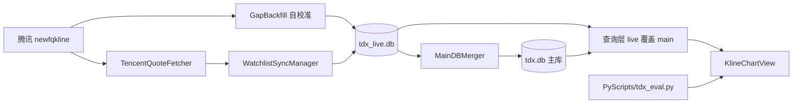

# Kline 仓库地图（目录 + 文件用途）

> 生成方式：只读静态扫描（2026-11-04），未构建、未运行、未改代码。
> 覆盖口径：生成前仓库共 **601 个文件**（已排除 `.git/`；含本文件为 602）。其中 `Kline/` 226 个（179 Swift + 31 `.tdx` + 11 `.py` + 2 `.pyc` + 3 `.xcassets/Contents.json`）、
> `.trae/` 165、`figma/` 47、`KlineTests/` 44、`archive/` 30、`Resource/` 17、`scripts/` 16、`src/` 10、`KlineUITests/` 6、
> `.trae-html-share-packages/` 6、`.github/` 5、`Kline.xcodeproj/` 4、根文件 10、`cloud/` 0（未检出子模块）、`build_logs/` 14（`.gitignore` 内）。
> 资源/多倍图/第三方 vendor/生成物按「组」说明，见 §8。

---

## 0. 文档基线（增量更新的起点）

| 项 | 值 |
|---|---|
| HEAD 完整哈希 | `f8132d60e898e61b3f6e445468d64fb87b07c9f5` |
| 短哈希 | `f8132d6` |
| 分支 | `main` |
| 提交时间（ISO） | `2026-10-20T16:32:02+08:00` |
| 提交标题 | `feat(compact): 首页竖屏水平堆栈改垂直堆栈（Task 11.4，用户补充反馈）` |
| 扫描时工作区状态 | 除本文档外**无任何未提交改动**；未跟踪文件仅 1 个：`.trae/documents/repo-map.md`（即本文件） |

> 说明：基线哈希对应「文档生成前最后一次提交」。本文档自身的增改不计入基线；后续 agent 更新时应保留上表格式，只替换哈希/时间/标题/状态。

### 0.1 如何增量更新本文档

1. **拿变更清单**：`git diff f8132d6..HEAD --name-status`（新增 A / 修改 M / 删除 D / 重命名 R）。
   若需要看单次提交意图，再跑 `git log --oneline f8132d6..HEAD`。
2. **只重读受影响范围**：按路径前缀定位到本文档的对应小节（如 `Kline/Chart/` → §4.4，`.github/workflows/` → §6），
   只重读变更文件的**首部注释/类型声明/调用点**，按需增删/改写表格行，不重扫全仓。
3. **把未提交改动也当作变更**：先 `git status --porcelain` 记录；`??` 新增与 ` M` 修改都要覆盖到对应小节，
   更新完再提交本人改动（本任务明确不 commit）。
4. **回落方案**：若 `f8132d6` 已不可达（rebase / gc / 历史被覆写），`git diff` 会报 `unknown revision`；
   此时退化为「按 mtime 粗筛」：`Get-ChildItem -Recurse -File | Where-Object LastWriteTime -gt <基线日期>`，
   或直接全量重扫；并在本文对应小节末尾注明「本次为全量重扫」。
5. **收尾**：替换 §0 表格中的哈希、日期、标题、工作区状态；保持「扫描时 601 文件」口径不变（除非目录结构变动）。

---

## 1. 整体架构总览（分五层）

1. **入表层（App Shell）**：`KlineApp.swift` 是 `@main` 入口，`ContentView.swift` 是四 Tab 根视图（首页 / 自选 / 行情 / 模拟）。
   K 线详情、布局编辑器、单人训练、个人中心都是挂在根 `ZStack` 上的全屏覆盖层，不在 Tab 栈里。
2. **展示层（页面与布局）**：首页、自选、行情、模拟各有 A/B/C(/D) 多档布局。
   - 首页是**配置驱动**：JSON 布局文件（`Documents/Layouts/home.json`）+ `PageLayoutRenderer` + `HomeWidgetRegistry`。
   - 自选/行情/模拟是**代码分发**：`PageLayoutStore` / `TradingLayoutStore` 存布局偏好，视图 `switch` 到对应 `*LayoutA/B/C/DView`。
   - 图表详情页：`KlineDetailView`（单图 / 2~4 图联动 / 训练态）内部嵌入一个或多个 `KlineChartView`。
3. **业务层（图表 / 公式 / 模拟交易 / 训练 / 回测）**：
   - 图表：`KlineChartView` 主文件与 `Chart/` 其余 17 个拆分件负责光标、手势、惯性、布局、图例、覆盖层、底部面板、联动/复盘。
   - 公式：系统 `.tdx` 模板 + 用户自定义指标 + 策略公式。**2026-10-16 起解析/拆分/求值整体下沉 Python**（`PyTDXFormulaBridge` → `PyScripts/tdx_eval.py`），Swift 只保留输出行样式模型。
   - 模拟交易：`SimStore` 持仓/委托，`SimCondEngine` 条件单预警，交易规则/判定可切 Swift 或 Python（`SimRulesBridge` 按 `mode` 分发）。
   - 训练/回测：训练走 as-of 合成 K 线复盘（`LinkedReplaySupport`）；回测走 `StrategyBacktestEngine`。
4. **数据层**：
   - 主库 `Documents/tdx.db`（首启从 bundle 复制，App 只读；`DatabaseManager` 串行队列）。
   - 增量库 `Documents/tdx_live.db`（五张周期表，`LiveDataStore` 读写；查询层「live 覆盖 main」）。
   - 设备侧**单源腾讯**补数：`GapBackfill`（历史缺口）+ `TencentQuoteFetcher`（当日最新一根）+ `WatchlistSyncManager`（清单编排）+ `TdxSyncManager`（四时刻调度）。
   - 写回主库：`MainDBMerger`（增量库 → 主库，单事务）。
   - 外部整库/整文件通道：USB/AFC、局域网推送（`KlineHTTPServer` + `LANSync*`）。
5. **运行时扩展层（Python 引擎）**：`PythonEngineHost`（定位并 dlopen 引擎，双来源：内嵌 `Kline.app/KlineEngine/` 或 TrollStore 安装的 `Engine.app`）→ `KlinePythonBridge`（JSON/bin 文件通道）→ `Kline/PyScripts/*.py`（随 App 打包）。
   `PyScripts` 是业务脚本版本轴，`Engine.app` 是引擎版本轴，两者独立发版、`apiVersion` 配对校验。

数据流（简版）：

---

## 2. 核心入口文件（先看这 11 个）

| 文件 | 角色 |
|---|---|
| [KlineApp.swift](file:///c:/Users/sunck/home/projects/ios/Kline/Kline/App/KlineApp.swift) | `@main` 入口。`init()` 依次：UI 测试复位 → 日志滚动 → 启动 HTTP 服务 → 增量库监视 → 四时刻同步调度 → 引擎预热 → 交易信任链校验。改启动顺序只改这里。 |
| [ContentView.swift](file:///c:/Users/sunck/home/projects/ios/Kline/Kline/App/ContentView.swift) | 根视图。四 Tab（默认停在「行情」）、双击首页进搜索、双击模拟进演示版个人页；`DetailRouter.item` 非空即全屏打开 `KlineDetailView`。 |
| [KlineDetailView.swift](file:///c:/Users/sunck/home/projects/ios/Kline/Kline/Chart/KlineDetailView.swift) | K 线详情页宿主：顶栏、单图/联动多图、指标面板、公式编辑器、训练指示条、设置弹窗；联动 tile 由 `LinkedViewStore` 描述。 |
| [KlineChartView.swift](file:///c:/Users/sunck/home/projects/ios/Kline/Kline/Chart/KlineChartView.swift) | 单张 K 线图核心：Canvas 绘制、十字光标、缩放/平移、指标栏、悬浮按钮联动。其余 `Chart*.swift` 都是它的扩展拆分件。 |
| [TdxSyncManager.swift](file:///c:/Users/sunck/home/projects/ios/Kline/Kline/Infrastructure/TdxSyncManager.swift) | 设备侧到点调度（11:00 / 14:30 / 15:05 清单范围；17:30 全市场）。只做「判定 + 触发 + 串接」，取数在 `GapBackfill`/`TencentQuoteFetcher`。 |
| [GapBackfill.swift](file:///c:/Users/sunck/home/projects/ios/Kline/Kline/Infrastructure/GapBackfill.swift) | 补缺口权威实现：腾讯取数 + 量纲自校准 + 写增量库 + 周期桶重算。其他取数器都复用它。 |
| [WatchlistSyncManager.swift](file:///c:/Users/sunck/home/projects/ios/Kline/Kline/Infrastructure/WatchlistSyncManager.swift) | 清单并集当日 bar 写入编排；季/年 bar 用「主库当期 bar ⊕ 新日线」合并。 |
| [DatabaseManager.swift](file:///c:/Users/sunck/home/projects/ios/Kline/Kline/Data/DatabaseManager.swift) | 主库唯一入口：复制种子库到 Documents、`metaList`、行情/图表查询、`dataVersion` 热刷新信号。 |
| [LiveDataStore.swift](file:///c:/Users/sunck/home/projects/ios/Kline/Kline/Data/LiveDataStore.swift) | 增量库唯一入口：五表读写、指纹监视、周期聚合、`upsertDaily`、`reloadAsync`。 |
| [PythonEngineHost.swift](file:///c:/Users/sunck/home/projects/ios/Kline/Kline/Debug/PythonEngineHost.swift) | 引擎安装/配对/加载/dlopen + `runPyBridge`；`KlinePythonBridge` 建在它上面。 |
| [ProfileDetailView.swift](file:///c:/Users/sunck/home/projects/ios/Kline/Kline/Profile/ProfileDetailView.swift) | 真正的设置中心：主题、五行布局、公式中心、本地/远程更新、联机同步、引擎实验室。 |

---

## 3. 根目录文件

| 文件 | 作用 |
|---|---|
| `README.md` | 项目简介 + 部署形态（TrollStore 现行 / 签名旧形态归档）。注意其中 `TRAE-Windows-Build-Workflow.md` 等链接指向仓库根，实际文件在 `.trae/documents/`，链接已失效。 |
| `Info.plist` | 文件共享、局域网用途、Bonjour `_klinesync._tcp`、隐藏状态栏、强制全屏（`UIRequiresFullScreen` + `…IgnoredStartingWithVersion=99.0` 以规避 iPadOS 26 窗口模式）。 |
| `Kline.entitlements` | TrollStore 侧权限：`no-sandbox`、`platform-application`、`AppDataContainers`、`persona-mgmt`。CI 用它给主二进制/root 辅助程序注入权限。 |
| `ExportOptions.plist` | 旧签名导出配置（development + teamID + provisioning profile），现行 TrollStore 链路不用，属归档形态残留。 |
| `tdx.db`（约 944 KB） | 演示/种子主库，**真的会打进 App**（`PBXResourcesBuildPhase` 中唯一资源）。首启复制到 `Documents/`。 |
| `opener.m` | 「装完自动打开新版」的 root 守护进程（ObjC）。CI 编译成 `Kline.app/opener`，轮询 `CFBundleVersion` 后经 LaunchServices 拉起新版。 |
| `rootprobe.c` | 极简 root 探针，退出码 0/1 表示是否拿到 root。CI 编译成 `Kline.app/rootprobe`。 |
| `check_indicators.py` | 构建期校验 `.tdx` 模板（与 `SystemIndicatorStore.parse` 同规则），由 Xcode `Check Indicators` Run Script 调用，失败即中断构建。 |
| `.gitignore` | 忽略 `*.txt`（白名单少量）、`build_logs/`、`EngineCache/`、`Kline/tdx.db`、`Kline/PyScripts/__pycache__/` 等。 |
| `.gitmodules` | 唯一子模块 `cloud` → `https://cnb.cool/sunchuquin/kline-data.git`（当前**未检出**，目录空）。 |

---

## 4. `Kline/` 源码逐目录

### 4.1 `Kline/App/`（20 个 Swift）

| 文件 | 作用 / 关系 |
|---|---|
| `KlineApp.swift` | 见入口表；含 `AppDelegate`（方向跟随系统）与 `ScreenGeometryProbe`（`-screen-probe` 启动参数写入尺寸探针）。 |
| `ContentView.swift` | 根 Tab 容器；管理搜索/个人中心/编辑器/训练浮层与两个悬浮按钮的可见性。 |
| `AdaptiveWidthKit.swift` | `CompactWidth.threshold` 窄屏阈值 + `WidthReader` 宽度测量；各页面统一引用，避免各自拍阈值。 |
| `KlineTheme.swift` | `KlineTheme`（日/夜/跟随系统）+ `KlineThemeStore`（UserDefaults `kline.displayTheme`）。 |
| `PageLayoutStore.swift` | 自选/行情/首页三组 A/B/C/D 布局枚举 + 持久化（`kline.favoritesLayout` / `kline.marketLayout`）。 |
| `PageLayout/PageLayoutSchema.swift` | 配置驱动布局的 JSON 模型（`PageLayoutFile` / 节点树）。 |
| `PageLayout/PageLayoutCodec.swift` | 布局 JSON 编解码与校验。 |
| `PageLayout/PageLayoutConfigStore.swift` | 按 page 读写 `Documents/Layouts/<page>.json`，首启种入内置默认；LAN 同步可热重载。 |
| `PageLayout/PageWidgetRegistry.swift` | 泛型「控件名 → builder」注册表；未注册控件渲染可诊断占位。 |
| `PageLayout/PageLayoutRenderer.swift` | 泛型布局渲染器（行/列/网格/叶子节点）。 |
| `PageLayout/CommonLayoutWidgets.swift` | 页面无关的通用控件名与默认控件。 |
| `QuickPanelLayouts.swift` | 悬浮快捷面板方案 A（`QuickPanelAView`）+ 共享子块；由 `FloatingAccessoryPanel` 调用。 |
| `QuickPanelLayoutsBC.swift` | 快捷面板方案 B / C。 |
| `FloatingAccessory.swift` | 悬浮按钮 A（四层同心圆）；内含 `FloatingAccessoryPanel` 按布局分发到 QuickPanel A/B/C。 |
| `FloatingAccessoryWheel.swift` | 悬浮按钮 B'（转圈驱动联动光标逐根平移）。 |
| `FloatingAccessoryCoordinator.swift` | 按钮协调器：详情页弹窗、光标自动移动时统一隐藏/恢复；`isDetailViewLoaded` 锁存。 |
| `FloatingAccessoryShared.swift` | 按钮尺寸、边距等常量。 |
| `SidebarDrawer.swift` | 通用侧栏抽屉（紧凑宽时由侧栏变抽屉）；行情 B/D、模拟 A 使用。 |
| `WrappingHStack.swift` | 自动换行横向布局；`SimSharedViews` 等处使用，有单元测试。 |
| `UITestStateReset.swift` | `-uitest-reset` 启动参数清空用户态，保证 UI 测试用例隔离。 |

### 4.2 `Kline/Data/`（6 个 Swift）

| 文件 | 作用 |
|---|---|
| `DatabaseManager.swift` | 主库只读访问 + `metaList` + 查询 API + `dataVersion`；所有 SQL 走 `dbQueue` 串行。 |
| `KlineData.swift` | 基础数据模型：`MetaItem`（id/file/code/name/type/firstDate/lastDate）等。 |
| `LiveDataStore.swift` | 增量库五表读写、指纹监视、当期/缺口周期聚合、`trim`。 |
| `MainDBMerger.swift` | 增量库 → 主库单事务 UPSERT（五表）+ `meta.last_date`；先预览再确认。 |
| `WatchlistSymbols.swift` | 「自选/分组/置顶/预警/条件单/委托」6 类清单并集 → `file` 集合；以主库 meta 为准。 |
| `MockData.swift` | 演示页数据（热点/行业/数据中心等）+ `HorizontalCardItem` 模型；供 `ProfileView` 演示版。 |

### 4.3 `Kline/Infrastructure/`（12 个 Swift）

| 文件 | 作用 / 关系 |
|---|---|
| `TdxSyncManager.swift` | 四时刻调度器；`TdxSyncConfig` 为开关/时刻；调用 `GapBackfill` + `WatchlistSyncManager`。 |
| `TdxSyncConfig.swift` | 同步开关、四时刻、仅交易日等配置（UserDefaults）。 |
| `GapBackfill.swift` | 补缺口：全市场扫描、腾讯 `newfqkline`、自校准、写增量库、周期桶重算；`TencentQuoteFetcher` 复用其 `fetchGap`。 |
| `TencentQuoteFetcher.swift` | 逐只取「最新一根」；复用 `GapJob` 与自校准，保证手/股口径一致。 |
| `WatchlistSyncManager.swift` | 清单范围当日更新编排；写增量库后靠既有 `dataVersion` 触发条件单/行情缓存刷新。 |
| `KlineHTTPServer.swift` | Network.framework HTTP 服务（前台 `0.0.0.0:5051`）：`/files`、`/download/*`、`/install`、`/install-local`、`/install-engine`、`/sandbox/*`（读写删）、`/sync/{reload,sha,request-pair,backup,reload-config,live-reset,status}`、`/spawnroot-test`、`/opener-log`。 |
| `LANSyncDiscovery.swift` | Bonjour/mDNS 发现对端 + 发布服务。 |
| `LANSyncModels.swift` | 联机同步 wire format（字段名即线上格式，两端共用）。 |
| `LANSyncSupport.swift` | `LANSyncPairing`（配对签 token）、`LANSyncReload`（热重载 scope）、可同步内容清单。 |
| `LANSyncTransfer.swift` | 对端 HTTP 传输（推/拉、整库替换、断点/校验）。 |
| `LocalNetworkAddress.swift` | 本机局域网地址解析（配对 URL 展示）。 |
| `DebugLogger.swift` | 轻量文件日志 `Documents/debug_log.txt`，启动归档 `debug_log.prev.txt`；串行队列、Release 也写。 |

### 4.4 `Kline/Chart/`（18 个 Swift）

| 文件 | 作用 |
|---|---|
| `KlineChartView.swift` | 图表核心：Canvas 主图/副图、缩放平移、指标栏、悬浮控件、预取。 |
| `KlineChartViewState.swift` | `ChartEditorUIState` 等编辑器 UI 状态（面板/搜索/全屏公式编辑标志）。 |
| `KlineDetailView.swift` | 详情页宿主；含 `DualSplitDivider`、`CursorLinkState`、顶栏高度 PreferenceKey。 |
| `ChartTypes.swift` | `ChartSeries` / `ChartStyle` / 周期等基础类型。 |
| `ChartConfigStore.swift` | 图表配置（周期、指标归属、主副图数量、联动配置）持久化。 |
| `ChartCacheStore.swift` | 按 (标的, 周期) 缓存图表数据/指标结果，减少重复计算。 |
| `IndicatorPipeline.swift` | 指标求值管线 + `IndicatorComputationStore`；首帧/副图/预取共用。 |
| `ChartCursorKit.swift` | 十字光标域：读数文本、光标覆盖层、双光标区间统计、像素/价格换算。 |
| `ChartGestureSupport.swift` | 手势状态与速度采样（`DragMode` 等）。 |
| `ChartGestureHandlers.swift` | 单指拖动状态机、双指回调、周期切换、退出窗口推算。 |
| `ChartInertiaSupport.swift` | 惯性滑动 `ChartMomentumAnimator`（参数集中为静态常量）。 |
| `ChartLayoutKit.swift` | 主图/副图面板的 ZStack 组装（Canvas + 坐标 + 光标 + 覆盖层）。 |
| `ChartOverlayKit.swift` | 坐标标签、`AxisLabel`、刻度等覆盖层组件。 |
| `ChartLegendKit.swift` | 指标数值栏、行情数据行、可拖动 `InfoPannerCenter`。 |
| `ChartSheetKit.swift` | 底部指标选择面板：容器、指标格子、参数入口。 |
| `LinkedViewStore.swift` | 联动视图数量（2~4）与每格 (标的, 周期) 配置持久化。 |
| `LinkedKlineTile.swift` | 联动中的单格容器（共享数据槽、首屏加载、信息栏按钮）。 |
| `LinkedReplaySupport.swift` | 联动 as-of 复盘：合成 K 线、未来淡化、指标 as-of 重算。 |

### 4.5 `Kline/Formula/`（13 个 Swift）

| 文件 | 作用 |
|---|---|
| `FormulaEngine.swift` | TDX 输出行/单元模型与渲染辅助（求值已下沉 Python）。 |
| `FormulaKind.swift` | 公式分类（主图/副图/选股/策略等）。 |
| `IndicatorStyle.swift` | `TDXLineStyle`（实线/虚线/圆点/柱状/不绘制）等样式枚举。 |
| `CustomIndicator.swift` | 用户自定义指标模型 + `IndicatorScope`。 |
| `SystemIndicatorStore.swift` | 系统 `.tdx` 仓库：按周期目录加载，首启从 bundle 复制到 `Documents/indicator/<周期>/`。 |
| `FormulaCenterView.swift` | 公式中心列表页（系统/自定义/策略入口）。 |
| `FormulaEditorView.swift` | 指标公式编辑器（全屏）。 |
| `StrategyFormula.swift` | 策略 DSL 模型（`StrategyRuleKind`、买卖规则）。 |
| `StrategyFormulaEditorView.swift` | 策略公式编辑器。 |
| `StrategyDetailView.swift` | 策略详情（规则展示、绑定账户、生成条件单、回测入口）。 |
| `StrategyPickListView.swift` | 策略选股结果列表。 |
| `StrategyPickRunner.swift` | 策略选股执行（池：全市场/自选等）。 |
| `StrategyTrade.swift` | 策略交易规格（仓位/方向/执行口径）。 |

### 4.6 `Kline/Home/`（29 个 Swift）

根目录（11）：

| 文件 | 作用 |
|---|---|
| `HomeView.swift` | 首页容器：JSON 布局优先 + 硬编码回退；注册内置控件并监听配置变更。 |
| `HomeLayoutContext.swift` | 渲染上下文（数据源、动作、宽度等）传给各控件。 |
| `HomeLayoutDefaults.swift` | 内置默认布局 JSON（B 档默认；A 档已删除）。 |
| `HomeLayoutBView.swift` | 布局 B 的代码版（JSON 不可用/预览时回退）。 |
| `HomeLayoutCView.swift` | 布局 C 的代码版。 |
| `HomeLayoutDView.swift` | 布局 D 的代码版。 |
| `HomeWidgetRegistry.swift` | 把 11 个首页控件注册进 `PageWidgetRegistry<HomeLayoutContext>`。 |
| `HomePageKit.swift` | 首页入口类型、路由与通用逻辑。 |
| `HomePageModel.swift` | 首页数据模型（市场宽度 `HomeBreadth` 等）与计算。 |
| `SearchPageView.swift` | 搜索页（双击首页 Tab 进入）：本地搜索 + 历史 + 结果管理。 |
| `SearchHistoryStore.swift` | 搜索历史持久化模型。 |

`Home/Editor/`（7）—— 全屏布局编辑器：

| 文件 | 作用 |
|---|---|
| `PageLayoutEditorView.swift` | 编辑器主界面（全屏，`HomeLayoutEditorRouter` 控制呈现）。 |
| `PageLayoutEditorModel.swift` | 编辑模型：树结构、选中、保存/重置、校验。 |
| `LayoutNodeTreeList.swift` | 左/右侧节点树列表。 |
| `LayoutNodeInspector.swift` | 节点属性检查器。 |
| `HomeWidgetEditorSchema.swift` | 控件参数 schema（可编辑字段描述）。 |
| `WidgetParamCandidateProvider.swift` | 参数候选值（如标的、分组）供给。 |
| `HomeLayoutFullPreviewView.swift` | 全屏预览（直接走 `PageLayoutRenderer`）。 |

`Home/Widgets/`（11）—— 首页卡片控件：

`HomeHeaderBar`（标题/头像/搜索）、`HomeSearchModeView`（搜索态占位）、`HomeMarketOverviewStrip`（大盘概览条）、`HomeQuickEntryRow` / `HomeQuickEntryChip`（快捷入口行/胶囊）、`HomeQuoteRow`（行情行）、`HomeFavoritesBlock`（自选块）、`HomeSimSummaryBlock`（模拟账户摘要）、`HomeTopGainersBlock`（涨幅榜）、`HomeSectionCard`（通用分节卡片）、`HomeWidgetPalette`（涨红跌绿配色助手）。

### 4.7 `Kline/Favorites/`（8 个 Swift）

| 文件 | 作用 |
|---|---|
| `FavoritesView.swift` | 容器：按 `PageLayoutStore.favoritesLayout` 分发 A/B/C/D，状态在 `FavoritesPageModel`。 |
| `FavoritesPageKit.swift` | `FavoritesPageModel`：分组 Tab、标的、排序、横向滚动、预取。 |
| `FavoritesStore.swift` | 自选/分组/置顶持久化（`FavoritesGroupKind`）。 |
| `FavoritesRowMenu.swift` | 行长按菜单（批量编辑、加分组、删除等）。 |
| `FavoritesLayoutAView.swift` | A · 经典表格式。 |
| `FavoritesLayoutBView.swift` | B · 分组侧栏 + 表格工作区。 |
| `FavoritesLayoutCView.swift` | C · 自选卡片流。 |
| `FavoritesLayoutDView.swift` | D · 看板（含 `FavoritesGroupStat`）。 |

### 4.8 `Kline/Market/`（15 个 Swift）

| 文件 | 作用 |
|---|---|
| `MarketView.swift` | 行情页容器：分类侧栏 + 布局分发（`MarketLayoutStyle`）+ 顶部字段。 |
| `MarketPageKit.swift` | `MarketPageModel` / `MarketRowMetrics` 等共享骨架。 |
| `MarketRow.swift` | 行情行模型（`MarketRow`）。 |
| `MarketRowCache.swift` | 全市场行数据缓存 + 启动预热 + 增量刷新。 |
| `MarketTableRow.swift` | 单行视图渲染（配合 `MarketRow` / `MarketRowCache`）。 |
| `MarketTableSupport.swift` | 列布局 `ColumnLayout`、表格几何辅助。 |
| `MarketField.swift` | 可配置字段枚举（价格/涨幅/量额/换手等）。 |
| `MarketFilter.swift` | 筛选范围/选项模型。 |
| `MarketConfigStore.swift` | 列显示、顺序、筛选、页面配置持久化（`MarketConfigPage`）。 |
| `MarketColumnConfigPanel.swift` | 表头列配置面板 + `ColumnFilterButton`。 |
| `AddToGroupSheet.swift` | 「加入自选分组」弹层（自选/行情共用）。 |
| `MarketLayoutAView.swift` | A · 经典表格式。 |
| `MarketLayoutBView.swift` | B · 分类侧栏 + 表格。 |
| `MarketLayoutCView.swift` | C · 磁贴/宫格。 |
| `MarketLayoutDView.swift` | D · 总览式。 |

### 4.9 `Kline/Simulation/`（11 个 Swift）

| 文件 | 作用 |
|---|---|
| `SimulationView.swift` | 模拟页容器：按 `TradingLayoutStore.simulationLayout` 分发 A/B/C。 |
| `SimulationLayoutAView.swift` | A · 账户侧栏 + 工作区（含 `SidebarDrawer`）。 |
| `SimulationLayoutBView.swift` | B · 账户卡片宫格 + 分区。 |
| `SimulationLayoutCView.swift` | C · 券商经典顶栏。 |
| `SimSharedViews.swift` | 跨布局共享块（模块 Tab `SimModuleTab`、分段控件等）。 |
| `SimCondListView.swift` | 条件单列表（`SimCondEditorRequest`）。 |
| `SimCondDetailView.swift` | 条件单详情。 |
| `SimCondEditorView.swift` | 条件单编辑器。 |
| `SimSymbolPickerView.swift` | 标的选择器。 |
| `AlertRecordView.swift` | 预警记录列表。 |
| `StrategyGenConfirmView.swift` | 策略生成条件单的确认弹层。 |

### 4.10 `Kline/Trading/`（12 个 Swift）

| 文件 | 作用 |
|---|---|
| `SimStore.swift` | 模拟账户/持仓/委托/成交核心状态（`SimRoot` 持久化）。 |
| `SimModels.swift` | 账户/订单/成交模型（`SimOrderDirection` 等）。 |
| `SimTradingRules.swift` | 交易规则（手数、涨跌停、费用、T+1 等）+ `SimOrderDraft`。 |
| `SimFormat.swift` | 金额/数量/百分比格式化。 |
| `SimCondEngine.swift` | 条件单事件扫描与触发（`SimCondTrigger`）。 |
| `SimConditionModels.swift` | 条件单模型（`SimCondKind`）。 |
| `SimCondRule.swift` | 条件快照 `SimCondSnapshot` 与规则匹配。 |
| `SimCondKit.swift` | 条件类型胶囊等 UI 小件。 |
| `StrategyCondGenerator.swift` | 策略 → 条件单草稿生成（`StrategyCondDraft`）。 |
| `TradeTicketView.swift` | 下单票据（多套样式 `TradeTicketStyle`，含面板态）。 |
| `TradeTicketKit.swift` | 票据子组件（分段选项等）。 |
| `TradingLayoutStore.swift` | 模拟页布局 `SimulationLayoutStyle` + 快捷面板 `QuickPanelLayoutStyle` 持久化。 |

### 4.11 `Kline/Training/`（6 个 Swift）

| 文件 | 作用 |
|---|---|
| `TrainingSessionController.swift` | 单人训练会话：标的、起止、逐日推进、胜率统计、与详情页联动（as-of 右边界）。 |
| `TrainingStore.swift` | 训练记录持久化。 |
| `TrainingModels.swift` | 会话状态/记录模型（`TrainSessionStatus`）。 |
| `TrainingSetupSheet.swift` | 训练设置浮层（`TrainingSetupRouter`）。 |
| `TrainingRecordListView.swift` | 历史记录列表。 |
| `TrainingCondListView.swift` | 训练态条件单/预警记录浮层（`TrainingCondRouter`）。 |

### 4.12 `Kline/Backtest/`（5 个 Swift）

| 文件 | 作用 |
|---|---|
| `StrategyBacktestEngine.swift` | 回测执行（持仓 `BacktestPosition`、撮合、资金曲线）。 |
| `StrategyBacktestModels.swift` | 回测参数/结果模型（`BacktestParams`）。 |
| `BacktestParamView.swift` | 参数配置页。 |
| `BacktestResultView.swift` | 结果统计页。 |
| `NetValueChartView.swift` | 净值曲线图。 |

### 4.13 `Kline/Profile/`（9 个 Swift）

| 文件 | 作用 |
|---|---|
| `ProfileDetailView.swift` | 真正的设置中心：主题、快捷面板/模拟页/自选页/行情页/首页五组布局、布局编辑器、公式中心、本地更新、联机同步、Python 引擎实验室。 |
| `ProfileView.swift` | 仿通达信「我的」**演示页**（双击模拟 Tab 打开，用 `MockData`）。 |
| `DetailPage.swift` | 演示页的二级详情占位页。 |
| `HorizontalScrollCard.swift` / `ListCard.swift` | 演示页卡片组件（数据来自 `MockData`）。 |
| `LocalUpdateView.swift` | 「本地更新」三条固定行（在线服务 / 检查新版 / 更新引擎，下载前归档旧 IPA 保留 10 份）+ 「清单标的自动更新」与「补缺口」两个卡片组。 |
| `GitHubRemoteUpdate.swift` | GitHub Release 查询 + IPA 下载（`releases/latest`）。 |
| `LANSyncView.swift` | 局域网联机同步 UI（配对/推送/拉取/整库替换）。 |
| `TradingLayoutSettings.swift` | 五行布局设置面板（`LayoutDropdownButton` / `LayoutOptionsPanel`）。 |

### 4.14 `Kline/Python/`（13 个 Swift）

| 文件 | 作用 |
|---|---|
| `KlinePythonBridge.swift` | 生产桥接：Swift → 进程内 Python（JSON 文件 + 包装脚本），含 bin 零拷贝通道。 |
| `PyTDXFormulaBridge.swift` | TDX 公式解析/拆分/求值的 Python 桥（`splitUnits` / `evaluateUnitTexts` / `evaluateText`）。 |
| `DbWriteBridge.swift` | 「写路径」下沉桥（db_write.py）。 |
| `QuoteSnapshotBridge.swift` | 行情快照计算桥（quote_snapshot.py）。 |
| `SimRulesBridge.swift` | 交易判定/规则双后端分发（`.swift` / `.engine`）。 |
| `SimRulesAsync.swift` | 上述桥的 async 门面，供主线程 `await` 调用。 |
| `SimRulesCodec.swift` | 规则输入/输出的编解码。 |
| `SimRulesProjection.swift` | 规则投影（Python 结果 → Swift 状态）。 |
| `SimRulesTrust.swift` | 脚本哈希/版本锁信任链（启动时校验）。 |
| `SimStateBridge.swift` | 交易状态持久层桥（sim_state.py）。 |
| `SimTradeRuleConstants.swift` | 交易规则常量（与 Python 侧对齐）。 |
| `SimTradeRulesProjection.swift` | 交易规则投影。 |
| `StrategyProjection.swift` | 策略执行投影（策略公式 → 交易动作）。 |

### 4.15 `Kline/Debug/`（2 个 Swift）

| 文件 | 作用 |
|---|---|
| `PythonEngineHost.swift` | 引擎状态机（未安装/已安装/版本不匹配/损坏）、双来源定位、dlopen、`runPyBridge`、`blockingCall` 主线程断言。 |
| `PythonEngineLabView.swift` | 「Python 引擎实验室」调试页（安装/加载/跑实验脚本/看结果）。 |

### 4.16 `Kline/Indicators/`（31 个 `.tdx`，按组说明）

内置 TDX 指标模板（文本格式：`NAME=` / `SCOPE=` / `GROUP=` / `FORMULA:`）。代码按 `bundle/Indicators/*.tdx` 定位，并在首启把每个周期的模板克隆到 `Documents/indicator/<周期>/`。 成员：
`BIAS` `BIAS36` `BIAS-QL` `BOLL` `BRAR` `CCI` `CDJ` `CMK` `COL` `CR` `DMI` `EMA` `GMMA` `KD` `KDJ` `KQA` `MA` `MACD` `MARSI` `MASS` `OBV` `RSI` `SAR` `SDJ` `TRIX` `VMACD` `VR` `VRSI` `WR` `XS` `XS2`。
构建期由 `check_indicators.py` 校验；`SystemIndicatorStore` 按 `SCOPE=` 区分主/副图、按 `GROUP=` 排序。
注意：`project.pbxproj` 的 `membershipExceptions` 显式列了 `Indicators/*.tdx`（L40-43），而加载代码同时兼容 `bundle/Indicators/` 子目录与 bundle 根两种位置；若改打包方式需同步核对这条例外。

### 4.17 `Kline/PyScripts/`（11 个 `.py`，随 App 打包）

| 文件 | 作用 |
|---|---|
| `tdx_eval.py` | TDX 公式解析/拆分/求值权威实现（文本 op 跨调用 AST 缓存）。 |
| `template_parse.py` | `.tdx` 模板解析权威实现（与 `check_indicators.py` 同口径）。 |
| `period_aggregate.py` | 周/月/季/年聚合权威实现（与 Swift 侧对拍）。 |
| `quote_parse.py` | 腾讯取数口径解析（行字段/量纲）。 |
| `quote_snapshot.py` | 行情快照计算（拆分共享枢纽）。 |
| `mytt.py` | MyTT 麦语言指标函数库（pandas → numpy 垫片）。 |
| `chan.py` | 缠论（合并 → 分型 → 笔）语义移植。 |
| `candle_patterns.py` | K 线形态识别（TA-Lib CDL 语义的 numpy 向量化移植）。 |
| `sim_rules.py` | 条件单判定 / 交易规则成对下沉（约 162 KB，最大脚本）。 |
| `sim_state.py` | 交易状态持久层。 |
| `db_write.py` | 数据写路径下沉。 |

### 4.18 `Kline/Assets.xcassets/` 与 `Kline/Resources/`

- `Assets.xcassets/` 只有 3 个 `Contents.json`（根、`AccentColor`、`AppIcon`），**没有任何图片文件**；AppIcon 为空壳（图标由 TrollStore/系统占位或后续补）。
- `Kline/Resources/` 是**空目录**（0 文件，保留占位）。

---

## 5. `KlineTests/`（31 个 Swift + 13 fixtures）

测试集中在「PC Python ↔ App Swift 口径对拍」与「引擎桥接契约」，不是常规业务 UI 单测：

| 主题 | 文件 |
|---|---|
| 桥接基础 | `PyScriptsBridgeSmokeTests`、`PyBridgeTransportBaselineTests`、`PyBridgeNumpySmokeTests` |
| 周期/取数/模板口径 | `PeriodAggregationContractTests`、`QuoteParsingContractTests`、`PyBridgeQuoteParsingTests`、`QuoteSnapshotParityTests`（辅助 `QuoteSnapshotOracle`）、`IndicatorTemplateContractTests` |
| 指标脚本 | `PyBridgeMyTTFunctionTests`、`PyBridgeCandlePatternTests`、`PyBridgeChanTests`、`PyBridgePeriodAggregationTests`、`PyBridgeTemplateParseTests`、`PyTDXEvalTests` |
| 交易/策略 | `PyBridgeSimRulesTests`、`SimRulesAsyncTests`、`SimRulesCodecTests`、`SimRulesProjectionTests`、`SimRulesTrustTests`、`SimTradeRulesProjectionTests`、`StrategyProjectionTests`、`StrategyTdxBoundaryTests`、`BacktestAndCalibrateBatchTests` |
| 引擎与写库 | `PythonEngineHostSourceTests`、`DbWriteParityTests`、`PyBridgeFirstFramePerfTests` |
| 其他 | `KlineTests`（空壳入口）、`MarketRowTextCacheTests`、`WrappingHStackTests`、`SimRulesJSONCompare`（辅助）、`QuoteSnapshotOracle`（辅助） |

`Fixtures/`（13）：`period_aggregation.json`、`quote_parsing.json`、`indicator_templates.json`、`tdx_eval_golden.json`、`tdx_parse_golden.json`、`mytt_functions.json`、`chan_bi.json`、`candle_patterns.json`、`sim_rules.json`、`sim_rules_trust.json`、`strategy_dsl.json`、`backtest_golden.json`、`placeholder.json`。
前 3 个由 `src/contract_golden.py` 确定性生成，CI 会重跑两次并 `git diff --exit-code` 校验。

`KlineUITests/`（6）：`KlineUITests.swift`（主冒烟/布局切换）、`CondOrderSmokeUITests`、`GapBackfillUITests`（腾讯 6 段参数回归）、`LANSyncUITests`、`DeviceCompatProbeUITests`（窄屏/安全区）、`UITestLaunch`（启动辅助）。

---

## 6. `.github/workflows/`（5 个）

| 文件 | 作用 |
|---|---|
| `build.yml` | push `main`（忽略 `.trae/archive/figma/.github/KlineTests/src/contract_golden.py`）→ macOS 构建未签名 `.app` → 编译并嵌入 `rootprobe`/`opener` → `codesign` ad-hoc + 注入 `Kline.entitlements` → 改名 `Kline-TS` → 注入 `CFBundleVersion`=run number → 打 `.ipa` → 上传 artifact → 更新单一 `latest` Release（App 内远程更新源）。 |
| `engine.yml` | **仅手动触发**。下载 beeware Python-Apple-support → 只留真机 slice → `ldid -S` 重签所有 Mach-O → 组装 `Engine.app`（stub 可执行 + Info.plist + framework + manifest）→ 打 `KlineEngine-<ver>.tipa` + sha256 → 发独立 `engine-*` Release。 |
| `build-numpy-wheel.yml` | 构建 numpy iOS arm64 wheel（打补丁 `patch_numpy_ios.py`），发布 `numpy-wheel-<ver>` prerelease，供 `engine.yml` 引用。 |
| `test.yml` | 仅当 `KlineTests/**` / `Kline.xcodeproj/**` / `src/contract_golden.py` / 自身变更时触发：golden 确定性 + 模拟器跑 `KlineTests`（跳过 UI 测试）。 |
| `cleanup-artifacts.yml` | 定时清理 Actions artifacts，节省配额。 |

---

## 7. `src/` 与 `scripts/`（PC 侧工具，不在 App 运行时）

`src/`（10）：

| 文件 | 作用 |
|---|---|
| `tdx_parser.py`（37 KB） | 通达信 txt 目录 → `tdx.db`（日/周/月/季/年线 + meta + concept/index）导入工具；PC 侧生成主库。App 不调用。 |
| `txt_changes.py`（14 KB） | 新旧 txt 目录变更判定**唯一实现**（stat/content/Beyond Compare 三种模式）；`tdx_parser.py` 复用。 |
| `tdx_gui.py`（49 KB） | PySide2 桌面 GUI，浏览/检索 `./tdx.db` 的 meta 与表格；开发辅助。 |
| `contract_golden.py`（36 KB） | 契约 golden 生成器（周期聚合/取数解析/模板解析），产出 `KlineTests/Fixtures/` 的 3 个 JSON。 |
| `data/universe.txt`（157 KB） | 全市场标的清单（代码/名称）。 |
| `data/symbols.txt`（2.6 KB） | 常用/测试标的清单。 |
| `__pycache__/*.pyc`（4） | 运行残留；其中 `live_db_builder.cpython-310.pyc` 的源码已随「单源腾讯化」删除 → 孤儿字节码。 |

`scripts/`（16）：

| 文件 | 作用 |
|---|---|
| `verify_tdx_eval.py` / `verify_parse_port.py` | PC 端跑 `tdx_eval.py` 文本 op 并做差分/冒烟。 |
| `verify_mytt_shim.py` / `verify_chan.py` / `verify_candle_patterns.py` | numpy 垫片/缠论/形态脚本 vs 原版实现全量对拍。 |
| `verify_sim_rules.py` / `verify_cond_sweep_parity.py` | 交易判定与整环 `cond_sweep` 对拍。 |
| `verify_pyscript_io_contract.py` | 扫描 `PyScripts/*.py` 的桥接 IO 契约。 |
| `extract_sim_rules_golden.py` / `gen_sim_rules_inputs.py` / `gen_sim_rules_trust.py` | 从测试输出抽取/生成交易域 fixture 与信任链常量。 |
| `prepare_engine_cache.sh` | macOS 本地构建时准备 `EngineCache/device|sim`（供 Xcode「Embed Python Engine」阶段内嵌）。 |
| `install_numpy_into_engine.sh` | 把 numpy iOS wheel 装进引擎树 `site-packages`。 |
| `patch_numpy_ios.py` | 把 numpy iOS 支持补丁打到 2.5.3 sdist（meson long double / BLAS / cibuildwheel）。 |
| `kline_deploy_mac.sh` | macOS 本地闭环：构建 → 安装 → 启动 → 提交推送（对应 Windows 侧仓库外 `build_and_deploy.py`）。 |
| `vendor/MyTT_pandas.py` | 第三方 MyTT 原版（pandas 实现），作对照基准，不随 App 打包。 |

---

## 8. 资源 / 生成物 / 第三方（按组说明）

| 组 | 数量 | 说明 |
|---|---|---|
| `Resource/` | 17 PNG | `1宫格`、`2宫格1/2` … `8宫格`、`预设窗口模板`：K 线分屏/宫格**设计参考图**。不在 `Kline/` 同步组内、代码零引用 → 不随 App 打包。 |
| `figma/` | 47（5 HTML + 42 图） | 5 个可交互 HTML 设计稿（首页/自选行情/自选操作/交易/详情）+ `_shots/` 截图（A/B/C/D 档对照、调试帧）。纯设计资产。 |
| `.trae-html-share-packages/` | 6 ZIP | 旧分享包：`archive/demo.html.zip`（1.1 MB）+ `figma/` 下 5 个同名 6 MB 包；内容与 `figma/*.html` 重复，可清理。 |
| `archive/` | 30 | 归档：`legacy-signed-install/`（旧签名安装文档）、`system_architecture/`（6 张 mermaid 架构图 + 机制说明）、`trollstore-auto-deploy/`（自动部署调研）、`demo.qmd` + `demo_files/libs/**`（Quarto 第三方 vendor，bootstrap/mermaid 等）。 |
| `build_logs/` | 14 TXT | 真机取证的调试日志（`debug_log_*.txt`、`watchlist_*.txt`、`tencent_quote_switch_verify.txt`）。`.gitignore` 已忽略，不进版本库。 |
| `cloud/` | 0 | `cloud` 子模块（行情数据仓）占位，当前未检出 → 空目录。 |
| `__pycache__/`、`Kline/PyScripts/__pycache__/`、`src/__pycache__/` | 生成物 | Python 字节码，可随时删除。 |
| `Kline/Indicators/*.tdx` | 31 | 文本模板资源，见 §4.16。 |
| `Kline/Assets.xcassets` | 3 JSON | 空资源目录，见 §4.18。 |
| `docs 配图` | 1 SVG | `.trae/documents/Kline-页面布局设计.svg`，与同名 md 配套。 |

**多倍图**：仓库内 `.xcassets` 没有 `@2x/@3x` 图片，`figma/_shots` 与 `Resource/` 是单倍设计图，因此不存在多倍图组。

---

## 9. `.trae/` 文档与技能（165 个文件）

### 9.1 `rules/`

| 文件 | 主题 |
|---|---|
| `版本管理.md` | `alwaysApply` 强制规则：任何任务先加载 `.trae/skills/kline-device-validation-loop`（分阶段构建 → 装机 → 真机验收闭环）。文件名有误导性，内容与版本号无关。 |

### 9.2 `documents/`（22 md（含本文件）+ 1 svg；另有 3 个知识子库共 65 文件）

| 文件 | 主题 |
|---|---|
| `single-source-tencent-plan.md` | **现行架构决策**：单源腾讯化、移除云端分片/东财（分阶段）。 |
| `TRAE-Windows-Build-Workflow.md` | Windows + GitHub Actions 构建/部署 IPA 全流程。 |
| `Kline-Update-Plans.md` | TrollStore 下的远程/本地更新方案。 |
| `TrollStore-方案A-免确认自动安装.md` | 装完自动打开新版的方案 A（对应 `opener.m`）。 |
| `Kline-境内CI云端生产方案.md` | 云端生产改走境内 CI（CNB/Gitee Go）。**已被单源腾讯化取代**。 |
| `Kline-增量行情库自动同步.md` | 增量库三通道同步（USB/LAN/设备直连）。 |
| `live-sync-period-local-plan.md` | 周/月线由云端改为 App 本地聚合。 |
| `引擎直读库对拍-plan.md` | 引擎直读主库+增量库的对拍与切换。 |
| `首帧引擎实验-plan.md` | 首帧指标计算切 Python 引擎的验证轮。 |
| `python-engine/Phase-0引擎实验-plan.md` | Engine.app/tipa 方案与 manifest v1 契约。 |
| `python-engine/Python引擎下沉可行性分析.md` | 下沉可行性、首帧红线、部署顺序总纲。 |
| `python-engine/实现进度梳理.md` | 下沉各阶段进度。 |
| `python-engine/首帧红线重估与真机验证交接文档.md` | 真机性能验证交接。 |
| `Kline-联动多图光标联动说明.md` | 联动多图光标使用说明。 |
| `linked-asof-replay-plan.md` | 联动 as-of 历史时点复盘（合成 K 线/未来淡化）。 |
| `linked-range-axis-plan.md` | 小周期视图双竖轴范围框。 |
| `training-asof-large-period-plan.md` | 训练态大周期「形成中 K 线」切片。 |
| `Kline-设置面板设计规范.md` | 设置面板 UI 规范。 |
| `Kline-页面布局设计.md` + `.svg` | 页面布局设计说明与配图。 |
| `market-favorites-refresh-plan.md` | 行情/自选刷新逻辑优化计划。 |
| `search-page-fix-plan.md` | 搜索页整改（历史、背景、长按管理）。 |
| `strategy-execution-plan.md` | 策略公式执行侧（绑账户/生成条件单/回测）。 |
| `刷新按钮优化计划.md` / `调整Kline悬浮按钮显示时机计划.md` / `长按面板新增批量编辑-plan.md` | 三个局部交互优化计划。 |
| `accessory/INDEX.md`、`live-sync/INDEX.md` | 两个模块的知识库入口：下面各有 `decisions/`（逐条决策）、`modules/`（模块说明）、`pitfalls/`（踩坑）、`observability/`（日志与排障）与 `.obsidian/` 配置。`live-sync` 的知识大量描述已删除的云端分片链路，阅读时以 `single-source-tencent-plan.md` 为准。 |

### 9.3 `skills/`（10 个，每个 1 个 `SKILL.md`）

`kline-device-validation-loop`（**本仓库强制的设备验证闭环**：分阶段构建→装机→等用户真机验收）、
`swiftui-large-file-split`（拆分编排器）、`swift-split-recon` / `-patterns` / `-execute` / `-verify` / `-reorganize`（拆分四阶段 + 目录重组）、
`module-knowledge-digest`（模块知识沉淀）、`mermaid-doc-convention`（文档配图规范）、`regression-diff-bisection`（差分二分定位回归）。

### 9.4 `specs/`（23 个特性目录，23 `spec.md` + 22 `checklist.md` + 22 `tasks.md`）

历史规格归档，按主题分四组：
- **布局/UI**：`redesign-home-layouts`、`redesign-favorites-market-layouts`、`add-config-driven-home-layout`、`add-layout-editor`、`add-trading-layout-options`、`adapt-iphone11-compact-width`、`add-second-floating-accessory`、`enhance-favorites-item-ops`
- **数据同步**：`add-live-data-auto-sync`、`add-watchlist-intraday-sync`、`scale-live-db-to-whole-market`、`pipeline-shard-patch-sync`、`apply-patch-into-main-db`、`add-lan-peer-sync`
- **Python 引擎**：`analyze-python-engine-offload`、`add-python-offload-pilot`、`add-numpy-engine-batch2`、`embed-python-engine-macos`、`add-engine-deploy-channel`
- **业务功能**：`add-conditional-orders`、`add-solo-kline-training`、`split-formula-kinds`、`add-criteria-contract-tests`

---

## 10. 疑似死代码 / 已废弃 / 低风险冗余

**核对结论（基线 `f8132d6`，2026-11-05）**：下列清单仍全部成立 —— `src/__pycache__/` 仍有 4 个 pyc（含 `live_db_builder` 孤儿）、`cloud/` 仍空、`Kline/Resources/` 仍空、`Resource/` 仍 17 张 PNG、`.trae-html-share-packages/` 仍 6 个 ZIP、`ExportOptions.plist` 仍存在、`build_logs/` 仍 14 个 txt。

只列能确定的，不做穷举（避免误导）：

1. **`src/__pycache__/live_db_builder.cpython-310.pyc`**：源码 `src/live_db_builder.py` 已随云端分片链路删除，只剩字节码。
2. **云端分片/东财相关文档**：`.trae/documents/Kline-境内CI云端生产方案.md`、`Kline-增量行情库自动同步.md` 中的分片章节已被 `single-source-tencent-plan.md` 取代；代码侧路由 `/sync/{merge-bucket,apply-patch,patch-session,probe}` 已删。
3. **`src/__pycache__/`、`Kline/PyScripts/__pycache__/`、仓库根 `__pycache__/`**：构建/运行残留。
4. **`Resource/` 17 张宫格 PNG**：代码零引用、不在 App target → 设计参考，不是运行资源。
5. **`.trae-html-share-packages/` 6 个 ZIP**：与 `figma/*.html` 重复的历史分享包。
6. **`archive/demo_files/libs/**`**：Quarto 导出附带的第三方 vendor，仅 `archive/demo.html` 用。
7. **`ExportOptions.plist`**：旧签名形态的导出配置，现行 CI 走 ad-hoc + TrollStore，不再使用。
8. **`Kline/Resources/`**：空目录。
9. **`cloud/`**：子模块未检出，当前为空。
10. **`ProfileView` + `MockData` 演示页**：`ProfileView` 是仿通达信「我的」演示页，入口是**双击模拟 Tab**（`ContentView.isTestPresented`）；真正设置页是 `ProfileDetailView`。若不需要演示页，可整组下线（`ProfileView`/`DetailPage`/`HorizontalScrollCard`/`ListCard`/`MockData`）。
11. **README 失效链接**：`README.md` 指向仓库根的 `TRAE-Windows-Build-Workflow.md` / `Kline-Update-Plans.md` / `Kline-页面布局设计.md` / `Kline-设置面板设计规范.md`，实际都在 `.trae/documents/`。
12. **`build_logs/`**：已被 `.gitignore` 忽略；保留仅为本地取证。

未发现「明显无引用」的 Swift 类型：`DetailPage`、`SidebarDrawer`、`WrappingHStack`、`AddToGroupSheet`、`QuickPanelA/B/CView`、`AdaptiveWidthKit` 均能在代码中找到调用点。

---

## 11. 口径与限制

- 本图基于**文件名、文件首部注释、类型声明、构建配置、CI 脚本与关键调用点**交叉推断；未逐行读完 179 个 Swift 文件（`KlineChartView`、`KlineDetailView`、`SimStore`、`sim_rules.py` 等超大文件只读首部/结构与引用关系）。
- `.tdx`、`PyScripts` 按脚本/模板口径说明，未展开每个公式内部实现。
- 「谁调用谁」以 grep 到的调用点为准；Swift 扩展（`extension KlineChartView`）按扩展归属说明。
- 本图不构成行为契约；改动前仍应以源码与 `.trae/documents` 中的设计文档为准。
